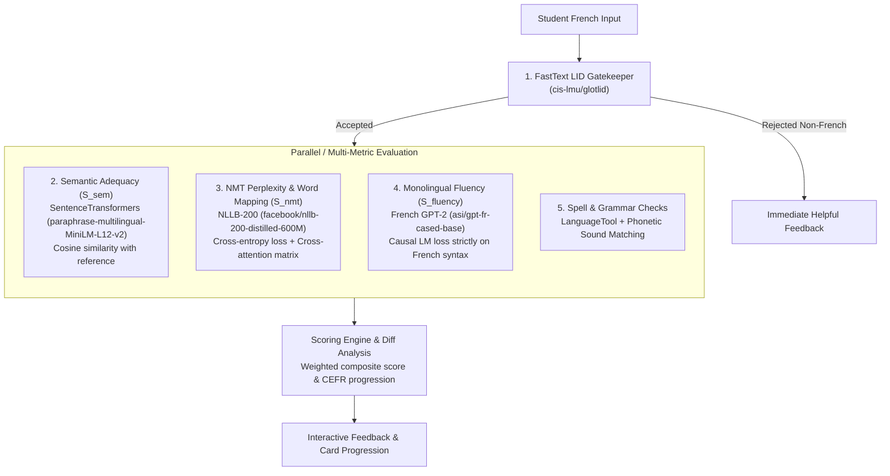

# 🇫🇷 FrenchTutor Application

**FrenchTutor** is an intelligent, full-stack language learning web application designed to help Spanish speakers learn French naturally through structured exercises, neural translation evaluation, adaptive CEFR scoring, and interactive cross-attention word alignment.

The platform combines a modular **FastAPI** backend organized into clean subpackages (`api`, `db`, `ml`, `nlp`, `scoring`, `ingestion`) with a reactive **Vite + React** single-page interface with **Dark Mode** support, backed by SQLite and a state-of-the-art Natural Language Processing (NLP) pipeline.

---

## 📑 Table of Contents

- [Key Features](#-key-features)
- [NLP Evaluation Architecture](#-nlp-evaluation-architecture)
- [Project Directory Structure](#-project-directory-structure)
- [Prerequisites](#-prerequisites)
- [Installation & Setup](#-installation--setup)
- [Docker Deployment](#-docker-deployment)
- [Development Workflows](#-development-workflows)
- [CLI Commands & Task Automation](#-cli-commands--task-automation)
  - [Makefile Targets Reference](#makefile-targets-reference)
  - [Data Ingestion & Mining Pipeline CLI](#data-ingestion--mining-pipeline-cli)
  - [Running the Application Manually](#running-the-application-manually)
- [Testing & Quality Assurance](#-testing--quality-assurance)
- [Environment Configuration](#-environment-configuration)
- [Troubleshooting](#-troubleshooting)

---

## ✨ Key Features

- **Interactive Spanish-to-French Practice**: Real-time evaluation of user answers for both **Translation** and **Transcription** exercise modes.
- **Modular Micro-Architecture**: Decoupled backend architecture split into cohesive submodules: `backend.api`, `backend.db`, `backend.ml`, `backend.nlp`, `backend.scoring`, and `backend.ingestion`.
- **Dynamic Cross-Attention Word Alignment**: Visual mapping showing how Spanish source tokens correspond to French target tokens.
- **Multifaceted Linguistic Scoring**: Deconstructs user translations by semantic adequacy, NMT perplexity, fluency, and grammatical accuracy.
- **Rule-Based Spellchecking & Sound Matching**: Intelligent detection of phonetic confusions, accents, and typos (via LanguageTool + phonetic heuristics).
- **CEFR Adaptive Progression & Vocabulary Engine**: Tracks learned, mastered, and newly introduced lexemes according to CEFR standards (A1 to C2) based on FLELex / CEFRLex.
- **Balanced Candidate Sentence Buffer**: Smart sampling pipeline balancing progression cards (new vocabulary) and reinforcement cards (known vocabulary) for translations and transcription exercises.
- **High-Quality Neural TTS**: Automatic audio synthesis and playback caching using Edge-TTS with native French neural voices.
- **Extensible Multi-Source Dataset Ingestion**: Ingest and mine sentences from **HuggingFace UniversalCEFR** (`UniversalCEFR/readme_fr`), **Tatoeba**, or educational French PDFs.
- **Modern UI with Full Dark Theme**: Sleek Tailwind CSS interface with seamless light/dark mode toggling and accessible contrast.

---

## 🧠 NLP Evaluation Architecture

User submissions are evaluated through a multi-stage linguistic pipeline:



1. **Language Identification (LID) Gatekeeper**:
   - **Model**: `cis-lmu/glotlid` (via FastText).
   - **Purpose**: Validates that the input is French before running heavier neural models.
2. **Semantic Adequacy ($S_{\text{sem}}$)**:
   - **Model**: `sentence-transformers/paraphrase-multilingual-MiniLM-L12-v2`.
   - **Purpose**: Computes cosine similarity between student input and reference translation to assess meaning preservation regardless of syntax.
3. **NMT Conditional Perplexity ($S_{\text{NMT}}$) & Cross-Attention Mapping**:
   - **Model**: `facebook/nllb-200-distilled-600M`.
   - **Purpose**: Evaluates translation likelihood given the Spanish prompt and extracts token cross-attention weights for interactive word-level alignment.
4. **Monolingual Fluency ($S_{\text{fluency}}$)**:
   - **Model**: `asi/gpt-fr-cased-base`.
   - **Purpose**: Assesses native structural fluency and naturalness strictly in French.
5. **Rule-Based Spelling & Grammar Checks**:
   - Utilizes `language-tool-python` and phoneme/levenshtein-aware heuristics to pinpoint accent errors, typos, and agreement mistakes.

---

## 📁 Project Directory Structure

```
FrenchTutor/
├── backend/                        # Modular Python backend application & API
│   ├── api/                        # FastAPI routers & request/response schemas
│   │   ├── audio.py                # Audio TTS streaming & generation endpoints
│   │   ├── deps.py                 # Dependency injection & singleton references
│   │   ├── exercises.py            # Translation & transcription session endpoints
│   │   ├── schemas.py              # Pydantic data contract schemas
│   │   ├── stats.py                # User stats & vocabulary summary endpoints
│   │   └── users.py                # User profile CRUD & level configuration
│   ├── db/                         # Modular SQLite database management
│   │   ├── connection.py           # SQLite connection pooling & WAL mode
│   │   ├── manager.py              # Unified DataManager repository aggregator
│   │   ├── sentences.py            # Sentence querying, filtering & updates
│   │   ├── users.py                # User profiles, CEFR levels & settings
│   │   ├── history.py              # User exercise attempts & evaluation history
│   │   ├── audio.py                # Cached TTS audio file mapping
│   │   └── vocabulary.py           # User vocabulary state & candidate buffering
│   ├── ml/                         # Machine learning & neural model inference
│   │   ├── engine.py               # MLEngine: neural inference execution wrapper
│   │   ├── registry.py             # Singleton model loading & caching registry
│   │   ├── precompute.py           # Background eager loading & task precomputation
│   │   └── token_utils.py          # Cross-attention word alignment & token parsing
│   ├── nlp/                        # Natural language processing & linguistic utilities
│   │   ├── text_utils.py           # Text normalization, tokenization & diff helpers
│   │   ├── tts_engine.py           # Edge-TTS neural speech synthesis & cache
│   │   └── vocab_engine.py         # CEFR vocabulary classifier & lemma extractor
│   ├── scoring/                    # Linguistic evaluation & scoring engines
│   │   ├── engine.py               # Composite scoring aggregation & feedback
│   │   ├── cefr.py                 # Dynamic CEFR level delta computation
│   │   └── transcription.py        # Phonetic, typo, & word diff transcription scoring
│   ├── ingestion/                  # Data mining and dataset ingestion pipeline
│   │   ├── pipeline/               # Mining modules (HuggingFace, Tatoeba, PDF, lexemes)
│   │   │   ├── mine_hf_dataset.py  # UniversalCEFR HuggingFace mining module
│   │   │   ├── mine_tatoeba.py     # Tatoeba corpus sentence miner
│   │   │   ├── mine_pdf.py         # Monolingual PDF extractor and translator
│   │   │   ├── seed_lexemas.py     # Lexemes catalog seeder
│   │   │   └── ingest_and_link.py  # Sentence linker with strict lexeme validation
│   │   ├── orchestrator.py         # Ingestion CLI entry point
│   │   ├── rescore_dataset.py      # Batch rescoring of sentence corpus
│   │   └── translate_sentences.py  # Automated sentence pair translation
│   ├── config.py                   # Centralized application configuration & defaults
│   └── server.py                   # FastAPI application initialization & static mount
├── frontend/                       # Modern React Single Page Application (SPA)
│   ├── src/
│   │   ├── components/             # Reusable UI components with full Dark Mode support
│   │   │   ├── ExerciseSession.jsx # Translation & transcription exercise container
│   │   │   ├── SentenceCard.jsx    # Translation card UI with interactive feedback
│   │   │   ├── TranscriptionCard.jsx # Audio transcription practice card
│   │   │   ├── WordAlignmentView.jsx # Attention alignment visualization
│   │   │   ├── ScoreDeltaBanner.jsx# Level progression and delta feedback banner
│   │   │   ├── Header.jsx          # App navbar, stats, and theme toggler
│   │   │   ├── UserMenu.jsx        # User selection and CEFR level switcher
│   │   │   ├── SettingsModal.jsx   # Exercise settings & preferences modal
│   │   │   └── LoginScreen.jsx     # Profile selection & onboarding screen
│   │   ├── App.jsx                 # Core application controller & exercise state
│   │   ├── main.jsx                # React DOM root entry point
│   │   └── index.css               # Tailwind CSS design system & dark theme tokens
│   ├── package.json                # Frontend npm dependencies & scripts
│   ├── vite.config.js              # Vite bundler configuration & backend proxy
│   └── tailwind.config.js          # Tailwind CSS design system rules
├── data/                           # Application datasets & persistent stores
│   ├── app.db                      # Primary SQLite database
│   ├── audio_cache/                # Cached synthetic MP3 audio files
│   ├── books/                      # Source educational PDFs for sentence mining
│   ├── flelex_beacco.tsv           # FLELex / Beacco CEFR vocabulary catalog
│   └── user_profile.json           # User progress state & study preferences
├── docs/                           # Architectural and design documentation
├── scripts/                        # Utility & maintenance scripts
├── tests/                          # Pytest automated test suite
│   ├── conftest.py                 # Shared fixtures & test database isolation
│   ├── test_server.py              # FastAPI endpoint integration tests
│   ├── test_scoring.py             # Scoring & evaluation logic tests
│   ├── test_data_manager.py        # Database operations unit tests
│   ├── test_mine_hf_dataset.py     # UniversalCEFR HuggingFace mining tests
│   ├── test_ingestion_lexema_filter.py # Sentence lexeme validation & filter tests
│   ├── test_ml_models.py           # Neural ML model inference tests
│   ├── test_progressive_vocab.py   # Vocabulary progression unit tests
│   ├── test_spellchecker.py        # Spellchecking & diff unit tests
│   ├── test_transcription.py       # Speech & transcription verification tests
│   ├── test_cefr_classifier.py     # CEFR classifier unit tests
│   ├── test_eager_processor.py     # Background eager processor unit tests
│   └── test_lifecycle_cleanup.py   # Server process lifecycle and cleanup tests
├── .env.example                    # Environment variable template
├── Makefile                        # Central developer automation tasks
├── pyproject.toml                  # Python package configuration (uv managed)
├── run_tests.py                    # Fast test runner script with categories
└── uv.lock                         # Deterministic package dependency pins
```

---

## 📦 Prerequisites

Ensure you have the following installed on your system:
- **Python**: `>= 3.11` (Python 3.11 or 3.12 recommended, `< 3.14`)
- **uv**: Ultra-fast Python package and project manager ([Installation Guide](https://github.com/astral-sh/uv))
- **Node.js**: `>= 18.0` & **npm**: `>= 9.0`

---

## 🚀 Installation & Setup

### 1. Clone & Configure Environment

```bash
git clone <repo-url> FrenchTutor
cd FrenchTutor

# Create local environment config
cp .env.example .env
```

> [!NOTE]
> `.env` sets `UV_NO_SYNC=1`. This prevents `uv run` from unintentionally desynchronizing your selected PyTorch variant (CPU vs CUDA) during standard execution.

### 2. Install Dependencies

Use the project `Makefile` to install both Python dependencies and frontend packages:

```bash
# Option A: Standard CPU setup (Fast download, ~180MB PyTorch wheel)
make install

# Option B: GPU setup with CUDA 12.4 acceleration (~2.5GB PyTorch wheel)
make install-gpu
```

*(Under the hood, `make install` runs `uv sync --extra cpu` followed by `cd frontend && npm install`)*.

---

## 🐳 Docker Deployment

The application is fully containerized using Docker, allowing you to run the entire stack (FastAPI backend + React frontend) in a single unified container without needing to manually configure Python, `uv`, or Node.js on your host machine.

### CPU-Only Deployment (Default)
If you do not have an NVIDIA GPU, or want a lightweight deployment, use the `backend-cpu` service:

```bash
# Build and start the container in detached mode
docker-compose up backend-cpu -d --build

# View the logs
docker-compose logs -f backend-cpu
```

### GPU-Accelerated Deployment (CUDA)
If your host machine has an NVIDIA GPU and the [NVIDIA Container Toolkit](https://docs.nvidia.com/datacenter/cloud-native/container-toolkit/latest/install-guide.html) installed, you can run the GPU-accelerated version. 

This version uses PyTorch with CUDA 12.4 support, dramatically speeding up the NLP evaluation pipeline:

```bash
# Build and start the GPU container in detached mode
docker-compose up backend-gpu -d --build

# View the logs
docker-compose logs -f backend-gpu
```

### Accessing the Application
Once the Docker container is running, the unified application (serving both the React frontend and the API) will be accessible at:
- **Web App:** [http://localhost:8000](http://localhost:8000) (or `8001` for the GPU deployment)
- **API Docs:** [http://localhost:8000/docs](http://localhost:8000/docs)

---

## 💻 Development Workflows

### Full-Stack Development (Recommended)

To start both the **FastAPI backend** (with hot reload on code changes) and the **Vite React frontend** (with Hot Module Replacement - HMR) simultaneously:

```bash
make dev
```

- **Frontend App**: [http://localhost:5173](http://localhost:5173)
- **Backend API**: [http://localhost:8000](http://localhost:8000)
- **Swagger / OpenAPI Documentation**: [http://localhost:8000/docs](http://localhost:8000/docs)

### Parallel Worktree Execution (Custom Ports)

If working on multiple Git worktrees or feature branches concurrently, override port assignments to avoid collisions:

```bash
make dev BACKEND_PORT=8001 FRONTEND_PORT=5174
```

### Production Build & Launch

To build the React production bundle and serve everything unified through FastAPI:

```bash
# Build frontend bundle into frontend/dist and launch FastAPI
make start

# Or specify a custom production port
make start PORT=8080
```

---

## 🛠️ CLI Commands & Task Automation

### Makefile Targets Reference

| Target | Command | Description |
| :--- | :--- | :--- |
| `make help` | `make help` | Displays list of all available Makefile commands |
| `make install` | `uv sync --extra cpu && cd frontend && npm install` | Installs Python CPU environment and frontend npm dependencies |
| `make install-gpu` | `uv sync --extra cu124 && cd frontend && npm install` | Installs Python GPU environment with CUDA 12.4 and frontend npm dependencies |
| `make dev` | *Spawns FastAPI + Vite HMR* | Runs development servers concurrently with cleanup signal trapping |
| `make build` | `cd frontend && npm run build` | Compiles the production frontend bundle into `frontend/dist` |
| `make start` | `uv run ... python -m backend.server` | Launches production server serving API + static frontend bundle |
| `make test` | `uv run --no-sync pytest` | Runs fast unit, API, and scoring test suite (`<2s`) |
| `make ingest` | `uv run ... backend.ingestion.orchestrator` | Runs database ingestion pipeline (pass `ARGS="..."`) |
| `make clean` | `rm -rf frontend/dist .pytest_cache ...` | Cleans build artifacts and Python `__pycache__` directories |

---

### Data Ingestion & Mining Pipeline CLI

The project includes an ingestion orchestrator to seed lexemes, mine sentences, and populate the SQLite database.

Invoke the orchestrator using `uv run` or via `make ingest ARGS="..."`:

```bash
# Display full orchestrator help
uv run python -m backend.ingestion.orchestrator --help
# or: make ingest ARGS="--help"
```

#### Common Ingestion Workflows:

```bash
# 1. Run the entire default pipeline (Init DB -> Seed Lexemas -> Mine Tatoeba -> Ingest & Link)
uv run python -m backend.ingestion.orchestrator --all

# 2. Mine sentences from HuggingFace UniversalCEFR dataset (UniversalCEFR/readme_fr)
uv run python -m backend.ingestion.orchestrator --mine-hf

# 3. Reset and initialize fresh database schema
uv run python -m backend.ingestion.orchestrator --reset-db

# 4. Seed lexemes catalog from data/flelex_beacco.tsv
uv run python -m backend.ingestion.orchestrator --seed-lexemas

# 5. Mine and score sentences from Tatoeba dataset
uv run python -m backend.ingestion.orchestrator --mine-tatoeba

# 6. Mine, translate, and score sentences from a French educational PDF
uv run python -m backend.ingestion.orchestrator --mine-pdf data/books/sample.pdf

# 7. Ingest mined sentences and establish relational CEFR lexeme links (with strict validation)
uv run python -m backend.ingestion.orchestrator --ingest

# 8. Clear database sentences and links (maintenance)
uv run python -m backend.ingestion.orchestrator --clear-db
```

---

### Running the Application Manually

You can also run components individually without `make`:

#### Backend FastAPI Server
```bash
# Development with auto-reload
uv run python -m backend.server --port 8000 --reload

# Production mode
uv run python -m backend.server --port 8000
```

#### Frontend Vite Server
```bash
cd frontend
npm run dev        # Development HMR server
npm run build      # Production build
npm run preview    # Preview production build locally
```

---

## 🧪 Testing & Quality Assurance

The test suite uses `pytest` with test markers to distinguish between lightning-fast unit tests and heavyweight ML model tests.

```bash
# 1. Run fast unit and API tests (<2s, excludes ML models)
make test
# or:
uv run pytest

# 2. Run all tests including heavy ML models
uv run pytest -m ""
# or using the custom runner:
uv run python run_tests.py --all

# 3. Run only ML model inference tests
uv run pytest -m ml

# 4. Run tests with coverage report
uv run pytest --cov=backend --cov-report=term-missing
```

> [!TIP]
> ML tests require downloading Hugging Face models on the first invocation (~3-4 GB). Standard fast unit tests mock these layers or use lightweight surrogates to ensure rapid feedback.

---

## ⚙️ Environment Configuration

Environment variables can be defined in a `.env` file at the root of the project:

| Variable | Default | Description |
| :--- | :--- | :--- |
| `UV_NO_SYNC` | `1` | Prevents `uv` from re-syncing dependencies dynamically on `run` |
| `HOST` | `0.0.0.0` | Bind host address for the FastAPI server |
| `PORT` / `BACKEND_PORT` | `8000` | Port for the FastAPI backend server |
| `FRONTEND_PORT` | `5173` | Port for the Vite frontend development server |
| `RELOAD` | `false` | Enable/disable FastAPI uvicorn auto-reload |

---

## 🔧 Troubleshooting

### Port Already in Use (`8000` or `5173`)
If a previous server instance was left running in the background:
```bash
# Check what process is occupying the port
lsof -i :8000
# or
ss -tulpn | grep 8000

# Terminate process by PID
kill -9 <PID>

# Or terminate directly by port
fuser -k 8000/tcp
```

### PyTorch Flavor Desynchronization
If `uv` unintentionally reverts your PyTorch installation from GPU to CPU or vice-versa:
1. Verify `UV_NO_SYNC=1` exists in your `.env`.
2. Reinstall your desired flavor:
   ```bash
   make install       # for CPU
   make install-gpu   # for CUDA 12.4
   ```

### Corrupted Virtual Environment
To completely reset your virtual environment:
```bash
rm -rf .venv
uv sync --extra cpu   # or --extra cu124
```
