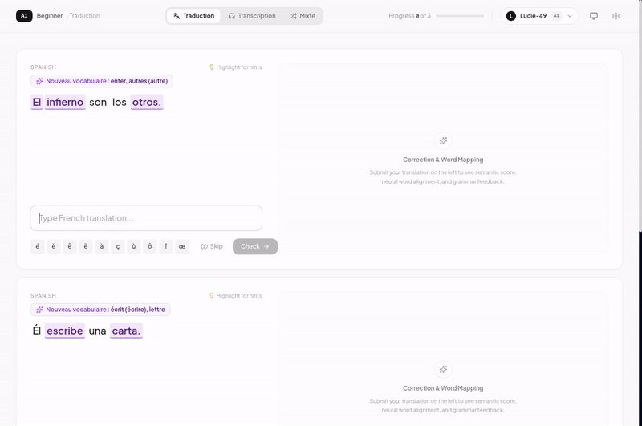
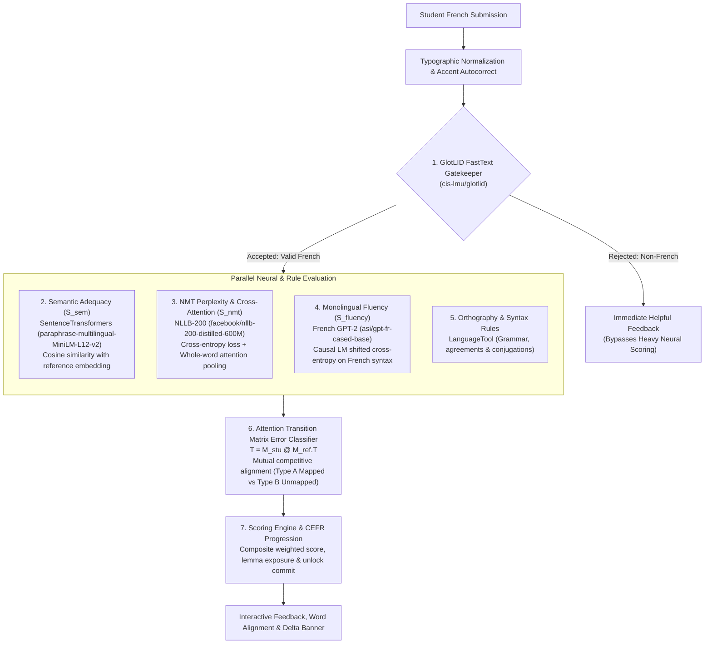

# 🇫🇷 DeepTutor

<p align="center">
  <strong>Intelligent, Adaptive French Acquisition Platform Powered by Multi-Model Neural NLP, Psycholinguistic Lexical Modeling, and Comprehensible Input Principles.</strong>
</p>

<p align="center">
  
  
  
  
  
  
  
  
</p>

---

## 🎬 Application Demo

Watch DeepTutor in action—from real-time Spanish-to-French translation exercises and neural audio playback to pure NMT cross-attention token alignment, in-sentence error classification, and dynamic CEFR progression:

<p align="center">
  <a href="docs/assets/demo_frenchtutor.mp4" title="Click to open and watch full HD demo video with audio">
    
  </a>
  <br />
  <em>Click the preview above or <a href="docs/assets/demo_frenchtutor.mp4">▶️ <strong>click here to watch the full demo video with sound</strong></a>.</em>
</p>

---

## 📑 Table of Contents

- [Application Demo](#-application-demo)
- [Technical Documentation Hub](#-technical-documentation-hub)
- [Key Features](#-key-features)
- [NLP Evaluation Architecture](#-nlp-evaluation-architecture)
- [Prerequisites](#-prerequisites)
- [Installation & Setup](#-installation--setup)
- [Docker Deployment](#-docker-deployment)
- [Development Workflows](#-development-workflows)
- [CLI Commands & Task Automation](#-cli-commands--task-automation)
  - [Makefile Targets Reference](#makefile-targets-reference)
  - [Data Ingestion & Mining Pipeline CLI](#data-ingestion--mining-pipeline-cli)
  - [Running the Application Manually](#running-the-application-manually)
- [Testing & Quality Assurance](#-testing--quality-assurance)
- [Environment Configuration](#-environment-configuration)
- [Troubleshooting](#-troubleshooting)

---

## 📚 Technical Documentation Hub

For in-depth architectural specifications, mathematical formulations, database schemas, and engineering guides, refer to the technical chapters in the [`docs/`](docs/README.md) hub:

| Chapter | Document | Core Topics Covered |
| :--- | :--- | :--- |
| **Index** | **[`docs/README.md`](docs/README.md)** | Technical documentation hub, reading pathways, system map, and glossary. |
| **01** | **[`01. Architecture Overview`](docs/01_architecture_overview.md)** | Full-stack topology, submission lifecycle, asynchronous precomputation, and concurrency locks. |
| **02** | **[`02. Database & Data Models`](docs/02_database_and_models.md)** | Two-tier lexical schema (`lemmas` vs `words`), dual user tracking, ER diagrams, and SQLite WAL configuration. |
| **03** | **[`03. NLP & Scoring Pipeline`](docs/03_nlp_and_scoring_pipeline.md)** | Multi-stage evaluation (GlotLID, MiniLM semantic adequacy, NLLB perplexity & cross-attention, French GPT-2 fluency, LanguageTool, transition matrix error classification, and transcription diffs). |
| **04** | **[`04. Vocabulary & Progression`](docs/04_vocabulary_and_progression.md)** | Lexical math, Zipf score formula, cumulative rank CEFR cutoffs, Krashen's $i+1$ algorithm, and candidate buffering queues. |
| **05** | **[`05. Ingestion & Mining Pipeline`](docs/05_ingestion_and_mining.md)** | CLI orchestrator, Lexique 4 seeding, multi-source corpus miners (UniversalCEFR, Tatoeba, Lingua, CATIE-AQ, PDFs), LSH deduplication, and strict relational linking. |
| **06** | **[`06. Deployment & Operations`](docs/06_deployment_and_operations.md)** | Dependency management via `uv`, CPU vs CUDA 12.4 GPU PyTorch environments (`UV_NO_SYNC=1`), Docker setups, pytest test markers, and Makefile automation. |

---

## ✨ Key Features

### 1. Dual Practice Modes
- **Spanish-to-French Translation**: Real-time evaluation of user translations against reference targets with fine-grained error feedback.
- **Audio Transcription Training**: High-fidelity listening comprehension exercises where learners transcribe spoken French with character-level diffs, phonetic scoring, and accent verification.

### 2. Pure NMT Cross-Attention & Transition Matrix Error Classification
- **Subtoken Cross-Attention Pooling**: Whole-word bilingual alignment extracted directly from the cross-attention tensors of `facebook/nllb-200-distilled-600M`.
- **Attention Transition Matrix**: Computes the linear algebraic overlap $T = M_{\text{stu}} M_{\text{ref}}^T \in \mathbb{R}^{|W_{\text{stu}}| \times |W_{\text{ref}}|}$ to pair student words with reference counterparts through mutual competitive alignment.
- **Categorized Error Badges & In-Sentence Highlights**:
  - **Type A (Mapped)**: Identifies incorrect word substitutions (e.g., *lui* for *toi*), highlighted in **orange/amber** with replacement targets.
  - **Type B (Unmapped)**: Identifies extraneous or unexpected words without reference counterparts (e.g., adding an unprompted adverb), highlighted in **rose/pink**.

### 3. Multi-Metric Neural Evaluation Pipeline
- Evaluates student input across independent linguistic dimensions: FastText language verification (`glotlid`), SentenceTransformers semantic similarity ($S_{\text{sem}}$), NMT translation conditional perplexity ($S_{\text{NMT}}$), causal French GPT-2 fluency ($S_{\text{fluency}}$), and rule-based grammar checking (`LanguageTool`).

### 4. Psycholinguistic Lexical Modeling & CEFR Progression
- **Two-Tier Lexical Graph**: Disentangles 69,728 canonical dictionary headwords (`lemmas`) from 189,863 surface inflected tokens (`words`), grounded in **Lexique 4**.
- **Continuous Zipf Scoring & Rank Cutoffs**: Standardized logarithmic word frequency $\text{Zipf} = \log_{10}(\text{FreqLemme}) + 3$ mapped to rank thresholds for CEFR levels A1 through C2.
- **Krashen's $i+1$ Comprehensible Input Engine**: Dynamically queries sentences containing **exactly 1 unknown lemma** for progression, balanced with reinforcement sentences containing **0 unknown lemmas**.
- **In-Memory Candidate Buffering**: Pre-samples progression and reinforcement cards to eliminate database scan latencies during active study sessions.

### 5. Neural Speech Synthesis & Caching
- **Edge-TTS Neural Audio**: High-clarity native French neural voices (`fr-FR-HenriNeural`, `fr-FR-DeniseNeural`) generated on-demand with MD5-keyed persistent audio caching.

### 6. Multi-Source Ingestion & Mining Pipeline
- Extract, validate, deduplicate (via MinHash LSH), score, and link sentences from **HuggingFace UniversalCEFR** (`UniversalCEFR/readme_fr`), **Tatoeba**, **Lingua.com**, **CATIE-AQ dialogues**, and **monolingual educational French PDFs** (with automatic MarianMT translation).

### 7. Modern Reactive Frontend
- Built with **React 18 + Vite**, **Tailwind CSS**, and **Heroicons**, featuring full **Dark / Light mode** toggling, responsive layouts, interactive token hint popovers, and score delta banners.

---

## 🧠 NLP Evaluation Architecture

When a student submits a translation, the input is processed through a sequential and parallel multi-stage evaluation pipeline:



### Detailed Pipeline Stages:
1. **Typographic Normalization**: Automatically normalizes quotes, apostrophes, and spacing around French high punctuation (`:`, `;`, `?`, `!`), providing non-punitive autocorrect hints.
2. **GlotLID Gatekeeper**: Evaluates input using `cis-lmu/glotlid`. Non-French submissions (e.g., Spanish, English, or keyboard spam) fail immediately with pedagogical guidance without wasting GPU/CPU inference on deeper models.
3. **Semantic Adequacy ($S_{\text{sem}}$)**: Measures conceptual fidelity by computing cosine similarity between sentence embeddings:
   $$S_{\text{sem}} = \max(0, \min(100, \cos(\mathbf{e}_{\text{student}}, \mathbf{e}_{\text{ref}}) \times 100))$$
4. **NMT Perplexity ($S_{\text{NMT}}$)**: Evaluates translation likelihood given the Spanish prompt using `facebook/nllb-200-distilled-600M`:
   $$S_{\text{NMT}} = \max\left(0, \min\left(100, \frac{\text{PPL}_{\text{ref}}}{\max(\text{PPL}_{\text{student}}, 10^{-5})} \times 100\right)\right)$$
5. **Monolingual Fluency ($S_{\text{fluency}}$)**: Uses `asi/gpt-fr-cased-base` to evaluate grammatical flow and natural phrasing native to French:
   $$S_{\text{fluency}} = \max\left(0, \min\left(100, \frac{\text{PPL}_{\text{ref}}^{\text{LM}}}{\max(\text{PPL}_{\text{student}}^{\text{LM}}, 10^{-5})} \times 100\right)\right)$$
6. **LanguageTool Syntax & Agreement Engine**: Local grammar checking tuned to ignore stylistic trivialities while catching genuine agreement, gender/number, and verb conjugation errors.
7. **Transition Matrix Error Classification**: Analyzes cross-attention overlap to distinguish misselected words from completely unexpected tokens, driving the inline error highlights and badges in the UI.

---

## 📦 Prerequisites

Ensure the following tools are available on your system:
- **Python**: `>= 3.11` (Python 3.11 or 3.12 recommended, `< 3.14`)
- **uv**: Ultra-fast Python package and project manager ([Installation Guide](https://github.com/astral-sh/uv))
- **Node.js**: `>= 18.0` & **npm**: `>= 9.0`
- **Docker & Docker Compose** (Optional, for containerized deployments)
- **NVIDIA GPU with CUDA 12.4+** (Optional, for GPU-accelerated inference)

---

## 🚀 Installation & Setup

### 1. Clone & Configure Environment

```bash
git clone <repo-url> DeepTutor
cd DeepTutor

# Create local environment config
cp .env.example .env
```

> [!NOTE]
> `.env` sets `UV_NO_SYNC=1`. This prevents `uv run` from unintentionally reverting or switching your chosen PyTorch variant (CPU vs CUDA) during command invocations.

### 2. Install Dependencies

Use the project `Makefile` to install both Python dependencies and frontend packages in a single step:

```bash
# Option A: Standard CPU setup (Fast download, ~180MB PyTorch wheel)
make install

# Option B: GPU setup with CUDA 12.4 acceleration (~2.5GB PyTorch wheel)
make install-gpu
```

*(Under the hood, `make install` runs `uv sync --extra cpu` followed by `cd frontend && npm install`)*.

### 3. Load Database Snapshot (Skip Ingestion)

To immediately use the app without mining datasets from scratch (~30,000+ pre-scored sentences and complete Lexique 4 lemmas):

```bash
# Cleanly initialize the database with pre-mined linguistic data
make load-db
```

*(Alternatively, you can run the full ingestion pipeline from scratch using `make ingest ARGS="--all"`)*.

---

## 🐳 Docker Deployment

The application is containerized using Docker, allowing you to run the complete stack (FastAPI backend + React frontend) in unified containers without configuring Python or Node on the host:

### CPU-Only Deployment (Default)
```bash
# Build and start container in detached mode
docker-compose up backend-cpu -d --build

# Inspect container logs
docker-compose logs -f backend-cpu
```

### GPU-Accelerated Deployment (CUDA 12.4)
Requires the [NVIDIA Container Toolkit](https://docs.nvidia.com/datacenter/cloud-native/container-toolkit/latest/install-guide.html):

```bash
# Build and start GPU container in detached mode
docker-compose up backend-gpu -d --build

# Inspect container logs
docker-compose logs -f backend-gpu
```

### Development with Live Reloading (Docker Compose)
Mounts source code directly into containers so that edits hot-reload automatically:

```bash
# CPU development (FastAPI reload + Vite HMR)
docker compose -f docker-compose.dev.yml up backend-dev frontend-dev --build

# GPU development (CUDA accelerated backend + Vite HMR)
docker compose -f docker-compose.dev.yml up backend-dev-gpu frontend-dev --build
```

### Accessing the Application
- **Production Web App:** [http://localhost:8000](http://localhost:8000) (or `8001` for GPU deployment)
- **Development Web App (Vite HMR):** [http://localhost:5173](http://localhost:5173)
- **Interactive Swagger API Docs:** [http://localhost:8000/docs](http://localhost:8000/docs)

---

## 💻 Development Workflows

### Full-Stack Development (Recommended)

To start both the **FastAPI backend** (with auto-reload) and the **Vite React frontend** (with Hot Module Replacement) concurrently:

```bash
make dev
```

- **Frontend App**: [http://localhost:5173](http://localhost:5173)
- **Backend API**: [http://localhost:8000](http://localhost:8000)
- **Swagger Documentation**: [http://localhost:8000/docs](http://localhost:8000/docs)

### Parallel Worktree Execution (Custom Ports)

When running multiple Git worktrees or feature branches simultaneously, override port assignments to avoid port conflicts:

```bash
make dev BACKEND_PORT=8001 FRONTEND_PORT=5174
```

### Production Build & Launch

To compile the React production bundle into `frontend/dist` and serve all assets through FastAPI:

```bash
# Compile frontend bundle and launch production server
make start

# Or specify a custom production port
make start PORT=8080
```

---

## 🛠️ CLI Commands & Task Automation

### Makefile Targets Reference

| Target | Command | Description |
| :--- | :--- | :--- |
| `make help` | `make help` | Displays list of all available Makefile commands |
| `make install` | `uv sync --extra cpu && cd frontend && npm install` | Installs Python CPU environment and frontend npm dependencies |
| `make install-gpu` | `uv sync --extra cu124 && cd frontend && npm install` | Installs Python GPU environment with CUDA 12.4 and frontend npm dependencies |
| `make dev` | *Spawns FastAPI + Vite HMR* | Runs development servers concurrently with cleanup signal trapping |
| `make build` | `cd frontend && npm run build` | Compiles the production frontend bundle into `frontend/dist` |
| `make start` | `uv run ... python -m backend.server` | Launches production server serving API + static frontend bundle |
| `make test` | `uv run --no-sync pytest` | Runs fast unit, API, and scoring test suite (`<2s`) |
| `make ingest` | `uv run ... backend.ingestion.orchestrator` | Runs database ingestion pipeline (pass `ARGS="..."`) |
| `make load-db` | `uv run ... backend.db.snapshot restore` | Restores default database snapshot into `data/app.db` (skips ingestion) |
| `make dump-db` | `uv run ... backend.db.snapshot dump` | Creates clean database snapshot (excluding user data) in `data/snapshots/` |
| `make clean` | `rm -rf frontend/dist .pytest_cache ...` | Cleans build artifacts and Python `__pycache__` directories |

---

### Data Ingestion & Mining Pipeline CLI

The application includes an ingestion orchestrator to seed the Lexique 4 lexical catalog, mine sentences from multiple corpora, and populate the SQLite database.

Invoke the orchestrator using `uv run` or via `make ingest ARGS="..."`:

```bash
# Display full orchestrator options
uv run python -m backend.ingestion.orchestrator --help
# or: make ingest ARGS="--help"
```

#### Common Ingestion Workflows:

```bash
# 1. Complete default setup (Init DB -> Seed Lexique Lemmas -> Mine Tatoeba -> Ingest & Link)
uv run python -m backend.ingestion.orchestrator --all

# 2. Mine sentences from HuggingFace UniversalCEFR (UniversalCEFR/readme_fr)
uv run python -m backend.ingestion.orchestrator --mine-universal-cefr

# 3. Reset and initialize fresh database schema
uv run python -m backend.ingestion.orchestrator --reset-db

# 4. Seed 69,728 lemmas & 189,863 words from Lexique 4
uv run python -m backend.ingestion.orchestrator --seed-lemmas

# 5. Mine and score bilingual sentences from Tatoeba
uv run python -m backend.ingestion.orchestrator --mine-tatoeba

# 6. Mine, translate (MarianMT), and score sentences from an educational PDF
uv run python -m backend.ingestion.orchestrator --mine-pdf data/books/sample.pdf

# 7. Ingest mined sentences with strict relational lexeme validation
uv run python -m backend.ingestion.orchestrator --ingest

# 8. Clear all sentences and links (maintenance)
uv run python -m backend.ingestion.orchestrator --clear-db
```

---

### Running the Application Manually

You can also start components independently without `make`:

#### Backend FastAPI Server
```bash
# Development mode with hot-reload
uv run python -m backend.server --port 8000 --reload

# Production mode
uv run python -m backend.server --port 8000
```

#### Frontend Vite Server
```bash
cd frontend
npm run dev        # Development HMR server (http://localhost:5173)
npm run build      # Production build to dist/
npm run preview    # Preview production bundle locally
```

---

## 🧪 Testing & Quality Assurance

The test suite uses `pytest` with markers to separate fast unit/API tests from heavyweight neural model tests:

```bash
# 1. Run fast unit and API tests (<2s, skips heavy neural downloads)
make test
# or:
uv run pytest

# 2. Run the entire test suite including heavy ML models
uv run pytest -m ""

# 3. Run only ML model inference & transition matrix tests
uv run pytest -m ml

# 4. Run tests with coverage reporting
uv run pytest --cov=backend --cov-report=term-missing
```

> [!TIP]
> ML tests automatically download weights on the first invocation (~3-4 GB). Fast unit tests mock these layers or use lightweight surrogates to ensure rapid developer iteration.

---

## ⚙️ Environment Configuration

Configuration variables can be customized in a `.env` file at the root of the repository:

| Variable | Default | Description |
| :--- | :--- | :--- |
| `UV_NO_SYNC` | `1` | Prevents `uv` from re-syncing dependencies dynamically on `run` |
| `HOST` | `0.0.0.0` | Bind host address for the FastAPI server |
| `PORT` / `BACKEND_PORT` | `8000` | Port for the FastAPI backend server |
| `FRONTEND_PORT` | `5173` | Port for the Vite frontend development server |
| `RELOAD` | `false` | Enable/disable FastAPI uvicorn auto-reload |
| `HF_CACHE_DIR` | `~/.cache/huggingface` | Hugging Face model cache directory |
| `DATABASE_URL` | `sqlite:///data/app.db` | Path to SQLite database file |

---

## 🔧 Troubleshooting

### PyTorch Flavor Desynchronization
If `uv` inadvertently switches your PyTorch installation between CPU and CUDA:
1. Verify `UV_NO_SYNC=1` is present in `.env`.
2. Reinstall your desired flavor:
   ```bash
   make install       # for CPU
   make install-gpu   # for CUDA 12.4
   ```
---
