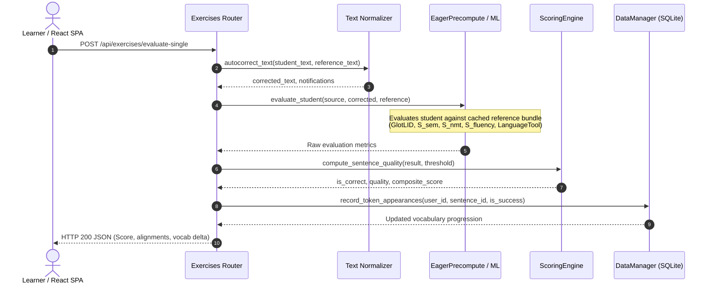
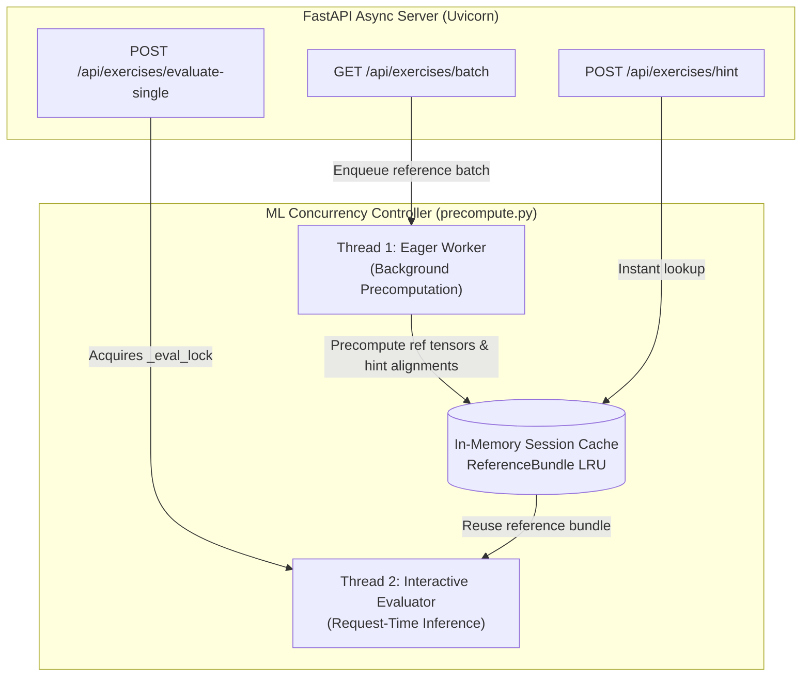

# Chapter 1: System Architecture & Runtime Lifecycle

[← Documentation Index](file:///home/eyenga/Projects/FrenchTutor/docs/README.md) | [Next: Chapter 2 — Database Schema & Lexical Models →](file:///home/eyenga/Projects/FrenchTutor/docs/02_database_and_models.md)

---

## 1. User Translation Submission & Multi-Stage Scoring Lifecycle

When the user submits an answer, the request hits [`POST /api/exercises/evaluate-single`](file:///home/eyenga/Projects/FrenchTutor/backend/api/exercises.py#L190). The submission undergoes an evaluation pipeline before updating user progress.

#### Detailed Execution Steps in the Pipeline

1. **Text Normalization & Minor Autocorrection**:
   [`autocorrect_text(...)`](file:///home/eyenga/Projects/FrenchTutor/backend/nlp/text_utils.py) applies typographic normalization (French apostrophes `'`, non-breaking spaces before punctuation `:;?!«»`). Minor accent oversights or trivial typos are corrected, producing user-facing advisory notifications (`autocorrect_msgs`) while preserving pedagogical fidelity.

2. **Reference Bundle & Hint Alignment Retrieval**:
   [`EagerPrecomputeManager.evaluate_student(...)`](file:///home/eyenga/Projects/FrenchTutor/backend/ml/precompute.py) retrieves the precomputed [`ReferenceBundle`](file:///home/eyenga/Projects/FrenchTutor/backend/ml/precompute.py#L17-L33). During batch preparation, Thread 1 precomputes cross-attention and token alignments between the Spanish source and French target (`aligned_ref_map`), enabling instant token hints ([`POST /api/exercises/hint`](file:///home/eyenga/Projects/FrenchTutor/backend/api/exercises.py#L177)) and avoiding duplicate passes on the reference sentence.

3. **GlotLID Language Identification Gatekeeper**:
   The input is validated by `cis-lmu/glotlid` (FastText). If the student submits Spanish, English, or gibberish, the system flags `is_french = False`. Failed LID checks bypass subsequent heavy neural scoring, immediately failing the card.

4. **Parallel Neural Metrics Calculation**:
   - **Semantic Adequacy ($S_{\text{sem}}$)**: Normalized cosine similarity between the student sentence embedding and the reference embedding:
     $$S_{\text{sem}} = \max(0, \min(100, \cos(\mathbf{e}_{\text{student}}, \mathbf{e}_{\text{ref}}) \times 100))$$
   - **NMT Perplexity ($S_{\text{NMT}}$)**: Evaluates the translation likelihood given the source text. Calculated as the ratio of reference perplexity to student perplexity:
     $$S_{\text{NMT}} = \max\left(0, \min\left(100, \frac{\text{PPL}_{\text{ref}}}{\max(\text{PPL}_{\text{student}}, 10^{-5})} \times 100\right)\right)$$
   - **Monolingual Fluency ($S_{\text{fluency}}$)**: Evaluates natural French construction using a causal GPT-2 language model:
     $$S_{\text{fluency}} = \max\left(0, \min\left(100, \frac{\text{PPL}_{\text{ref}}^{\text{LM}}}{\max(\text{PPL}_{\text{student}}^{\text{LM}}, 10^{-5})} \times 100\right)\right)$$

5. **Token Alignment & Surprise Breakdowns**:
   Using the cross-attention matrix extracted from NMT inference, whole-word alignment is pooled across Spanish source words and French target words to support interactive UI hover highlighting and hints. Token-level surprise ($\Delta L_i > 8.0$) flags high-surprise tokens directly based on conditional NMT probabilities.

6. **Composite Correctness Decision**:
   [`ScoringEngine.compute_sentence_quality(...)`](file:///home/eyenga/Projects/FrenchTutor/backend/scoring/engine.py#L269-L297) compares all three metrics against the user's configured threshold ($\tau$, default 75.0):
   $$\text{is\_correct} = (S_{\text{sem}} \ge \tau) \land (S_{\text{NMT}} \ge \tau) \land (S_{\text{fluency}} \ge \tau) \land \text{is\_french}$$

7. **Transactional Vocabulary & History Commit**:
   [`DataManager.record_token_appearances(...)`](file:///home/eyenga/Projects/FrenchTutor/backend/db/manager.py) increments the exposure count and success count for every lemma in `user_lemmas` and surface form in `user_words`. If an unknown lemma reaches the mastery threshold ([`VOCABULARY_UNLOCK_THRESHOLD = 1`](file:///home/eyenga/Projects/FrenchTutor/backend/config.py#L21)), it transitions to `unlocked = 1`.

---

## 2. Concurrency & Asynchronous Architecture

FrenchTutor employs a hybrid concurrency model combining Python's asynchronous event loop (FastAPI / `asyncio`) for network I/O with multi-threaded thread pools and mutex locks for CPU- and GPU-bound neural inference.

### 2.1 Dual-Threaded Pipeline Mechanics

PyTorch and Transformers pipelines cannot safely process concurrent dynamic-length batches across multiple arbitrary OS threads without VRAM fragmentation or lock contention. FrenchTutor organizes ML execution into two coordinated threads:

- **Thread 1 (Background Precomputation Worker)**:
  - Backed by a single-threaded FIFO pool (`ThreadPoolExecutor(max_workers=1)`).
  - Precomputes reference metrics upon batch dispatch: NMT perplexity ($\text{PPL}_{\text{ref}}$), fluency ($\text{PPL}_{\text{ref}}^{\text{LM}}$), dense embedding ($\mathbf{e}_{\text{ref}}$), and source-to-reference cross-attention alignment (`aligned_ref_map`).
  - Stores outputs in an LRU session cache indexed by `(source_text, reference_text)` and signals completion via `threading.Event`.

- **Thread 2 (Interactive Student Evaluator)**:
  - Runs synchronously inside the FastAPI request handler, guarded by `_eval_lock`.
  - Reuses the cached `ReferenceBundle` from Thread 1, blocking briefly on `event.wait()` only if Thread 1 is still computing.
  - Executes delta forward passes exclusively for student input, reducing grading latency from ~1,200ms to <150ms.

---

## 3. Repository Architecture & Directory Navigation

The FrenchTutor codebase is organized into decoupled modules separating API routing, persistence, neural inference, and frontend presentation:

- **[`backend/api/`](file:///home/eyenga/Projects/FrenchTutor/backend/api/)**: FastAPI routes, dependency injection, and Pydantic schemas.
- **[`backend/db/`](file:///home/eyenga/Projects/FrenchTutor/backend/db/)**: SQLite connection lifecycle (WAL mode), table migrations, and repository mixins (`DataManager`).
- **[`backend/ml/`](file:///home/eyenga/Projects/FrenchTutor/backend/ml/)**: Neural model inference wrappers, model registry, and eager precomputation pipelines.
- **[`backend/nlp/`](file:///home/eyenga/Projects/FrenchTutor/backend/nlp/)**: Text normalization, typography, Edge-TTS audio synthesis, and vocabulary extraction.
- **[`backend/scoring/`](file:///home/eyenga/Projects/FrenchTutor/backend/scoring/)**: Quality scoring criteria, CEFR progression deltas, and transcription diff algorithms.
- **[`backend/ingestion/`](file:///home/eyenga/Projects/FrenchTutor/backend/ingestion/)**: Multi-source corpus miners (UniversalCEFR, Tatoeba, PDF) and Lexique 4 database seeding.
- **[`frontend/`](file:///home/eyenga/Projects/FrenchTutor/frontend/)**: React 19 single-page application built with Vite and Tailwind CSS.

> [!TIP]
> For the complete granular file-by-file tree and module descriptions, see the [Project Directory Structure in README.md](file:///home/eyenga/Projects/FrenchTutor/README.md#-project-directory-structure).

---

## 4. Technology Stack Summary

| Layer | Component | Implementation | Rationale |
| :--- | :--- | :--- | :--- |
| **Frontend UI** | Client SPA | React 19, Vite, Tailwind CSS, Lucide Icons | Responsive sub-millisecond UI updates, component modularity, instant keyboard shortcuts (`Ctrl+Enter`, `Tab`). |
| **Backend API** | Web Server | FastAPI, Starlette, Uvicorn | Asynchronous route handling, native OpenAPI typing via Pydantic, high-throughput I/O. |
| **Persistence** | Relational DB | SQLite 3 (`PRAGMA journal_mode=WAL;`) | Zero external infrastructure overhead, transactional ACID guarantees, microsecond query speeds. |
| **ML Runtime** | Framework | PyTorch 2.5, HuggingFace Transformers | Industry-standard neural execution, dynamic device resolution (CUDA with CPU fallback). |
| **LID Gatekeeper**| Lang Detection | GlotLID (`cis-lmu/glotlid`), FastText | Sub-millisecond rejection of non-French inputs prior to heavy transformer forward passes. |
| **Semantics** | Sentence Embedding | CamemBERT / `paraphrase-multilingual-MiniLM-L12-v2` | Dense sentence representations for contextual cosine similarity ($S_{\text{sem}}$). |
| **Translation** | Sequence-to-Sequence | Helsinki-NLP / `facebook/nllb-200-distilled-600M` | Bilingual adequacy scoring ($S_{\text{NMT}}$) and cross-attention token alignment matrix extraction. |
| **Fluency** | Causal LM | French GPT-2 (`asi/gpt-fr-cased-base`) | Native French perplexity calculation ($S_{\text{fluency}}$) to detect unnatural phrased constructions. |
| **Grammar** | Rule-Based Heuristics | LanguageTool (fr-FR), Levenshtein | Accurate detection of agreement errors, verb conjugation mistakes, and orthographic typos. |
| **Speech** | Audio Synthesis | EdgeTTS, gTTS | Natural French audio pronunciation with background batch caching. |
| **Dependency Mgr**| Package System | `uv` (Astral) | Extremely fast deterministic virtualenv and dependency lockfile resolution. |

---

> [!NOTE]
> For in-depth details on the SQLite tables, referential integrity cascades, and two-tier lemma/word models, proceed to [Chapter 2: Database Schema & Lexical Models](file:///home/eyenga/Projects/FrenchTutor/docs/02_database_and_models.md).

---

[← Documentation Index](file:///home/eyenga/Projects/FrenchTutor/docs/README.md) | [Next: Chapter 2 — Database Schema & Lexical Models →](file:///home/eyenga/Projects/FrenchTutor/docs/02_database_and_models.md)
