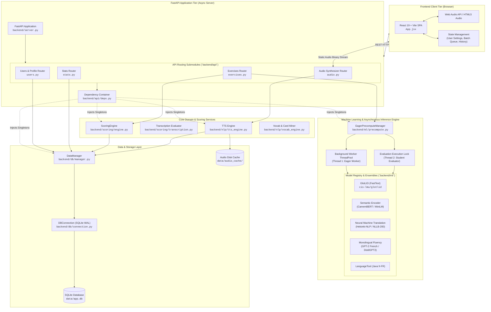
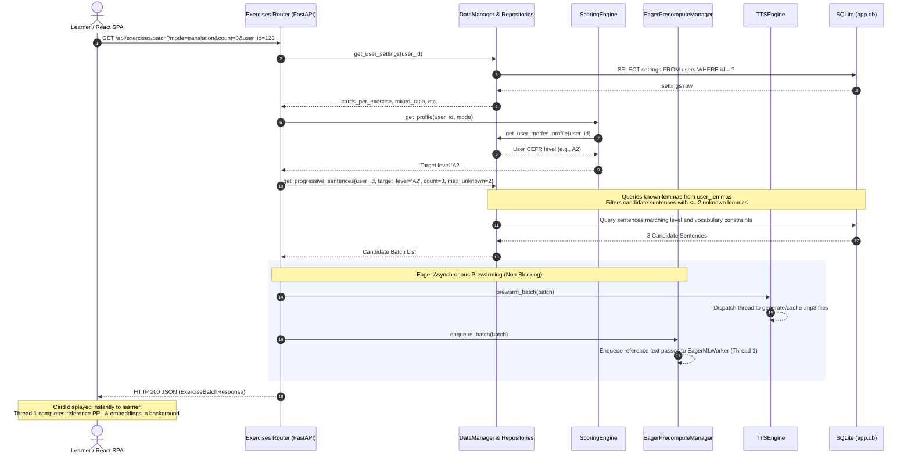
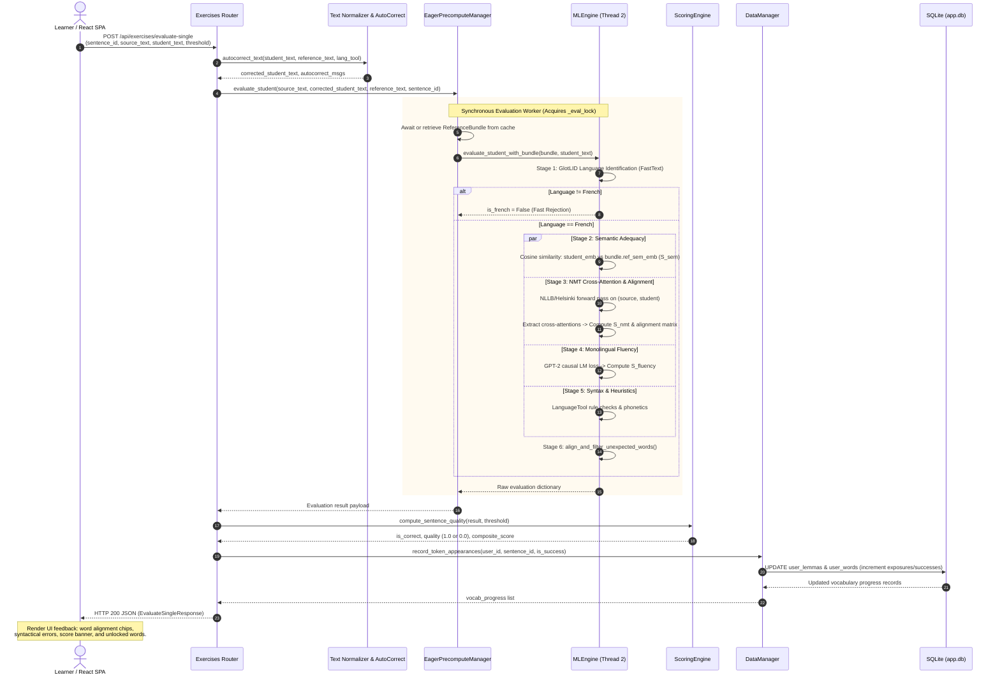
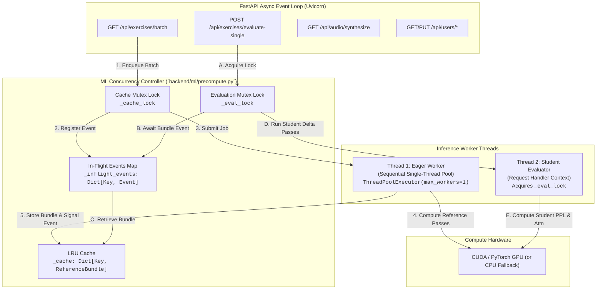

# Chapter 1: System Architecture & Runtime Lifecycle

[← Documentation Index](file:///home/eyenga/Disk2/Projects/FrenchTutor/docs/README.md) | [Next: Chapter 2 — Database Schema & Lexical Models →](file:///home/eyenga/Disk2/Projects/FrenchTutor/docs/02_database_and_models.md)

---

## 1. High-Level Architecture & Design Principles

FrenchTutor is an adaptive, AI-augmented language learning platform specifically engineered to bridge the gap between deterministic rule-based language pedagogy and deep learning inference. Rather than assessing learner translations with rigid string-matching heuristics, FrenchTutor employs a multi-tiered neural evaluation architecture combined with psycholinguistic lexical modeling (Lexique 4, CEFR level progression).

The platform operates as a modern client-server system composed of a React Vite single-page application (SPA), a high-performance Python FastAPI service, an asynchronous background ML pipeline, and an embedded SQLite transactional database running in Write-Ahead Logging (WAL) mode.



### Core Design Principles

1. **Sub-Second Latency via Asynchronous Decoupling**: Large neural models (transformers, sequence-to-sequence translation, causal language models) incur non-trivial forward-pass latency. FrenchTutor solves this through eager background precomputation: while a student reads a card, Thread 1 runs reference sentence encodings in the background. When the student submits their response, Thread 2 only computes the delta passes, reducing interactive latency by up to 60%.
2. **Two-Tier Lexical Rigor**: Natural French contains tens of thousands of surface forms derived from standard lemma roots. All user tracking, difficulty ratings, and card selections decouple dictionary base lemmas (`lemmas`) from surface inflected forms (`words`), grounded in empirical Lexique 4 lexical frequency data.
3. **Graceful Multi-Stage Evaluation Gatekeeping**: Neural models can suffer from hallucinations, out-of-domain degradation, or language confusion. Submissions pass through strict language identification (LID), phonetics, and grammar validation before incurring heavy cross-attention calculations.
4. **Resilient Hardware Portability**: The ML pipeline features a kernel probe ([`resolve_device_and_dtype()`](file:///home/eyenga/Disk2/Projects/FrenchTutor/backend/ml/engine.py#L34-L53)) that dynamically detects CUDA capabilities (e.g. Pascal SM 6.1 on GTX 1050 Ti) and transparently falls back to CPU float32 if GPU kernel execution is unsupported or memory-constrained.

---

## 2. Complete End-to-End Request Lifecycles

### 2.1 Exercise Fetching & Candidate Buffer Dispatch

When the user enters a session or requests new cards, the client dispatches a request to [`GET /api/exercises/batch`](file:///home/eyenga/Disk2/Projects/FrenchTutor/backend/api/exercises.py#L42). This triggers dynamic vocabulary selection, eager neural precomputation, and background TTS caching.



1. **User Settings & CEFR Resolution**: The router queries the user's active mode profile (translation, transcription, or mixed) and fetches the configured card count and active CEFR benchmark.
2. **Progressive Vocabulary Sampling ($i+1$)**: [`DataManager.get_progressive_sentences(...)`](file:///home/eyenga/Disk2/Projects/FrenchTutor/backend/db/manager.py) enforces that selected sentences contain mostly known vocabulary while introducing a controlled threshold of unknown words (governed by [`MAX_UNKNOWN_WORDS = 2`](file:///home/eyenga/Disk2/Projects/FrenchTutor/backend/config.py#L15)).
3. **Background TTS Prewarming**: [`deps.tts_engine.prewarm_batch(batch)`](file:///home/eyenga/Disk2/Projects/FrenchTutor/backend/nlp/tts_engine.py) immediately schedules synthesis for French audio snippets so that subsequent audio playback requests are serviced instantly from disk cache.
4. **Reference Pass Enqueueing**: [`deps.eager_processor.enqueue_batch(batch)`](file:///home/eyenga/Disk2/Projects/FrenchTutor/backend/ml/precompute.py#L76-L100) submits the sentence batch to Thread 1. Thread 1 computes reference perplexities, semantic embeddings, and source-to-reference token alignments before the learner even finishes reading the prompt.

---

### 2.2 User Translation Submission & Multi-Stage Scoring Lifecycle

When the user submits an answer, the request hits [`POST /api/exercises/evaluate-single`](file:///home/eyenga/Disk2/Projects/FrenchTutor/backend/api/exercises.py#L190). The submission undergoes an exhaustive 7-step evaluation pipeline before updating user progress.



#### Detailed Execution Steps in the Pipeline

1. **Text Normalization & Minor Autocorrection**:
   [`autocorrect_text(...)`](file:///home/eyenga/Disk2/Projects/FrenchTutor/backend/nlp/text_utils.py) applies typographic normalization (French apostrophes `'`, non-breaking spaces before punctuation `:;?!«»`). Minor accent oversights or trivial typos are corrected, producing user-facing advisory notifications (`autocorrect_msgs`) while preserving pedagogical fidelity.

2. **Precomputed Bundle Retrieval**:
   [`EagerPrecomputeManager.evaluate_student(...)`](file:///home/eyenga/Disk2/Projects/FrenchTutor/backend/ml/precompute.py) checks its LRU cache for the [`ReferenceBundle`](file:///home/eyenga/Disk2/Projects/FrenchTutor/backend/ml/precompute.py#L17-L33) generated during exercise dispatch. If Thread 1 is still processing that bundle, Thread 2 waits on the sentence's `threading.Event`. This guarantees zero duplicate passes on the reference sentence.

3. **GlotLID Language Identification Gatekeeper**:
   The input is validated by `cis-lmu/glotlid` (FastText). If the student submits Spanish, English, or gibberish, the system flags `is_french = False` (with exceptions for short sentences $\le 5$ words containing known foundational tokens in [`COMMON_FRENCH_WORDS`](file:///home/eyenga/Disk2/Projects/FrenchTutor/backend/config.py#L46-L54)). Failed LID checks bypass subsequent heavy neural scoring, immediately failing the card.

4. **Parallel Neural Metrics Calculation**:
   - **Semantic Adequacy ($S_{\text{sem}}$)**: Normalized cosine similarity between the student sentence embedding and the reference embedding:
     $$S_{\text{sem}} = \max(0, \min(100, \cos(\mathbf{e}_{\text{student}}, \mathbf{e}_{\text{ref}}) \times 100))$$
   - **NMT Perplexity ($S_{\text{NMT}}$)**: Evaluates the translation likelihood given the source text. Calculated as the ratio of reference perplexity to student perplexity:
     $$S_{\text{NMT}} = \max\left(0, \min\left(100, \frac{\text{PPL}_{\text{ref}}}{\max(\text{PPL}_{\text{student}}, 10^{-5})} \times 100\right)\right)$$
   - **Monolingual Fluency ($S_{\text{fluency}}$)**: Evaluates natural French construction using a causal GPT-2 language model:
     $$S_{\text{fluency}} = \max\left(0, \min\left(100, \frac{\text{PPL}_{\text{ref}}^{\text{LM}}}{\max(\text{PPL}_{\text{student}}^{\text{LM}}, 10^{-5})} \times 100\right)\right)$$

5. **Token Alignment & Unexpected Word Filtration**:
   Using the cross-attention matrix extracted from NMT inference combined with SimAlign embeddings, [`align_and_filter_unexpected_words(...)`](file:///home/eyenga/Disk2/Projects/FrenchTutor/backend/ml/engine.py#L179-L260) maps each student word through the Spanish source word back to the expected French reference token. Sound substitutions (synonyms, acceptable prepositions) are validated via cosine distance, while genuine vocabulary mistakes are flagged with the expected target word.

6. **Composite Correctness Decision**:
   [`ScoringEngine.compute_sentence_quality(...)`](file:///home/eyenga/Disk2/Projects/FrenchTutor/backend/scoring/engine.py#L269-L297) compares all three metrics against the user's configured threshold ($\tau$, default 75.0):
   $$\text{is\_correct} = (S_{\text{sem}} \ge \tau) \land (S_{\text{NMT}} \ge \tau) \land (S_{\text{fluency}} \ge \tau) \land \text{is\_french}$$

7. **Transactional Vocabulary & History Commit**:
   [`DataManager.record_token_appearances(...)`](file:///home/eyenga/Disk2/Projects/FrenchTutor/backend/db/manager.py) increments the exposure count and success count for every lemma in `user_lemmas` and surface form in `user_words`. If an unknown lemma reaches the mastery threshold ([`VOCABULARY_UNLOCK_THRESHOLD = 1`](file:///home/eyenga/Disk2/Projects/FrenchTutor/backend/config.py#L21)), it transitions to `unlocked = 1`.

---

## 3. Concurrency & Asynchronous Architecture

FrenchTutor employs a hybrid concurrency model combining Python's asynchronous event loop (FastAPI / `asyncio`) for network I/O with multi-threaded thread pools and mutex locks for CPU- and GPU-bound neural inference.



### 3.1 Dual-Threaded Pipeline Mechanics

PyTorch and Transformers pipelines cannot safely process concurrent dynamic-length batches across multiple arbitrary OS threads without severe VRAM fragmentation or lock contention. FrenchTutor structures ML execution into two specialized threads:

1. **Thread 1 (EagerMLWorker)**:
   - Dedicated `ThreadPoolExecutor(max_workers=1)` configured with FIFO semantics.
   - Enqueued immediately upon card batch generation.
   - Computes:
     - NMT reference perplexity ($\text{PPL}_{\text{ref}}$)
     - Monolingual fluency reference perplexity ($\text{PPL}_{\text{ref}}^{\text{LM}}$)
     - Reference semantic dense embedding ($\mathbf{e}_{\text{ref}}$)
     - Source-to-reference cross-attention alignment matrix
   - Stores artifacts in an in-memory session cache ([`_cache`](file:///home/eyenga/Disk2/Projects/FrenchTutor/backend/ml/precompute.py#L51)) indexed by `(source_text, reference_text)` and sets a `threading.Event`.

2. **Thread 2 (Interactive Student Evaluator)**:
   - Runs synchronously within the FastAPI request execution thread.
   - Guarded by [`_eval_lock`](file:///home/eyenga/Disk2/Projects/FrenchTutor/backend/ml/precompute.py#L65) to serialize GPU execution against concurrent user calls.
   - Checks `_cache`. If Thread 1 is currently processing that sentence, Thread 2 blocks on `event.wait(timeout=10.0)`.
   - Executes only the delta student forward passes and reuses the reference tensors.

### 3.2 Eager Model Preloading & Lifespan Architecture

Model instantiation in FrenchTutor follows a hybrid eager/lazy pattern managed by FastAPI's [`lifespan`](file:///home/eyenga/Disk2/Projects/FrenchTutor/backend/server.py#L50-L79) context manager:

- **Lifespan Startup**:
  - Initializes [`DataManager`](file:///home/eyenga/Disk2/Projects/FrenchTutor/backend/db/manager.py) and executes SQLite migrations.
  - Initializes [`ScoringEngine`](file:///home/eyenga/Disk2/Projects/FrenchTutor/backend/scoring/engine.py).
  - Initializes [`TTSEngine`](file:///home/eyenga/Disk2/Projects/FrenchTutor/backend/nlp/tts_engine.py).
  - Configures [`EagerPrecomputeManager`](file:///home/eyenga/Disk2/Projects/FrenchTutor/backend/ml/precompute.py) with lazy getter `get_ml_engine`.
  - Injects all handles into the shared dependency module [`backend.api.deps`](file:///home/eyenga/Disk2/Projects/FrenchTutor/backend/api/deps.py).
- **Thread-Safe Model Engine Loading**:
  - Heavy neural weights (HuggingFace checkpoints, FastText binaries, LanguageTool JVM) are guarded by a double-checked mutex lock ([`ml_engine_lock`](file:///home/eyenga/Disk2/Projects/FrenchTutor/backend/server.py#L21-L33)).
  - On shutdown, `lifespan` cleanly terminates worker pools and closes Java LanguageTool processes via [`atexit`](file:///home/eyenga/Disk2/Projects/FrenchTutor/backend/ml/engine.py#L79).

### 3.3 Dependency Injection via `backend.api.deps`

To prevent circular imports and simplify test mocking, FastAPI routes access shared service singletons through [`backend.api.deps`](file:///home/eyenga/Disk2/Projects/FrenchTutor/backend/api/deps.py):

```python
# backend/api/deps.py
from typing import Optional, TYPE_CHECKING

if TYPE_CHECKING:
    from backend.db import DataManager
    from backend.scoring.engine import ScoringEngine
    from backend.nlp.tts_engine import TTSEngine
    from backend.ml.precompute import EagerPrecomputeManager

data_manager: Optional["DataManager"] = None
scoring_engine: Optional["ScoringEngine"] = None
tts_engine: Optional["TTSEngine"] = None
eager_processor: Optional["EagerPrecomputeManager"] = None
```

In routers such as [`backend/api/exercises.py`](file:///home/eyenga/Disk2/Projects/FrenchTutor/backend/api/exercises.py#L7), functions access `deps.data_manager` or `deps.scoring_engine` directly. In unit tests, these handles can be monkeypatched or substituted with mock implementations without restarting the server.

---

## 4. Codebase Directory Structure & Navigation Guide

```
FrenchTutor/
├── backend/                             # Python FastAPI Backend & Domain Services
│   ├── api/                             # REST API routing endpoints & Pydantic schemas
│   │   ├── __init__.py
│   │   ├── audio.py                     # GET /api/audio/synthesize
│   │   ├── deps.py                      # Global dependency singletons container
│   │   ├── exercises.py                 # GET batch, POST evaluate-single, transcription, hint
│   │   ├── schemas.py                   # Pydantic request & response validation schemas
│   │   ├── stats.py                     # GET /api/stats (dataset & user distributions)
│   │   └── users.py                     # User profiles, CRUD, & settings management
│   ├── db/                              # Database layer & repository pattern
│   │   ├── connection.py                # SQLite WAL connection manager, DDL & migrations
│   │   ├── manager.py                   # DataManager aggregator delegating to sub-repos
│   │   └── repositories/                # Specialized repository implementations
│   │       ├── audio.py                 # Audio metadata & cache records
│   │       ├── history.py               # User exercise attempt history logs
│   │       ├── sentences.py             # Sentence queries, levels, and filtering
│   │       ├── users.py                 # User CRUD, mode states & preferences
│   │       └── vocabulary.py            # Lemma/word dual tracking & progressive sampling
│   ├── ingestion/                       # Mining, seeding, and ETL scripts
│   │   ├── orchestrator.py              # Ingestion CLI orchestrator
│   │   ├── pipeline/                    # Mining modules (Tatoeba, UniversalCEFR, Lingua, etc.)
│   │   └── seed_lemmas.py               # Lexique 4 canonical lemma & word seeder
│   ├── ml/                              # Deep learning models & inference wrappers
│   │   ├── engine.py                    # MLEngine orchestrator (LID, S_sem, S_nmt, S_fluency)
│   │   ├── models/                      # Swappable model wrapper implementations
│   │   ├── precompute.py                # EagerPrecomputeManager (dual-thread async pipeline)
│   │   ├── registry.py                  # ModelRegistry factory
│   │   └── token_utils.py               # Word breakdown & hybrid alignment matrix math
│   ├── nlp/                             # NLP utilities & text processing
│   │   ├── text_utils.py                # Autocorrect, accents, typography normalization
│   │   ├── tts_engine.py                # Text-to-speech synthesis (EdgeTTS / gTTS)
│   │   └── vocab_engine.py              # Lexical difficulty analysis & CEFR categorization
│   ├── scoring/                         # Pedagogical evaluation & CEFR math
│   │   ├── cefr.py                      # CEFR score-to-level mapping formulas
│   │   ├── engine.py                    # ScoringEngine (sentence quality & batch adjustments)
│   │   └── transcription.py             # Audio transcription evaluation (diff & Levenshtein)
│   ├── config.py                        # Global configuration constants & thresholds
│   └── server.py                        # FastAPI application factory, lifespan & server entry
│
├── frontend/                            # React 19 + Vite Frontend SPA
│   ├── dist/                            # Production build output mounted by FastAPI
│   ├── src/                             # Application source code
│   │   ├── components/                  # Modular React UI components
│   │   │   ├── ExerciseSession.jsx      # Card session orchestrator & keyboard listener
│   │   │   ├── Header.jsx               # App navigation bar, streak & mode switcher
│   │   │   ├── LoginScreen.jsx          # User selection & profile creation modal
│   │   │   ├── ScoreDeltaBanner.jsx     # End-of-batch summary banner
│   │   │   ├── SentenceCard.jsx         # Translation exercise card & interactive alignment
│   │   │   ├── SettingsModal.jsx        # User configuration dialog (thresholds, voice)
│   │   │   ├── TranscriptionCard.jsx    # Listening comprehension exercise card
│   │   │   ├── UserMenu.jsx             # Switcher dropdown for multi-user profiles
│   │   │   └── WordAlignmentView.jsx    # Visual cross-attention alignment matrix chips
│   │   ├── App.jsx                      # Root container, user state & batch orchestration
│   │   ├── index.css                    # Tailwind CSS definitions
│   │   └── main.jsx                     # Vite application bootstrap
│   ├── package.json                     # Frontend npm dependencies
│   └── vite.config.js                   # Vite build & dev proxy configuration
│
├── data/                                # Local persistent storage (gitignored binaries)
│   ├── app.db                           # Primary SQLite database
│   ├── audio_cache/                     # Pre-synthesized MP3/WAV speech files
│   └── raw/                             # Lexique438.tsv and raw mined datasets
│
├── docs/                                # Technical Documentation Suite
│   ├── README.md                        # Documentation Index & Architecture Map
│   ├── 01_architecture_overview.md      # This document
│   ├── 02_database_and_models.md        # Database schema, lexical design & repositories
│   ├── 03_nlp_and_scoring_pipeline.md   # Multi-stage NLP scoring & cross-attention
│   ├── 04_vocabulary_and_progression.md # Zipf math, CEFR progression & candidate buffers
│   ├── 05_ingestion_and_mining.md       # Corpus mining, Lexique 4 seeding & ingestion
│   └── 06_deployment_and_operations.md  # Docker, uv, PyTorch GPU/CPU, and Makefile
│
├── Dockerfile                           # Multi-stage container definition
├── docker-compose.yml                   # Production container orchestration
├── Makefile                             # Command automation (install, dev, test, ingest)
├── pyproject.toml                       # Python project metadata & uv dependency definitions
└── uv.lock                              # Deterministic dependency lockfile
```

---

## 5. Technology Stack Summary

| Layer | Component | Implementation | Rationale |
| :--- | :--- | :--- | :--- |
| **Frontend UI** | Client SPA | React 19, Vite, Tailwind CSS, Lucide Icons | Responsive sub-millisecond UI updates, component modularity, instant keyboard shortcuts (`Ctrl+Enter`, `Tab`). |
| **Backend API** | Web Server | FastAPI, Starlette, Uvicorn | Asynchronous route handling, native OpenAPI typing via Pydantic, high-throughput I/O. |
| **Persistence** | Relational DB | SQLite 3 (`PRAGMA journal_mode=WAL;`) | Zero external infrastructure overhead, transactional ACID guarantees, microsecond query speeds. |
| **ML Runtime** | Framework | PyTorch 2.5, HuggingFace Transformers | Industry-standard neural execution, dynamic device resolution (CUDA with CPU fallback). |
| **LID Gatekeeper**| Lang Detection | GlotLID (`cis-lmu/glotlid`), FastText | Sub-millisecond rejection of non-French inputs prior to heavy transformer forward passes. |
| **Semantics** | Sentence Embedding | CamemBERT / `paraphrase-multilingual-MiniLM-L12-v2` | Dense sentence representations for contextual cosine similarity ($S_{\text{sem}}$). |
| **Translation** | Sequence-to-Sequence | Helsinki-NLP / `facebook/nllb-200-distilled-600M` | Bilingual adequacy scoring ($S_{\text{NMT}}$) and cross-attention token alignment matrix extraction. |
| **Fluency** | Causal LM | French GPT-2 (`asi/gpt-fr-cased-base`) | Native French perplexity calculation ($S_{\text{fluency}}$) to detect unnatural phrased constructions. |
| **Grammar** | Rule-Based Heuristics | LanguageTool (fr-FR), Levenshtein | Accurate detection of agreement errors, verb conjugation mistakes, and orthographic typos. |
| **Speech** | Audio Synthesis | EdgeTTS, gTTS | Natural French audio pronunciation with background batch caching. |
| **Dependency Mgr**| Package System | `uv` (Astral) | Extremely fast deterministic virtualenv and dependency lockfile resolution. |

---

> [!NOTE]
> For in-depth details on the 9 SQLite tables, referential integrity cascades, and two-tier lemma/word models, proceed to [Chapter 2: Database Schema & Lexical Models](file:///home/eyenga/Disk2/Projects/FrenchTutor/docs/02_database_and_models.md).

---

[← Documentation Index](file:///home/eyenga/Disk2/Projects/FrenchTutor/docs/README.md) | [Next: Chapter 2 — Database Schema & Lexical Models →](file:///home/eyenga/Disk2/Projects/FrenchTutor/docs/02_database_and_models.md)
