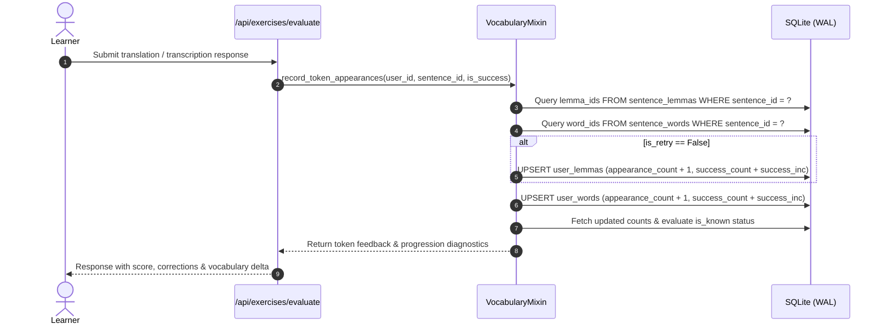

# Chapter 2: Database Schema, Lexical Models & Repositories

[← Previous: 01 Architecture Overview](file:///home/eyenga/Projects/FrenchTutor/docs/01_architecture_overview.md) | [Documentation Hub (README)](file:///home/eyenga/Projects/FrenchTutor/docs/README.md) | [Next: 03 NLP & Scoring Pipeline →](file:///home/eyenga/Projects/FrenchTutor/docs/03_nlp_and_scoring_pipeline.md)

---

## 1. Foundations of the Two-Tier Lexical Architecture

A core design challenge in intelligent language tutoring systems is bridging the gap between dictionary abstractions (lemmas) and actual textual exposure (surface word inflections). In earlier versions of FrenchTutor, word roots were referred to as generic *lexemas*, and all entries were assigned a static default level (`A1`). The lexical subsystem was subsequently re-architected around **Lexique 4** (`data/lexique/Lexique4/Lexique4.tsv`), establishing a **Two-Tier Lexical Architecture**:

1. **Tier 1: Canonical Base Lemmas (`lemmas`)**  
   Represents canonical dictionary headwords associated with syntactic categories (e.g., the infinitive verb *manger* with POS `VER`, or the singular masculine noun *chat* with POS `NOM`). Each lemma entry encapsulates corpus-level lexical frequency (`12_FreqLemme`) and a psycholinguistically validated CEFR proficiency level (A1 to C2).
2. **Tier 2: Inflected Surface Words (`words`)**  
   Represents surface tokens as they appear in natural language sentences (e.g., *mange*, *mangeons*, *mangeraient*). Every surface word record retains its specific surface frequency (`10_FreqMot`) and points back to its canonical parent lemma via a relational foreign key (`lemma_id`).

```
┌────────────────────────────────────────────────────────────┐
│                    Canonical Lemma                         │
│             [id: 42, lemma: 'manger', pos: 'VER', level: 'A1']    │
└─────────────────────────────┬──────────────────────────────┘
                              │ 1:N Relationship
       ┌──────────────────────┼──────────────────────┐
       ▼                      ▼                      ▼
┌──────────────┐       ┌──────────────┐       ┌──────────────┐
│ Surface Word │       │ Surface Word │       │ Surface Word │
│ 'mange'      │       │ 'mangeons'   │       │ 'mangeraient'│
│ (Freq: 245.2)│       │ (Freq: 18.4) │       │ (Freq: 4.1)  │
└──────────────┘       └──────────────┘       └──────────────┘
```

### Design Rationale: Why Two Tiers?

* **Psycholinguistic Pedagogical Validity**: Language learners acquire grammatical paradigms through base roots while encountering inflected morphology. Assessing learner proficiency strictly on surface forms would fragment mastery metrics (e.g., treating *parle*, *parles*, and *parlons* as three unrelated vocabulary challenges). Conversely, tracking only lemmas obscures morphological stumbling blocks.
* **Separation of Exercise Generation & Granular Analytics**: Exercise progression relies on lemma-level novelty (e.g., ensuring a candidate sentence introduces at most $i+1$ unknown lemmas). Meanwhile, surface exposure tracking captures whether a student has met specific irregular verb inflections or feminine/plural agreements.
* **Referential Integrity for Inflected-Only Entries**: In natural language datasets such as Lexique 4, approximately 3,696 `(4_Lemme, 5_Cgram)` pairs appear in surface form without an explicit base-row entry where `14_IsLem == '1'` (for instance, the feminine adjective *applicative* appears, while its canonical masculine form *applicatif* lacked a standalone `IsLem == 1` row in the raw corpus table). By modeling lemmas and words as distinct relational entities, FrenchTutor seeds referenced lemmas with their observed corpus frequency, establishing 100% referential integrity across all 69,728 unique lemmas and 189,863 surface words.
* **Surrogate Keys vs. Natural Uniqueness Constraints**: Integer surrogate keys (`id INTEGER PRIMARY KEY AUTOINCREMENT`) are used across both tables for fast, compact foreign-key joining and B-tree indexing in SQLite. Natural uniqueness constraints (`UNIQUE(lemma, pos)` on `lemmas` and `UNIQUE(word, lemma_id, pos)` on `words`) prevent duplicate entries and enforce unambiguous token resolution.

---

## 2. Complete Entity-Relationship (ER) Diagram

The FrenchTutor relational database consists of 10 primary tables and 1 compatibility view, maintaining data across sentences, vocabulary, learner progress, user configurations, and media caches.

```mermaid
erDiagram
    USERS ||--o{ USER_MODES : "configures"
    USERS ||--o| USER_SETTINGS : "customizes"
    USERS ||--o{ EXERCISE_HISTORY : "logs attempts"
    USERS ||--o{ USER_LEMMAS : "masters"
    USERS ||--o{ USER_WORDS : "encounters"

    LEMMAS ||--o{ WORDS : "has inflections (lemma_id)"
    LEMMAS ||--o{ USER_LEMMAS : "tracked per user"
    WORDS ||--o{ USER_WORDS : "tracked per user"

    SENTENCES ||--o{ SENTENCE_LEMMAS : "links base roots"
    LEMMAS ||--o{ SENTENCE_LEMMAS : "referenced by"
    SENTENCES ||--o{ SENTENCE_WORDS : "links surface tokens"
    WORDS ||--o{ SENTENCE_WORDS : "referenced by"

    SENTENCES ||--o{ EXERCISE_HISTORY : "evaluated in"
    SENTENCES ||--o{ AUDIO_CACHE : "synthesized for"

    USERS {
        text id PK "Slug or UUID identifier"
        text name "Display name"
    }

    USER_SETTINGS {
        text user_id PK,FK "References users(id)"
        text theme "UI theme (system/light/dark)"
        text preferred_voice "Preferred TTS voice"
        real correction_threshold "Passing quality threshold"
        int cards_per_exercise "Batch size per exercise"
        int auto_jump "Boolean auto-advance flag"
        int auto_play_audio "Boolean audio playback flag"
        int transcription_retry "Boolean retry on mistake"
        int blind_retry "Boolean hide text on retry"
        text active_mode "translation | transcription | mixed"
        int mixed_translation_ratio "Percentage of translation cards"
        timestamp updated_at "Last update timestamp"
    }

    USER_MODES {
        text user_id PK,FK "References users(id)"
        text mode PK "translation | transcription | mixed"
        text level "Current CEFR level (A1..C2)"
        int streak "Consecutive correct exercises"
        int total_completed "Total completed cards"
        int total_skipped "Total skipped cards"
        timestamp updated_at "Last update timestamp"
    }

    SENTENCES {
        int id PK "Autoincrement surrogate ID"
        text fr "French target text"
        text es "Spanish reference text"
        text level "CEFR level (A1..C2 NOCASE)"
        real score_ml "Composite model difficulty score"
        text source "Corpus source (tatoeba/custom/...)"
        text metadata "JSON string with linguistic features"
    }

    LEMMAS {
        int id PK "Autoincrement surrogate ID"
        text lemma "Base canonical headword"
        text pos "Lexique Cgram POS tag"
        text level "Rank-derived CEFR level (A1..C2)"
        real frequency "Occurrences per million words"
        int is_base "Boolean foundational function word"
        text metadata "JSON string (Zipf score, rank, etc.)"
        timestamp created_at "Timestamp of insertion"
    }

    WORDS {
        int id PK "Autoincrement surrogate ID"
        text word "Surface inflected word"
        int lemma_id FK "References lemmas(id)"
        text pos "Lexique Cgram POS tag"
        real frequency "Occurrences per million words"
        text metadata "JSON string"
        timestamp created_at "Timestamp of insertion"
    }

    SENTENCE_LEMMAS {
        int sentence_id PK,FK "References sentences(id)"
        int lemma_id PK,FK "References lemmas(id)"
    }

    SENTENCE_WORDS {
        int sentence_id PK,FK "References sentences(id)"
        int word_id PK,FK "References words(id)"
    }

    USER_LEMMAS {
        text user_id PK,FK "References users(id)"
        int lemma_id PK,FK "References lemmas(id)"
        text level "Cached CEFR level"
        int appearance_count "Total times lemma was seen"
        int success_count "Times answered correctly"
    }

    USER_WORDS {
        text user_id PK,FK "References users(id)"
        int word_id PK,FK "References words(id)"
        int appearance_count "Total times surface word was seen"
        int success_count "Times answered correctly"
    }

    EXERCISE_HISTORY {
        int id PK "Autoincrement surrogate ID"
        text user_id FK "References users(id)"
        text mode "Exercise mode name"
        int sentence_id FK "References sentences(id)"
        real quality "Evaluation quality score (0.0..1.0)"
        int is_skipped "Boolean skip flag"
        timestamp created_at "Attempt timestamp"
    }

    AUDIO_CACHE {
        int id PK "Autoincrement surrogate ID"
        int sentence_id FK "References sentences(id)"
        text text_hash UK "MD5/SHA256 text fingerprint"
        text text "Exact French utterance text"
        text file_path "Absolute path to cached audio file"
        timestamp created_at "Synthesis timestamp"
    }
```



---


## 3. Dual User Tracking System

The dual tracking mechanism is implemented in [`record_token_appearances(...)`](file:///home/eyenga/Projects/FrenchTutor/backend/db/vocabulary.py#L245-L320). When a learner completes or skips an exercise card, the system executes simultaneous updates across both layers:



### 3.1 Canonical Root Mastery (`user_lemmas`)
`user_lemmas` tracks the conceptual mastery of lexical roots.
* **Mastery Definition**: A lemma is considered *known* (`is_known = 1`) by a user if:
  1. It is marked as a foundational base word (`is_base = 1`), such as pronouns, common prepositions, or essential auxiliary verbs.
  2. Its CEFR level is strictly below the user's current target level (e.g., all A1 lemmas are automatically treated as known for an A2 learner).
  3. The user has practiced the lemma and achieved `success_count >= VOCABULARY_UNLOCK_THRESHOLD` (default is 1).
* **Algorithmic Role**: Candidate sentence generation (`get_progressive_sentences`) operates **strictly** over `user_lemmas` and `sentence_lemmas`. This ensures sentence difficulty is governed purely by root concepts rather than inflected variations.

### 3.2 Surface Exposure Tracking (`user_words`)
`user_words` records empirical exposure to specific inflected forms.
* **Pedagogical Purpose**: While a user may understand the lemma *devoir*, encountering rare subjunctive forms (e.g., *dussiez*) represents distinct morphosyntactic friction.
* **Data Granularity**: Tracks specific tense, agreement, and phonetic contractions seen in practice.
* **Engine Isolation**: Changes or extensions to `user_words` tracking do not affect candidate sentence selection, preserving predictable progression while supplying high-resolution analytics for dashboards and spaced-repetition diagnostics.

---

## 4. Indexing Strategies for High-Frequency Lookups & Candidate Sampling

Candidate sentence selection operates under tight interactive latency constraints. To guarantee sub-15ms generation times, FrenchTutor employs a multi-tiered query and caching architecture:

### 4.1 Composite Covering Index on `user_lemmas`
The core progression query uses a Common Table Expression (CTE) to compute which lemmas are already known by the learner:
```sql
CREATE INDEX IF NOT EXISTS idx_user_lemmas_user_success 
ON user_lemmas(user_id, success_count, lemma_id);
```
By indexing `(user_id, success_count, lemma_id)` in that order, SQLite performs an index-only scan to evaluate `WHERE user_id = ? AND success_count >= ?`, retrieving all known `lemma_id`s directly from the B-tree leaf pages without touching table data blocks.

### 4.2 The $i+1$ Candidate Aggregation Query
In [`VocabularyMixin.get_progressive_sentences(...)`](file:///home/eyenga/Projects/FrenchTutor/backend/db/vocabulary.py#L484-L501), sentences matching the user's level are evaluated against known vocabulary:

```sql
WITH known_lemmas AS (
    SELECT id FROM lemmas WHERE is_base = 1 OR level IN ('A1')
    UNION
    SELECT lemma_id FROM user_lemmas WHERE user_id = 'user_123' AND success_count >= 1
)
SELECT 
    s.*, 
    GROUP_CONCAT(sl.lemma_id) as all_lemma_ids,
    SUM(CASE WHEN kl.id IS NULL THEN 1 ELSE 0 END) as unknown_count,
    GROUP_CONCAT(CASE WHEN kl.id IS NULL THEN sl.lemma_id ELSE NULL END) as unknown_lemma_ids
FROM sentences s
JOIN sentence_lemmas sl ON s.id = sl.sentence_id
LEFT JOIN known_lemmas kl ON sl.lemma_id = kl.id
WHERE s.level = 'A2'
GROUP BY s.id
HAVING unknown_count <= 2;
```

**Index Acceleration**:
1. `s.level = 'A2'`: Filtered via `idx_sentences_level` (`sentences(level COLLATE NOCASE)`).
2. `JOIN sentence_lemmas sl ON s.id = sl.sentence_id`: Uses primary key `(sentence_id, lemma_id)`.
3. `LEFT JOIN known_lemmas kl ON sl.lemma_id = kl.id`: Fast hash lookup against CTE results.
4. `HAVING unknown_count <= 2`: Filters out sentences that introduce more than the allowed threshold of unmastered concepts.

### 4.3 In-Memory Candidate Buffering
To prevent repetitive SQL execution during active study sessions, `VocabularyMixin` maintains a per-user candidate buffer partitioned by mode and target level:
```python
buffer_key = f"{user_id}_{target_level}_{mode}"
buffer = self._user_candidates_buffer[buffer_key]  # {'reinforcement': [...], 'progression': [...]}
```
* **Progression Cards**: Sentences containing exactly $1 \le \text{unknown\_count} \le \text{max\_unknown}$.
* **Reinforcement Cards**: Sentences where $\text{unknown\_count} == 0$ (all lemmas already mastered).
* **Buffer Invalidation**: Any upsert or mutation of lemmas immediately flushes the candidate buffer via [`invalidate_lemmas_cache()`](file:///home/eyenga/Projects/FrenchTutor/backend/db/vocabulary.py#L32-L38).

### 4.4 In-Memory Lemma Metadata Cache
The static properties of all 69,728 lemmas (`lemma`, `pos`, `level`, `is_base`) are held in thread-safe memory via [`get_lemmas_dict()`](file:///home/eyenga/Projects/FrenchTutor/backend/db/vocabulary.py#L13-L28). When cards are popped from the candidate buffer, surface token pairing and known/new classifications are resolved entirely in-memory without issuing secondary SQL queries.

---

## 5. Summary Table of Indexes & Storage Optimization

| Table | Index Name | Indexed Columns | Design Target |
| :--- | :--- | :--- | :--- |
| `sentences` | `idx_sentences_level` | `level COLLATE NOCASE` | Fast level-based candidate filtering |
| `sentences` | `idx_sentences_score_ml` | `score_ml` | Quality/difficulty range queries |
| `lemmas` | `idx_lemmas_pos` | `pos` | POS-specific lookup & disambiguation |
| `lemmas` | `idx_lemmas_level` | `level` | Bulk filtering by CEFR rank level |
| `lemmas` | `idx_lemmas_is_base` | `is_base` | Foundational vocabulary identification |
| `words` | `idx_words_pos` | `pos` | Surface token grammatical classification |
| `words` | `idx_words_lemma_id` | `lemma_id` | Relational join from lemma to inflections |
| `sentence_lemmas` | `idx_sentence_lemmas_lemma` | `lemma_id` | Reverse lookup (finding sentences by lemma) |
| `sentence_words` | `idx_sentence_words_word` | `word_id` | Reverse lookup (finding sentences by word) |
| `user_lemmas` | `idx_user_lemmas_user_success` | `(user_id, success_count, lemma_id)` | Covering index for candidate CTE lookups |
| `exercise_history`| `idx_history_user_mode` | `(user_id, mode)` | User performance audit trail pagination |
| `audio_cache` | `idx_audio_cache_hash` | `text_hash UNIQUE` | $O(1)$ audio file retrieval by MD5 text key |
| `audio_cache` | `idx_audio_cache_sentence` | `sentence_id` | Sentence-to-audio cache invalidation |

---

[← Previous: 01 Architecture Overview](file:///home/eyenga/Projects/FrenchTutor/docs/01_architecture_overview.md) | [Documentation Hub (README)](file:///home/eyenga/Projects/FrenchTutor/docs/README.md) | [Next: 03 NLP & Scoring Pipeline →](file:///home/eyenga/Projects/FrenchTutor/docs/03_nlp_and_scoring_pipeline.md)
