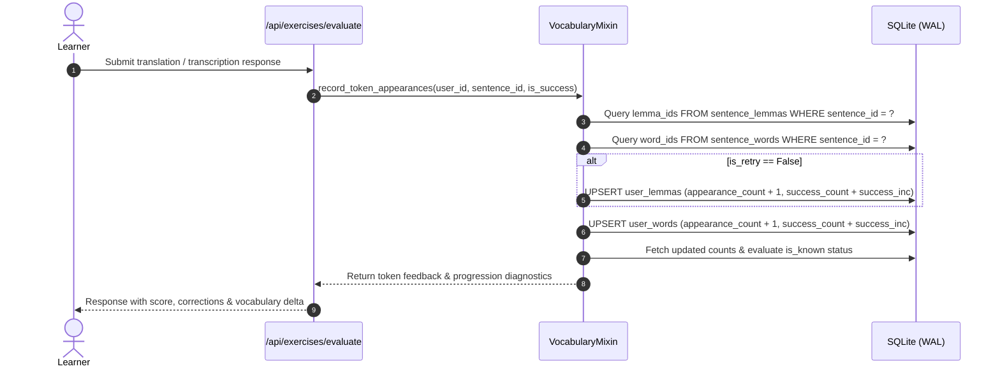
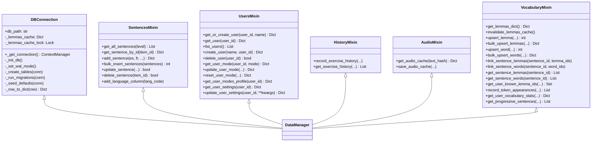

# Chapter 2: Database Schema, Lexical Models & Repositories

[← Previous: 01 Architecture Overview](file:///home/eyenga/Disk2/Projects/FrenchTutor/docs/01_architecture_overview.md) | [Documentation Hub (README)](file:///home/eyenga/Disk2/Projects/FrenchTutor/docs/README.md) | [Next: 03 NLP & Scoring Pipeline →](file:///home/eyenga/Disk2/Projects/FrenchTutor/docs/03_nlp_and_scoring_pipeline.md)

---

## 1. Foundations of the Two-Tier Lexical Architecture

A core design challenge in intelligent language tutoring systems is bridging the gap between dictionary abstractions (lemmas) and actual textual exposure (surface word inflections). In earlier versions of FrenchTutor, word roots were referred to as generic *lexemas*, and all entries were assigned a static default level (`A1`). The lexical subsystem was subsequently re-architected around **Lexique 4** (`data/lexique/Lexique4/Lexique4.tsv`), establishing a **Two-Tier Lexical Architecture**:

1. **Tier 1: Canonical Base Lemmas (`lemmas`)**  
   Represents canonical dictionary headwords associated with syntactic categories (e.g., the infinitive verb *manger* with POS `VER`, or the singular masculine noun *chat* with POS `NOM`). Each lemma entry encapsulates corpus-level lexical frequency (`12_FreqLemme`) and a psycholinguistically validated CEFR proficiency level (A1 to C2).
2. **Tier 2: Inflected Surface Words (`words`)**  
   Represents surface tokens as they appear in natural language sentences (e.g., *mange*, *mangeons*, *mangeraient*). Every surface word record retains its specific surface frequency (`10_FreqMot`) and points back to its canonical parent lemma via a relational foreign key (`lemma_id`).

```
┌────────────────────────────────────────────────────────────┐
│                    Canonical Lemma                         │
│             [id: 42, lemma: 'manger', pos: 'VER', level: 'A1']    │
└─────────────────────────────┬──────────────────────────────┘
                              │ 1:N Relationship
       ┌──────────────────────┼──────────────────────┐
       ▼                      ▼                      ▼
┌──────────────┐       ┌──────────────┐       ┌──────────────┐
│ Surface Word │       │ Surface Word │       │ Surface Word │
│ 'mange'      │       │ 'mangeons'   │       │ 'mangeraient'│
│ (Freq: 245.2)│       │ (Freq: 18.4) │       │ (Freq: 4.1)  │
└──────────────┘       └──────────────┘       └──────────────┘
```

### Design Rationale: Why Two Tiers?

* **Psycholinguistic Pedagogical Validity**: Language learners acquire grammatical paradigms through base roots while encountering inflected morphology. Assessing learner proficiency strictly on surface forms would fragment mastery metrics (e.g., treating *parle*, *parles*, and *parlons* as three unrelated vocabulary challenges). Conversely, tracking only lemmas obscures morphological stumbling blocks.
* **Separation of Exercise Generation & Granular Analytics**: Exercise progression relies on lemma-level novelty (e.g., ensuring a candidate sentence introduces at most $i+1$ unknown lemmas). Meanwhile, surface exposure tracking captures whether a student has met specific irregular verb inflections or feminine/plural agreements.
* **Referential Integrity for Inflected-Only Entries**: In natural language datasets such as Lexique 4, approximately 3,696 `(4_Lemme, 5_Cgram)` pairs appear in surface form without an explicit base-row entry where `14_IsLem == '1'` (for instance, the feminine adjective *applicative* appears, while its canonical masculine form *applicatif* lacked a standalone `IsLem == 1` row in the raw corpus table). By modeling lemmas and words as distinct relational entities, FrenchTutor seeds referenced lemmas with their observed corpus frequency, establishing 100% referential integrity across all 69,728 unique lemmas and 189,863 surface words.
* **Surrogate Keys vs. Natural Uniqueness Constraints**: Integer surrogate keys (`id INTEGER PRIMARY KEY AUTOINCREMENT`) are used across both tables for fast, compact foreign-key joining and B-tree indexing in SQLite. Natural uniqueness constraints (`UNIQUE(lemma, pos)` on `lemmas` and `UNIQUE(word, lemma_id, pos)` on `words`) prevent duplicate entries and enforce unambiguous token resolution.

---

## 2. Complete Entity-Relationship (ER) Diagram

The FrenchTutor relational database consists of 10 primary tables and 1 compatibility view, maintaining data across sentences, vocabulary, learner progress, user configurations, and media caches.


---

## 3. SQL Table DDL & Indexing Specifications

The schema is created and migrated automatically during database initialization in [`backend/db/connection.py`](file:///home/eyenga/Disk2/Projects/FrenchTutor/backend/db/connection.py).

### 3.1 Sentences Table
Stores bilingual (and multilingual) sentence pairs evaluated by the system. Additional language columns (such as `en`) can be added dynamically at runtime via `add_language_column()`.
```sql
CREATE TABLE IF NOT EXISTS sentences (
    id INTEGER PRIMARY KEY AUTOINCREMENT,
    fr TEXT NOT NULL,
    es TEXT NOT NULL,
    level TEXT NOT NULL DEFAULT 'A1' COLLATE NOCASE,
    score_ml REAL DEFAULT NULL,
    source TEXT NOT NULL DEFAULT 'custom',
    metadata TEXT DEFAULT '{}'
);

CREATE INDEX IF NOT EXISTS idx_sentences_level ON sentences(level COLLATE NOCASE);
CREATE INDEX IF NOT EXISTS idx_sentences_score_ml ON sentences(score_ml);
```

### 3.2 Canonical Lemmas Table
Stores unique canonical base lemmas with their psycholinguistic CEFR levels and corpus frequencies.
```sql
CREATE TABLE IF NOT EXISTS lemmas (
    id INTEGER PRIMARY KEY AUTOINCREMENT,
    lemma TEXT NOT NULL,
    pos TEXT NOT NULL,
    level TEXT NOT NULL DEFAULT 'A1',
    frequency REAL DEFAULT 0.0,
    is_base BOOLEAN NOT NULL DEFAULT 0,
    metadata TEXT DEFAULT '{}',
    created_at TIMESTAMP DEFAULT CURRENT_TIMESTAMP,
    UNIQUE(lemma, pos)
);

CREATE INDEX IF NOT EXISTS idx_lemmas_pos ON lemmas(pos);
CREATE INDEX IF NOT EXISTS idx_lemmas_level ON lemmas(level);
CREATE INDEX IF NOT EXISTS idx_lemmas_is_base ON lemmas(is_base);
```

### 3.3 Inflected Words Table
Stores all surface word forms, bound to their parent canonical lemma through a cascading foreign key.
```sql
CREATE TABLE IF NOT EXISTS words (
    id INTEGER PRIMARY KEY AUTOINCREMENT,
    word TEXT NOT NULL,
    lemma_id INTEGER NOT NULL,
    pos TEXT NOT NULL,
    frequency REAL DEFAULT 0.0,
    metadata TEXT DEFAULT '{}',
    created_at TIMESTAMP DEFAULT CURRENT_TIMESTAMP,
    FOREIGN KEY (lemma_id) REFERENCES lemmas(id) ON DELETE CASCADE,
    UNIQUE(word, lemma_id, pos)
);

CREATE INDEX IF NOT EXISTS idx_words_pos ON words(pos);
CREATE INDEX IF NOT EXISTS idx_words_lemma_id ON words(lemma_id);
```

### 3.4 Relational Junction Tables (`sentence_lemmas` & `sentence_words`)
Pre-indexed M:N relational maps connecting sentences with their extracted lemmas and surface tokens.
```sql
CREATE TABLE IF NOT EXISTS sentence_lemmas (
    sentence_id INTEGER NOT NULL,
    lemma_id INTEGER NOT NULL,
    PRIMARY KEY (sentence_id, lemma_id),
    FOREIGN KEY (sentence_id) REFERENCES sentences(id) ON DELETE CASCADE,
    FOREIGN KEY (lemma_id) REFERENCES lemmas(id) ON DELETE CASCADE
);

CREATE INDEX IF NOT EXISTS idx_sentence_lemmas_lemma ON sentence_lemmas(lemma_id);

CREATE TABLE IF NOT EXISTS sentence_words (
    sentence_id INTEGER NOT NULL,
    word_id INTEGER NOT NULL,
    PRIMARY KEY (sentence_id, word_id),
    FOREIGN KEY (sentence_id) REFERENCES sentences(id) ON DELETE CASCADE,
    FOREIGN KEY (word_id) REFERENCES words(id) ON DELETE CASCADE
);

CREATE INDEX IF NOT EXISTS idx_sentence_words_word ON sentence_words(word_id);
```

### 3.5 Dual User Vocabulary Tracking Tables
Tracks user interaction statistics independently at the lemma level (canonical mastery) and word level (surface form exposures).
```sql
CREATE TABLE IF NOT EXISTS user_lemmas (
    user_id TEXT NOT NULL,
    lemma_id INTEGER NOT NULL,
    level TEXT DEFAULT 'A1',
    appearance_count INTEGER NOT NULL DEFAULT 0,
    success_count INTEGER NOT NULL DEFAULT 0,
    PRIMARY KEY (user_id, lemma_id),
    FOREIGN KEY (user_id) REFERENCES users(id) ON DELETE CASCADE,
    FOREIGN KEY (lemma_id) REFERENCES lemmas(id) ON DELETE CASCADE
);

-- Composite covering index optimized for candidate sentence CTE lookups
CREATE INDEX IF NOT EXISTS idx_user_lemmas_user_success 
ON user_lemmas(user_id, success_count, lemma_id);

CREATE TABLE IF NOT EXISTS user_words (
    user_id TEXT NOT NULL,
    word_id INTEGER NOT NULL,
    appearance_count INTEGER NOT NULL DEFAULT 0,
    success_count INTEGER NOT NULL DEFAULT 0,
    PRIMARY KEY (user_id, word_id),
    FOREIGN KEY (user_id) REFERENCES users(id) ON DELETE CASCADE,
    FOREIGN KEY (word_id) REFERENCES words(id) ON DELETE CASCADE
);
```

### 3.6 Users, Modes, Settings & Telemetry Tables
```sql
CREATE TABLE IF NOT EXISTS users (
    id TEXT PRIMARY KEY,
    name TEXT NOT NULL DEFAULT 'Default User'
);

CREATE TABLE IF NOT EXISTS user_modes (
    user_id TEXT NOT NULL,
    mode TEXT NOT NULL,
    level TEXT NOT NULL DEFAULT 'A1',
    streak INTEGER NOT NULL DEFAULT 0,
    total_completed INTEGER NOT NULL DEFAULT 0,
    total_skipped INTEGER NOT NULL DEFAULT 0,
    updated_at TIMESTAMP DEFAULT CURRENT_TIMESTAMP,
    PRIMARY KEY (user_id, mode),
    FOREIGN KEY (user_id) REFERENCES users(id) ON DELETE CASCADE
);

CREATE TABLE IF NOT EXISTS user_settings (
    user_id TEXT PRIMARY KEY,
    theme TEXT DEFAULT 'system',
    preferred_voice TEXT DEFAULT 'default',
    correction_threshold REAL DEFAULT 0.75,
    cards_per_exercise INTEGER DEFAULT 7,
    auto_jump INTEGER DEFAULT 1,
    auto_play_audio INTEGER DEFAULT 1,
    transcription_retry INTEGER DEFAULT 1,
    blind_retry INTEGER DEFAULT 0,
    active_mode TEXT DEFAULT 'translation',
    mixed_translation_ratio INTEGER DEFAULT 50,
    updated_at TIMESTAMP DEFAULT CURRENT_TIMESTAMP,
    FOREIGN KEY (user_id) REFERENCES users(id) ON DELETE CASCADE
);

CREATE TABLE IF NOT EXISTS exercise_history (
    id INTEGER PRIMARY KEY AUTOINCREMENT,
    user_id TEXT NOT NULL,
    mode TEXT NOT NULL DEFAULT 'translation',
    sentence_id INTEGER,
    quality REAL,
    is_skipped BOOLEAN DEFAULT 0,
    created_at TIMESTAMP DEFAULT CURRENT_TIMESTAMP,
    FOREIGN KEY (user_id) REFERENCES users(id) ON DELETE CASCADE,
    FOREIGN KEY (sentence_id) REFERENCES sentences(id) ON DELETE SET NULL
);

CREATE INDEX IF NOT EXISTS idx_history_user_mode ON exercise_history(user_id, mode);

CREATE TABLE IF NOT EXISTS audio_cache (
    id INTEGER PRIMARY KEY AUTOINCREMENT,
    sentence_id INTEGER,
    text_hash TEXT UNIQUE NOT NULL,
    text TEXT NOT NULL,
    file_path TEXT NOT NULL,
    created_at TIMESTAMP DEFAULT CURRENT_TIMESTAMP,
    FOREIGN KEY (sentence_id) REFERENCES sentences(id) ON DELETE CASCADE
);

CREATE INDEX IF NOT EXISTS idx_audio_cache_hash ON audio_cache(text_hash);
CREATE INDEX IF NOT EXISTS idx_audio_cache_sentence ON audio_cache(sentence_id);
```

### 3.7 Compatibility Views
To maintain backwards compatibility for legacy components referencing the prior lexema naming conventions:
```sql
CREATE VIEW IF NOT EXISTS user_lexema_counts AS
SELECT user_id, lemma_id AS lexema_id, level, appearance_count, success_count
FROM user_lemmas;
```

---

## 4. Dual User Tracking System

The dual tracking mechanism is implemented in [`record_token_appearances(...)`](file:///home/eyenga/Disk2/Projects/FrenchTutor/backend/db/vocabulary.py#L245-L320). When a learner completes or skips an exercise card, the system executes simultaneous updates across both layers:



### 4.1 Canonical Root Mastery (`user_lemmas`)
`user_lemmas` tracks the conceptual mastery of lexical roots.
* **Mastery Definition**: A lemma is considered *known* (`is_known = 1`) by a user if:
  1. It is marked as a foundational base word (`is_base = 1`), such as pronouns, common prepositions, or essential auxiliary verbs.
  2. Its CEFR level is strictly below the user's current target level (e.g., all A1 lemmas are automatically treated as known for an A2 learner).
  3. The user has practiced the lemma and achieved `success_count >= VOCABULARY_UNLOCK_THRESHOLD` (default is 1).
* **Algorithmic Role**: Candidate sentence generation (`get_progressive_sentences`) operates **strictly** over `user_lemmas` and `sentence_lemmas`. This ensures sentence difficulty is governed purely by root concepts rather than inflected variations.

### 4.2 Surface Exposure Tracking (`user_words`)
`user_words` records empirical exposure to specific inflected forms.
* **Pedagogical Purpose**: While a user may understand the lemma *devoir*, encountering rare subjunctive forms (e.g., *dussiez*) represents distinct morphosyntactic friction.
* **Data Granularity**: Tracks specific tense, agreement, and phonetic contractions seen in practice.
* **Engine Isolation**: Changes or extensions to `user_words` tracking do not affect candidate sentence selection, preserving predictable progression while supplying high-resolution analytics for dashboards and spaced-repetition diagnostics.

---

## 5. Database Connection Management & SQLite Optimization

All database interactions pass through [`DBConnection`](file:///home/eyenga/Disk2/Projects/FrenchTutor/backend/db/connection.py#L23-L73).

### 5.1 Write-Ahead Logging (WAL) Mode
During initialization, [`DBConnection._set_wal_mode()`](file:///home/eyenga/Disk2/Projects/FrenchTutor/backend/db/connection.py#L86-L94) configures SQLite pragma flags:
* `PRAGMA journal_mode = WAL;`: Enables SQLite Write-Ahead Logging. Readers never block writers, and writers do not block readers. This is critical for FrenchTutor, where background candidate precomputation threads continuously read the database while active user exercises write telemetry and history records.
* `PRAGMA synchronous = NORMAL;`: Reduces disk I/O fsync overhead while maintaining crash resilience under WAL mode.
* `PRAGMA busy_timeout = 10000;`: Waits up to 10 seconds to resolve transient locks before throwing a busy operational error.

### 5.2 Context Manager & Transaction Lifecycle
Connections are obtained via the [`_get_connection()`](file:///home/eyenga/Disk2/Projects/FrenchTutor/backend/db/connection.py#L43-L73) context manager:

```python
@contextmanager
def _get_connection(self):
    conn = None
    try:
        try:
            conn = sqlite3.connect(self.db_path, timeout=15.0)
        except sqlite3.OperationalError as e:
            if os.path.exists(self.db_path):
                uri_path = f"file:{os.path.abspath(self.db_path)}?immutable=1"
                conn = sqlite3.connect(uri_path, uri=True, timeout=15.0)
            else:
                raise e
        conn.row_factory = sqlite3.Row
        conn.execute("PRAGMA busy_timeout = 10000;")
        conn.execute("PRAGMA foreign_keys = ON;")
        yield conn
        conn.commit()
    except Exception:
        if conn:
            try:
                conn.rollback()
            except Exception:
                pass
        raise
    finally:
        if conn:
            try:
                conn.close()
            except Exception:
                pass
```

Key operational traits:
* **Atomic Unit of Work**: Every block automatically commits on normal completion or executes a full `rollback()` if an unhandled exception occurs.
* **Strict Foreign Key Enforcement**: SQLite disables foreign key validation by default. FrenchTutor explicitly executes `PRAGMA foreign_keys = ON;` on every single opened connection to guarantee cascading deletes across junction tables.
* **Row Factory Mapping**: Sets `conn.row_factory = sqlite3.Row` for fast, dict-like key-value column indexing.
* **Immutable Read-Only Fallback**: If file permission errors prevent standard opening on an existing database, the connection falls back to `?immutable=1` URI mode.

---

## 6. Repository Architecture & The Aggregation Pattern

FrenchTutor employs a modular **Repository Aggregation Pattern** using Python multiple-inheritance mixins. Rather than placing all SQL operations inside a monolithic class, queries and mutations are isolated into focused domain modules.



### 6.1 The Unified `DataManager` Interface
As defined in [`backend/db/manager.py`](file:///home/eyenga/Disk2/Projects/FrenchTutor/backend/db/manager.py#L9-L10):
```python
class DataManager(DBConnection, SentencesMixin, UsersMixin, HistoryMixin, AudioMixin, VocabularyMixin):
    pass
```
The FastAPI dependency injection container instantiates a single `DataManager` instance, exposing the full breadth of domain operations across all endpoints without needing multiple disparate database clients:
* [`SentencesMixin`](file:///home/eyenga/Disk2/Projects/FrenchTutor/backend/db/sentences.py): Sentence pair persistence, batch ingestion, dynamic multilingual column generation, and level distribution aggregations.
* [`VocabularyMixin`](file:///home/eyenga/Disk2/Projects/FrenchTutor/backend/db/vocabulary.py): Lexique lemma/word upserts, sentence linking, dual tracking counters, in-memory lemma cache management, and the $i+1$ progressive sentence selection query.
* [`UsersMixin`](file:///home/eyenga/Disk2/Projects/FrenchTutor/backend/db/users.py): User profiles, mode-specific streaks and completions (`translation`, `transcription`, `mixed`), and configuration flags (`user_settings`).
* [`HistoryMixin`](file:///home/eyenga/Disk2/Projects/FrenchTutor/backend/db/history.py): Audit logging of exercise attempts, evaluation scores, and skip actions.
* [`AudioMixin`](file:///home/eyenga/Disk2/Projects/FrenchTutor/backend/db/audio.py): Text hash indexing and file path caching for Edge-TTS and Piper audio synthesis.

---

## 7. Indexing Strategies for High-Frequency Lookups & Candidate Sampling

Candidate sentence selection operates under tight interactive latency constraints. To guarantee sub-15ms generation times, FrenchTutor employs a multi-tiered query and caching architecture:

### 7.1 Composite Covering Index on `user_lemmas`
The core progression query uses a Common Table Expression (CTE) to compute which lemmas are already known by the learner:
```sql
CREATE INDEX IF NOT EXISTS idx_user_lemmas_user_success 
ON user_lemmas(user_id, success_count, lemma_id);
```
By indexing `(user_id, success_count, lemma_id)` in that order, SQLite performs an index-only scan to evaluate `WHERE user_id = ? AND success_count >= ?`, retrieving all known `lemma_id`s directly from the B-tree leaf pages without touching table data blocks.

### 7.2 The $i+1$ Candidate Aggregation Query
In [`VocabularyMixin.get_progressive_sentences(...)`](file:///home/eyenga/Disk2/Projects/FrenchTutor/backend/db/vocabulary.py#L484-L501), sentences matching the user's level are evaluated against known vocabulary:

```sql
WITH known_lemmas AS (
    SELECT id FROM lemmas WHERE is_base = 1 OR level IN ('A1')
    UNION
    SELECT lemma_id FROM user_lemmas WHERE user_id = 'user_123' AND success_count >= 1
)
SELECT 
    s.*, 
    GROUP_CONCAT(sl.lemma_id) as all_lemma_ids,
    SUM(CASE WHEN kl.id IS NULL THEN 1 ELSE 0 END) as unknown_count,
    GROUP_CONCAT(CASE WHEN kl.id IS NULL THEN sl.lemma_id ELSE NULL END) as unknown_lemma_ids
FROM sentences s
JOIN sentence_lemmas sl ON s.id = sl.sentence_id
LEFT JOIN known_lemmas kl ON sl.lemma_id = kl.id
WHERE s.level = 'A2'
GROUP BY s.id
HAVING unknown_count <= 2;
```

**Index Acceleration**:
1. `s.level = 'A2'`: Filtered via `idx_sentences_level` (`sentences(level COLLATE NOCASE)`).
2. `JOIN sentence_lemmas sl ON s.id = sl.sentence_id`: Uses primary key `(sentence_id, lemma_id)`.
3. `LEFT JOIN known_lemmas kl ON sl.lemma_id = kl.id`: Fast hash lookup against CTE results.
4. `HAVING unknown_count <= 2`: Filters out sentences that introduce more than the allowed threshold of unmastered concepts.

### 7.3 In-Memory Candidate Buffering
To prevent repetitive SQL execution during active study sessions, `VocabularyMixin` maintains a per-user candidate buffer partitioned by mode and target level:
```python
buffer_key = f"{user_id}_{target_level}_{mode}"
buffer = self._user_candidates_buffer[buffer_key]  # {'reinforcement': [...], 'progression': [...]}
```
* **Progression Cards**: Sentences containing exactly $1 \le \text{unknown\_count} \le \text{max\_unknown}$.
* **Reinforcement Cards**: Sentences where $\text{unknown\_count} == 0$ (all lemmas already mastered).
* **Buffer Invalidation**: Any upsert or mutation of lemmas immediately flushes the candidate buffer via [`invalidate_lemmas_cache()`](file:///home/eyenga/Disk2/Projects/FrenchTutor/backend/db/vocabulary.py#L32-L38).

### 7.4 In-Memory Lemma Metadata Cache
The static properties of all 69,728 lemmas (`lemma`, `pos`, `level`, `is_base`) are held in thread-safe memory via [`get_lemmas_dict()`](file:///home/eyenga/Disk2/Projects/FrenchTutor/backend/db/vocabulary.py#L13-L28). When cards are popped from the candidate buffer, surface token pairing and known/new classifications are resolved entirely in-memory without issuing secondary SQL queries.

---

## 8. Summary Table of Indexes & Storage Optimization

| Table | Index Name | Indexed Columns | Design Target |
| :--- | :--- | :--- | :--- |
| `sentences` | `idx_sentences_level` | `level COLLATE NOCASE` | Fast level-based candidate filtering |
| `sentences` | `idx_sentences_score_ml` | `score_ml` | Quality/difficulty range queries |
| `lemmas` | `idx_lemmas_pos` | `pos` | POS-specific lookup & disambiguation |
| `lemmas` | `idx_lemmas_level` | `level` | Bulk filtering by CEFR rank level |
| `lemmas` | `idx_lemmas_is_base` | `is_base` | Foundational vocabulary identification |
| `words` | `idx_words_pos` | `pos` | Surface token grammatical classification |
| `words` | `idx_words_lemma_id` | `lemma_id` | Relational join from lemma to inflections |
| `sentence_lemmas` | `idx_sentence_lemmas_lemma` | `lemma_id` | Reverse lookup (finding sentences by lemma) |
| `sentence_words` | `idx_sentence_words_word` | `word_id` | Reverse lookup (finding sentences by word) |
| `user_lemmas` | `idx_user_lemmas_user_success` | `(user_id, success_count, lemma_id)` | Covering index for candidate CTE lookups |
| `exercise_history`| `idx_history_user_mode` | `(user_id, mode)` | User performance audit trail pagination |
| `audio_cache` | `idx_audio_cache_hash` | `text_hash UNIQUE` | $O(1)$ audio file retrieval by MD5 text key |
| `audio_cache` | `idx_audio_cache_sentence` | `sentence_id` | Sentence-to-audio cache invalidation |

---

[← Previous: 01 Architecture Overview](file:///home/eyenga/Disk2/Projects/FrenchTutor/docs/01_architecture_overview.md) | [Documentation Hub (README)](file:///home/eyenga/Disk2/Projects/FrenchTutor/docs/README.md) | [Next: 03 NLP & Scoring Pipeline →](file:///home/eyenga/Disk2/Projects/FrenchTutor/docs/03_nlp_and_scoring_pipeline.md)
