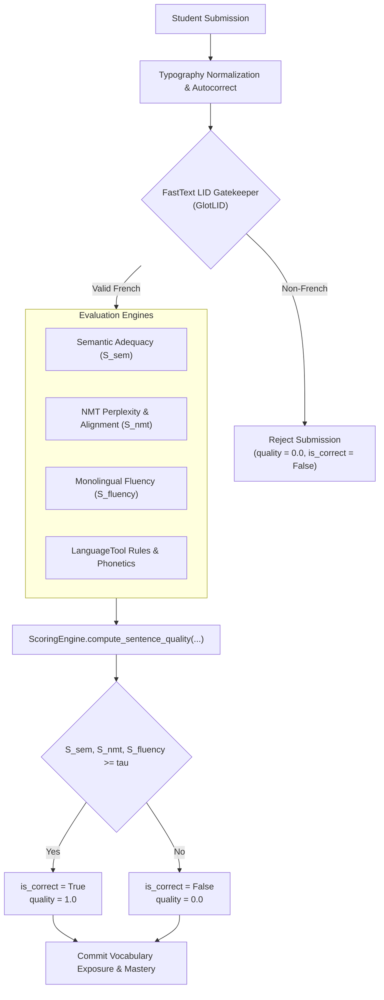
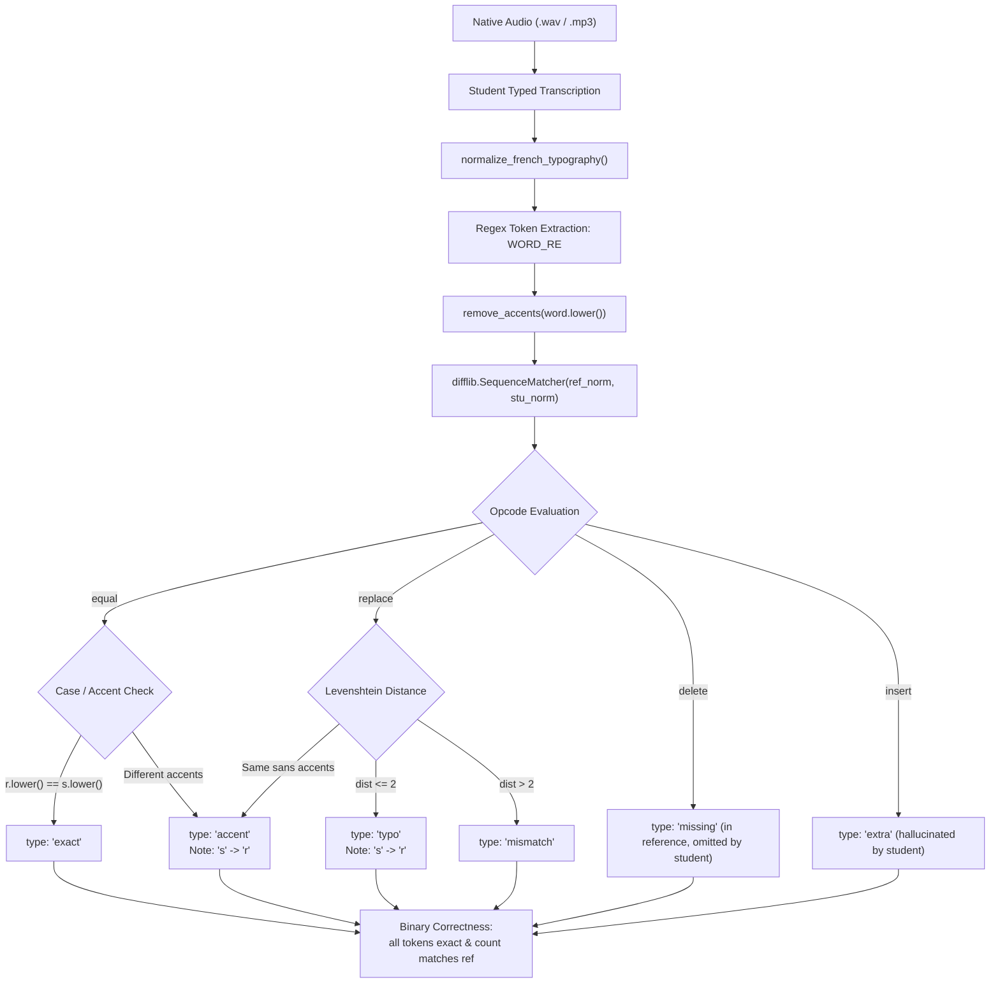

<!-- Navigation Header -->
[← 02 Database Schema & Models](file:///home/eyenga/Projects/FrenchTutor/docs/02_database_and_models.md) | [Documentation Index](file:///home/eyenga/Projects/FrenchTutor/docs/README.md) | [04 Vocabulary & Progression →](file:///home/eyenga/Projects/FrenchTutor/docs/04_vocabulary_and_progression.md)

---

# Chapter 3: Multi-Stage NLP & Scoring Pipeline

This chapter provides an exhaustive architectural, mathematical, and algorithmic reference for the **linguistic evaluation and scoring pipeline** in **FrenchTutor**.

Rather than relying on brittle string matching or opaque, non-deterministic commercial LLM APIs, FrenchTutor employs a **multi-stage, multi-model evaluation pipeline** composed of fast local neural models and linguistic heuristics:

1. **Gatekeeper**: FastText-based language identification ([`cis-lmu/glotlid`](https://huggingface.co/cis-lmu/glotlid)) validating authentic French input before neural processing.
2. **Semantic Adequacy ($S_{\text{sem}}$)**: Dense multilingual bi-encoder embeddings ([`dangvantuan/sentence-camembert-base`](https://huggingface.co/dangvantuan/sentence-camembert-base) or [`sentence-transformers/paraphrase-multilingual-MiniLM-L12-v2`](https://huggingface.co/sentence-transformers/paraphrase-multilingual-MiniLM-L12-v2)) measuring semantic cosine similarity against reference translations.
3. **NMT Perplexity ($S_{\text{NMT}}$) & Cross-Attention Alignment**: Sequence-to-sequence translation models ([`Helsinki-NLP/opus-mt-es-fr`](https://huggingface.co/Helsinki-NLP/opus-mt-es-fr) and [`facebook/nllb-200-distilled-600M`](https://huggingface.co/facebook/nllb-200-distilled-600M)) providing conditional cross-entropy loss, token surprise ($\Delta L$), and cross-attention matrix extraction for token-level Spanish-to-French word alignment.
4. **Monolingual Fluency ($S_{\text{fluency}}$)**: Causal autoregressive French language modeling ([`asi/gpt-fr-cased-small`](https://huggingface.co/asi/gpt-fr-cased-small) / [`asi/gpt-fr-cased-base`](https://huggingface.co/asi/gpt-fr-cased-base)) calculating shifted token-level negative log-likelihood and relative perplexity.
5. **Orthography, Grammar & Phonetic Evaluation**: Two-tier LanguageTool rule matching, typographical normalization, Levenshtein distance, and phonetic sound matching.
6. **Audio Transcription & Pronunciation Scoring**: Word-level diff sequence matching, accent error classification, and acoustic transcription feedback.



---

## 1. Pipeline Architecture Overview & Lifecycle

The scoring pipeline runs within the FastAPI execution lifecycle defined in [`backend/api/exercises.py`](file:///home/eyenga/Projects/FrenchTutor/backend/api/exercises.py), coordinated by [`backend/ml/engine.py`](file:///home/eyenga/Projects/FrenchTutor/backend/ml/engine.py), [`backend/ml/precompute.py`](file:///home/eyenga/Projects/FrenchTutor/backend/ml/precompute.py), and [`backend/scoring/engine.py`](file:///home/eyenga/Projects/FrenchTutor/backend/scoring/engine.py).

### 1.1 Dual-Threaded Concurrency Pattern
Running four neural network forward passes for every submission would introduce unacceptable latency (800ms–1.5s on CPU). To achieve interactive response times (<150ms on CPU, <40ms on GPU), FrenchTutor uses an **eager dual-threaded architecture** implemented in [`backend/ml/precompute.py`](file:///home/eyenga/Projects/FrenchTutor/backend/ml/precompute.py):

- **Thread 1 (`EagerPrecomputeManager` Background Worker)**:
  When an exercise batch is requested via `GET /api/exercises/batch`, Thread 1 immediately processes the reference sentences in the background. It generates a [`ReferenceBundle`](file:///home/eyenga/Projects/FrenchTutor/backend/ml/precompute.py#L17-L33) containing:
  - $\text{PPL}_{\text{ref}}^{\text{NMT}}$: Reference sentence NMT perplexity.
  - $\text{PPL}_{\text{ref}}^{\text{fluency}}$: Reference sentence causal GPT-2 perplexity.
  - $\mathbf{e}_{\text{ref}}$: Precomputed normalized semantic embedding vector.
  - $\mathbf{A}_{\text{ref}}$: Source-to-reference cross-attention alignment matrix.
  - `first_time_src_indices` and `first_time_tgt_indices`: Indices corresponding to target $i+1$ progression vocabulary.

- **Thread 2 (Student Evaluation Worker)**:
  When the learner submits a translation (`POST /api/exercises/evaluate-single`), the precomputed bundle is retrieved from memory (`_cache`). Neural inference is executed **only on the student's text**. The student metrics are directly compared against the cached baseline.

```
Total Student Latency = Latency(Student Passes) + 0 ms (Reference Passes)
```

---

## 2. Text Normalization & Punctuation Reconciliation

Before any neural model processes user input, the text undergoes strict typographic normalization and reconciliation in [`backend/nlp/text_utils.py`](file:///home/eyenga/Projects/FrenchTutor/backend/nlp/text_utils.py):

### 2.1 Typographic Normalization: [`normalize_french_typography`](file:///home/eyenga/Projects/FrenchTutor/backend/nlp/text_utils.py#L26-L59)
French text submitted through web inputs frequently contains mismatched apostrophes, inconsistent hyphens, and irregular non-breaking spaces. The function applies deterministic normalization:
1. **Apostrophes**: Normalizes Unicode right/left single quotes (`’`, `‘`, `` ` ``, `´`, `′`) to standard ASCII single quote `'`.
2. **Hyphens & Dashes**: Normalizes non-breaking hyphens, en-dashes, em-dashes, and minus signs (`‑`, `–`, `—`, `−`) to standard ASCII `-`.
3. **Space Sanitization**: Replaces non-breaking spaces (`\u00a0`), narrow non-breaking spaces (`\u202f`), and thin spaces (`\u2009`) with standard spaces, stripping zero-width spaces (`\u200b`, `\ufeff`).
4. **Punctuation Spacing**: Enforces standard French typographic rules by inserting a space before high punctuation marks (`?`, `!`, `:`, `;`) using regex lookbehinds and collapses redundant whitespace.

### 2.2 Terminal Punctuation Reconciliation: [`autocorrect_text`](file:///home/eyenga/Projects/FrenchTutor/backend/nlp/text_utils.py#L61-L150)
Language learners often omit the final period or question mark. If a student writes `"Je vais à la gare"` for a reference sentence ending in `"."` or `"?"`, the terminal punctuation is reconciled automatically:
- Terminal marks (`.`, `?`, `!`) from the reference are appended or harmonized.
- **Tier 1 Typo Correction**: LanguageTool is invoked strictly for spelling typos where edit distance $\le 2$ or casing errors. Genuine grammatical errors, syntax issues, and confused words are explicitly preserved so the scoring engine can penalize them.

---

## 3. Stage 1: FastText Language Identification Gatekeeper

### 3.1 Model & Mechanism
Learners may mistakenly submit answers in the source language (Spanish), native English, or random gibberish. The Gatekeeper in [`MLEngine.check_language`](file:///home/eyenga/Projects/FrenchTutor/backend/ml/engine.py#L83-L106) validates that the candidate is authentic French before triggering heavy neural evaluation.

The system uses **GlotLID** ([`cis-lmu/glotlid`](https://huggingface.co/cis-lmu/glotlid)), an open-source fasttext neural classifier trained on over 2,000 languages:
- **Model File**: Downloaded automatically via `hf_hub_download(repo_id="cis-lmu/glotlid", filename="model.bin")`.
- **Inference**: `predictions, probabilities = self.lid_model.predict(text_clean)`.
- **Validation Criteria**: The top predicted language tag must belong to the French dialect family (`fra`, `fr`, Picard `pcd`, Guadeloupean Creole `gcf`, Guianese Creole `gcr`) with a confidence probability:
  $$P(\text{lang} \in \text{French}) \ge 0.40$$

If language validation fails:
$$\text{is\_correct} \leftarrow \text{False}, \quad \text{quality} \leftarrow 0.0$$
The request short-circuits immediately, conserving CPU/GPU cycles.

---

## 4. Stage 2: Semantic Adequacy ($S_{\text{sem}}$)

### 4.1 Bi-Encoder Dense Embedding
The second stage measures whether the student’s translation preserves the meaning of the source sentence, accommodating valid synonyms (e.g., *voiture* vs. *automobile*, *vélo* vs. *bicyclette*).

Evaluation is performed via dense sentence representation using models registered in [`backend/ml/registry.py`](file:///home/eyenga/Projects/FrenchTutor/backend/ml/registry.py):
- **Default Production Model**: [`dangvantuan/sentence-camembert-base`](https://huggingface.co/dangvantuan/sentence-camembert-base), a French RoBERTa-based sentence transformer optimized for French semantic similarity.
- **Multilingual Fallback**: [`sentence-transformers/paraphrase-multilingual-MiniLM-L12-v2`](https://huggingface.co/sentence-transformers/paraphrase-multilingual-MiniLM-L12-v2), a 12-layer distilled cross-lingual MiniLM mapping French and Spanish into a shared 384-dimensional vector space.

### 4.2 Cosine Similarity Formulation
Let $\mathbf{u} = f_{\theta}(s_{\text{student}})$ and $\mathbf{v} = f_{\theta}(s_{\text{ref}})$ be the mean-pooled, $L_2$-normalized dense embeddings:
$$\|\mathbf{u}\|_2 = 1, \quad \|\mathbf{v}\|_2 = 1$$

The raw semantic cosine similarity $R_{\text{cos}}$ is computed across all acceptable reference translations $\{s_{\text{ref}}^{(1)}, \dots, s_{\text{ref}}^{(K)}\}$:
$$R_{\text{cos}} = \max_{k \in [1, K]} \left( \mathbf{u} \cdot \mathbf{v}^{(k)} \right) = \max_{k \in [1, K]} \left( \frac{\mathbf{u} \cdot \mathbf{v}^{(k)}}{\|\mathbf{u}\|_2 \|\mathbf{v}^{(k)}\|_2} \right)$$

The semantic adequacy score $S_{\text{sem}}$ is scaled to a continuous percentage $[0.0, 100.0]$:
$$S_{\text{sem}} = \max\left(0.0, \min\left(100.0, R_{\text{cos}} \times 100.0\right)\right)$$

If precomputed reference embeddings are available in `reference_bundle.ref_sem_emb`, only $\mathbf{u}$ is encoded at runtime.

---

## 5. Stage 3: NMT Perplexity ($S_{\text{NMT}}$) & Cross-Attention Word Alignment

### 5.1 Conditional Sequence-to-Sequence Modeling
Semantic embeddings alone cannot verify whether every individual word in the source Spanish sentence was translated into French. A student could write a grammatically correct French sentence that only translates half the prompt.

Stage 3 uses a neural machine translation (NMT) model:
- **Default Production Model**: [`Helsinki-NLP/opus-mt-es-fr`](https://huggingface.co/Helsinki-NLP/opus-mt-es-fr) (MarianSeq2Seq architecture).
- **Multilingual Model**: [`facebook/nllb-200-distilled-600M`](https://huggingface.co/facebook/nllb-200-distilled-600M) (No Language Left Behind, 200 languages).

The source text $X = (x_1, \dots, x_M)$ is passed to the encoder, and the candidate French text $Y = (y_1, \dots, y_N)$ is passed as labels to the decoder.

### 5.2 NMT Perplexity & Score Calculation
The model computes the conditional cross-entropy loss over target tokens:
$$\mathcal{L}_{\text{NMT}}(Y \mid X) = -\frac{1}{N} \sum_{i=1}^N \log P(y_i \mid y_{<i}, X; \theta_{\text{NMT}})$$

The sequence perplexity $\text{PPL}_{\text{NMT}}$ represents the model's surprise at generating the candidate tokens:
$$\text{PPL}_{\text{NMT}} = \exp\left( \mathcal{L}_{\text{NMT}}(Y \mid X) \right)$$

The NMT adequacy score $S_{\text{NMT}}$ normalizes the student's perplexity relative to the gold-standard reference sentence perplexity ($\text{PPL}_{\text{ref}}$):
$$S_{\text{NMT}} = \max\left(0.0, \min\left(100.0, \frac{\text{PPL}_{\text{ref}}}{\max(\text{PPL}_{\text{student}}, 10^{-5})} \times 100.0\right)\right)$$

If the student's translation is as probable as or more probable than the reference translation, $S_{\text{NMT}} \to 100.0$. If the student makes translation errors, hallucinating unrelated words or omitting clauses, $\text{PPL}_{\text{student}}$ spikes, driving $S_{\text{NMT}}$ down.

### 5.3 Token-Level Surprise Metric ($\Delta L$)
To identify the specific token that caused an error, [`_build_nmt_breakdowns`](file:///home/eyenga/Projects/FrenchTutor/backend/ml/token_utils.py#L79-L157) calculates the token-level cross-entropy loss $\ell_i = -\log P(y_i \mid y_{<i}, X)$ and compares it to the loss of the model's top-1 greedy prediction:
$$\ell_i^* = -\log P(\hat{y}_i \mid y_{<i}, X) \quad \text{where} \quad \hat{y}_i = \arg\max_v P(v \mid y_{<i}, X)$$
$$\Delta L_i = \max\left(0.0, \ell_i - \ell_i^*\right)$$

When $\Delta L_i > 8.0$ ([`NMT_DELTA_L_THRESHOLD`](file:///home/eyenga/Projects/FrenchTutor/backend/config.py#L20)), the token is flagged as an anomaly (`is_error = True`), and the model's expected token $\hat{y}_i$ is surfaced as `top_prediction`.

### 5.4 Cross-Attention Alignment Matrix Extraction
Transformer seq2seq models contain multi-head cross-attention mechanisms connecting the decoder to encoder representations. In [`HelsinkiNMTModel.infer`](file:///home/eyenga/Projects/FrenchTutor/backend/ml/registry.py#L93-L135), the cross-attention tensors are captured with `output_attentions=True`.

Cross-attention weights from the final 4 decoder layers are stacked and averaged across heads and layers:
$$\mathbf{A}_{\text{subtokens}} = \frac{1}{4 H} \sum_{l=L-3}^L \sum_{h=1}^H \mathbf{A}^{(l, h)} \in \mathbb{R}^{N_{\text{sub}} \times M_{\text{sub}}}$$

Because Marian and NLLB tokenizers use SentencePiece BPE sub-tokens (prefixed with `\u2581`), sub-tokens are mapped back to whole words via [`aggregate_sentencepiece_tokens_to_words`](file:///home/eyenga/Projects/FrenchTutor/backend/ml/token_utils.py#L34-L77), which handles French contraction splitting (e.g., *"d'un"* $\to$ `["d'", "un"]`, *"c'est"* $\to$ `["c'", "est"]`).

### 5.5 Pure NMT Cross-Attention Word Alignment
FrenchTutor uses pure cross-attention pooling directly extracted from the NMT model ([`_compute_attention_alignment_matrix`](file:///home/eyenga/Projects/FrenchTutor/backend/ml/token_utils.py)):

1. **Row Normalization**:
   $$\tilde{\mathbf{A}}_{t, s} = \frac{\mathbf{A}_{t, s}}{\sum_{s'} \mathbf{A}_{t, s'} + 10^{-8}}$$
2. **Word-Level Attention Pooling**:
   For target word $W_t^{\text{tgt}}$ consisting of sub-tokens $\mathcal{T}_t$ and source word $W_s^{\text{src}}$ consisting of sub-tokens $\mathcal{S}_s$:
   $$\mathbf{M}_{\text{attn}}(t, s) = \sum_{i \in \mathcal{T}_t} \sum_{j \in \mathcal{S}_s} \tilde{\mathbf{A}}_{i, j}$$
3. **Scaling**:
   $$\mathbf{M} = \frac{\mathbf{M}_{\text{attn}}}{\max(\mathbf{M}_{\text{attn}}) + 10^{-8}}$$

This produces a continuous alignment matrix $\mathbf{M} \in [0.0, 1.0]^{|W^{\text{tgt}}| \times |W^{\text{src}}|}$ purely from sequence-to-sequence attention dynamics without requiring external word-level semantic embeddings or forward passes.

When the user hovers over a Spanish source word $s$ in the UI, [`get_aligned_targets`](file:///home/eyenga/Projects/FrenchTutor/backend/nlp/text_utils.py#L151-L171) resolves the corresponding French targets:
$$\hat{t} = \arg\max_t \mathbf{M}_{t, s}$$
Any other target $t'$ satisfying $\mathbf{M}_{t', s} \ge 0.65 \times \mathbf{M}_{\hat{t}, s}$ and whose row argmax aligns back to $s$ is also included. This enables multi-word expression highlighting (e.g., Spanish *"desayunar"* $\to$ French *"prendre le petit déjeuner"*).

---

## 6. Stage 4: Monolingual Fluency ($S_{\text{fluency}}$)

### 6.1 Autoregressive Causal Language Model
Even if a translation is semantically accurate and maps each source word, it may sound unnatural or unidiomatic to a native speaker.

Stage 4 evaluates monolingual French naturalness using a French autoregressive language model:
- **Default Production Model**: [`asi/gpt-fr-cased-small`](https://huggingface.co/asi/gpt-fr-cased-small) (or [`asi/gpt-fr-cased-base`](https://huggingface.co/asi/gpt-fr-cased-base)), trained on 100GB+ of French text.

### 6.2 Causal Perplexity & Shifted Cross-Entropy
Given student token sequence $Y = (y_1, y_2, \dots, y_N)$, the causal LM predicts token $y_{i+1}$ given history $y_{\le i}$. The logits are shifted by 1 position:
$$\text{logits}_{\text{shift}} = \text{logits}_{[:-1, :]}, \quad \text{labels}_{\text{shift}} = Y_{[1:]}$$

The shifted cross-entropy loss is calculated:
$$\mathcal{L}_{\text{fluency}}(Y) = -\frac{1}{N - 1} \sum_{i=1}^{N - 1} \log P(y_{i+1} \mid y_{\le i}; \theta_{\text{GPT}})$$
$$\text{PPL}_{\text{fluency}} = \exp\left( \mathcal{L}_{\text{fluency}}(Y) \right)$$

The relative fluency score $S_{\text{fluency}}$ compares student naturalness against the native reference:
$$S_{\text{fluency}} = \max\left(0.0, \min\left(100.0, \frac{\text{PPL}_{\text{ref}}^{\text{fluency}}}{\max(\text{PPL}_{\text{student}}^{\text{fluency}}, 10^{-5})} \times 100.0\right)\right)$$

If the student uses unnatural word orders or ungrammatical collocations, causal perplexity spikes, reducing $S_{\text{fluency}}$.

---

## 7. Stage 5: Orthography, Grammar & Phonetic Sound Matching

### 7.1 LanguageTool Rule-Based Engine
Neural language models can overlook subtle agreement rules (e.g., feminine past participle agreement: *"Elle est parti"* vs. *"Elle est partie"*). Stage 5 integrates a local rule-based engine:
- **Engine**: [`language_tool_python.LanguageTool('fr')`](https://pypi.org/project/language-tool-python/).
- **Filtered Categories**: FrenchTutor filters out non-pedagogical stylistic suggestions in [`MLEngine.evaluate_syntax`](file:///home/eyenga/Projects/FrenchTutor/backend/ml/engine.py#L155-L178):
  - **Ignored Categories**: `STYLE`, `TYPOGRAPHY`, `PUNCTUATION`, `COLLOQUIALISMS`, `REDUNDANCY`.
  - **Ignored Issue Types**: `style`, `register`, `typographical`, `whitespace`, `locale-violation`.
- **Targeted Rules**: Retains genuine syntax errors, verb conjugations, gender/number disagreements, and confused homophones (e.g., *a/à*, *ou/où*, *son/sont*, *ce/se*).

### 7.2 Soundness & Phonetic Matching Heuristics
When a student word triggers a high surprise score ($\Delta L > 8.0$), the system verifies whether the substitution is linguistically acceptable before marking it as an error:

Implemented in [`align_and_filter_unexpected_words`](file:///home/eyenga/Projects/FrenchTutor/backend/ml/engine.py#L179-L264):
1. **Triangular Alignment Lookup**:
   Using the student alignment matrix $\mathbf{M}_{\text{stu}}$ and reference alignment matrix $\mathbf{M}_{\text{ref}}$, the system resolves which source word $s$ the student word $w_{\text{stu}}$ was intended to translate, and which reference word $w_{\text{ref}}$ was expected:
   $$s^* = \arg\max_s \mathbf{M}_{\text{stu}}[w_{\text{stu}}, s], \quad w_{\text{ref}}^* = \arg\max_r \mathbf{M}_{\text{ref}}[r, s^*]$$

2. **Soundness Verification**:
   The word is marked as valid (`is_error = False`) if any of these conditions hold:
   - **Exact Normalized Match**: `clean(w_stu) == clean(w_ref*)`.
   - **Functional Word Equivalence**: Both words belong to [`FUNCTION_WORDS`](file:///home/eyenga/Projects/FrenchTutor/backend/config.py#L39-L43) (e.g., valid alternations like *"un"* vs. *"le"*, *"ce"* vs. *"cet"*).
   - **Semantic Near-Synonym**: Embedding cosine similarity between isolated words $\ge 0.70$.
   - **Phonetic Equivalence & Typo Proximity**: Edit distance $\le 2$ or identical phonetic representations without accents (`remove_accents`).

If the word fails all soundness checks, it is flagged as an error, with the expected reference token presented to the user.

---

## 8. Audio Transcription & Pronunciation Scoring

FrenchTutor supports an audio transcription training mode (`mode = "transcription"`), evaluated through [`backend/scoring/transcription.py`](file:///home/eyenga/Projects/FrenchTutor/backend/scoring/transcription.py).

### 8.1 Evaluation Algorithm
In transcription mode, the student listens to native audio and transcribes what they heard. The transcription engine evaluates input against the reference text using token-level and character-level alignment:



### 8.2 Token Extraction & Matching
Tokens are extracted using a Unicode regex that preserves intra-word apostrophes and hyphens:
```python
WORD_RE = re.compile(r"\b[^\W\d_]+(?:[-'][^\W\d_]+)*\b", flags=re.UNICODE)
```
Reference tokens and student tokens are normalized without accents (`remove_accents(w.lower())`), and aligned using `difflib.SequenceMatcher`.

### 8.3 Error Categorization & Scoring Output
The sequence matcher opcodes are classified into five diagnostic categories:
- **`exact`**: Identical token (including accents and casing).
- **`accent`**: Base word matches, but accentuation is missing or incorrect (e.g., *a* vs. *à*, *ete* vs. *été*, *cote* vs. *côté*).
- **`typo`**: Levenshtein distance $\le 2$ between student and reference tokens.
- **`mismatch`**: Unrelated word substitution (Levenshtein distance $> 2$).
- **`missing`**: Reference word omitted in the student transcription.
- **`extra`**: Extraneous word added by the student.

Binary transcription correctness requires all reference words to be present with zero errors:
$$\text{is\_correct} = \left( |\text{diff\_items}| == |W_{\text{ref}}| \right) \land \forall d \in \text{diff\_items}, \, d.\text{type} == \text{"exact"}$$
$$\text{quality} = \begin{cases} 1.0 & \text{if } \text{is\_correct} \\ 0.0 & \text{otherwise} \end{cases}$$
$$\text{composite\_score} = \begin{cases} 100.0 & \text{if } \text{is\_correct} \\ 0.0 & \text{otherwise} \end{cases}$$


---

<!-- Navigation Footer -->
[← 02 Database Schema & Models](file:///home/eyenga/Projects/FrenchTutor/docs/02_database_and_models.md) | [Documentation Index](file:///home/eyenga/Projects/FrenchTutor/docs/README.md) | [04 Vocabulary & Progression →](file:///home/eyenga/Projects/FrenchTutor/docs/04_vocabulary_and_progression.md)
