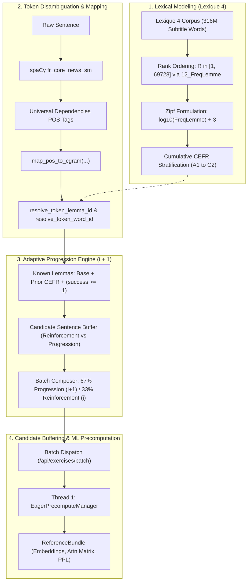
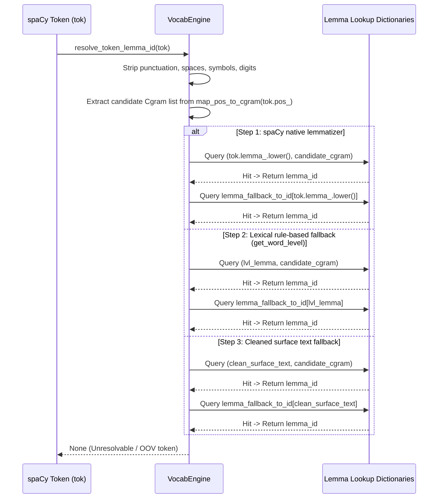
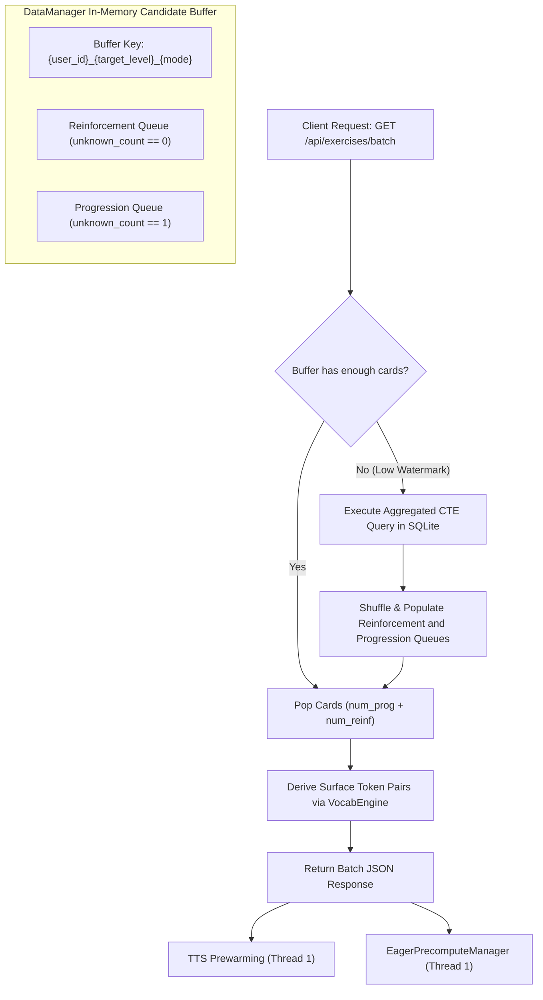
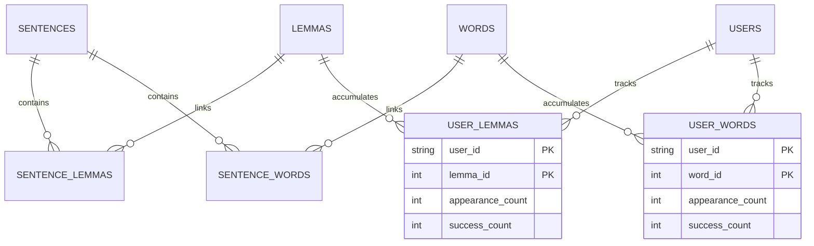
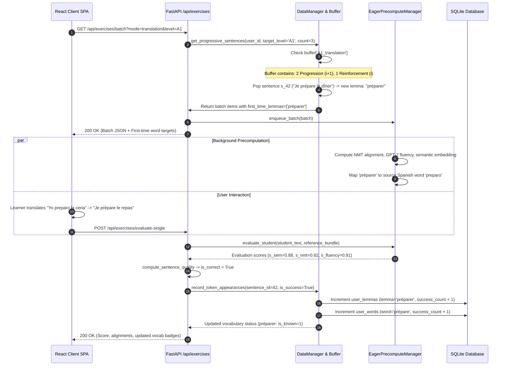

<!-- Navigation Header -->
[← 03 NLP & Scoring Pipeline](file:///home/eyenga/Disk2/Projects/FrenchTutor/docs/03_nlp_and_scoring_pipeline.md) | [Documentation Index](file:///home/eyenga/Disk2/Projects/FrenchTutor/docs/README.md) | [05 Ingestion & Corpus Mining →](file:///home/eyenga/Disk2/Projects/FrenchTutor/docs/05_ingestion_and_mining.md)

---

# Chapter 4: Vocabulary Modeling, CEFR Progression & Candidate Buffering

This chapter details the mathematical foundations, linguistic algorithms, and engineering architecture governing vocabulary acquisition, lexical CEFR assignment, and dynamic exercise generation in **FrenchTutor**.

FrenchTutor abandons arbitrary word categorization in favor of an **empirically grounded psycholinguistic model** derived from corpus frequency, paired with Stephen Krashen’s **$i+1$ Comprehensible Input hypothesis** implemented computationally over a two-tier relational lexical graph.



---

## 1. Theoretical Grounding & Mathematical Model of Lexical CEFR Assignment

### 1.1 Empirical Lexical Profiling vs. Arbitrary CEFR Tags
The Common European Framework of Reference for Languages (CEFR) standardizes functional and communicative competencies (e.g., "can understand simple everyday phrases"), but **does not publish official vocabulary quotas or standardized wordlists**. 

Educational frameworks that manually assign static CEFR labels to words suffer from subjectivity, inconsistencies, and dialectal bias. To achieve objective, reproducible grading, FrenchTutor adopts empirical applied linguistics benchmarks (Milton & Alexiou 2009, Nation 2001, Laufer 2010), which establish that foreign language proficiency correlates directly with cumulative receptive vocabulary breadth sorted by natural corpus frequency.

FrenchTutor models lexical difficulty directly from **Lexique 4** (`data/lexique/Lexique4/Lexique4.tsv`), an authoritative French lexical resource spanning a 316-million-word film and television subtitle corpus reflecting modern spoken French.

### 1.2 Mathematical Formulation: Frequency Rank and the Zipf Score
All unique `(lemma, pos)` pairs in Lexique 4 are ordered strictly descending by their corpus lemma frequency (`12_FreqLemme`, occurrences per million words):

$$R \in [1, N], \quad \text{where } N = 69{,}728$$

To model human linguistic perception across exponential scales, we calculate the logarithmic **Zipf frequency score**:

$$\text{Zipf} = \log_{10}(\text{FreqLemme}) + 3$$

> [!NOTE]
> The $+3$ offset normalizes occurrences per million ($10^6$) into occurrences per billion ($10^9$) words. A Zipf score of $6.0$ corresponds to 1,000 occurrences per million words, while a Zipf score of $1.0$ indicates 0.001 occurrences per million (1 per billion).

While the continuous Zipf score and raw frequencies are calculated and preserved in [`lemmas.metadata`](file:///home/eyenga/Disk2/Projects/FrenchTutor/backend/db/connection.py#L48-L62) for analytical diagnostics, CEFR level classification is governed strictly by the **cumulative rank index $R$**.

### 1.3 Cumulative Rank Thresholds & CEFR Stratification Table

The lexical cutoffs reflect natural vocabulary acquisition plateaus from foundational conversational fluency to advanced academic literacy:

| CEFR Level | Lemma Rank Range ($R$) | Frequency Threshold (`12_FreqLemme`) | Zipf Score Range | Cumulative Size | Pedagogical Scope & Prototypical Examples |
| :---: | :---: | :---: | :---: | :---: | :--- |
| **A1** | **$1 \le R \le 800$** | $\ge 95.0$ / M | $\text{Zipf} \ge 4.98$ | 800 lemmas | **Foundational survival lexicon:** Function words, high-frequency verbs, everyday nouns (*être, avoir, maison, ami, regarder, manger*). |
| **A2** | **$801 \le R \le 1{,}800$** | $32.0 \le F < 95.0$ | $4.51 \le \text{Zipf} < 4.98$ | 1,800 lemmas | **Routine daily interaction:** Routine conversational terms, basic travel, home, and environment (*chambre, rapide, préparer, village, fête*). |
| **B1** | **$1{,}801 \le R \le 3{,}500$** | $12.5 \le F < 32.0$ | $4.10 \le \text{Zipf} < 4.51$ | 3,500 lemmas | **Independent threshold:** Expressing opinions, professional routines, abstract feelings (*secteur, refuser, menace, bilan, prudent*). |
| **B2** | **$3{,}501 \le R \le 6{,}500$** | $4.5 \le F < 12.5$ | $3.65 \le \text{Zipf} < 4.10$ | 6,500 lemmas | **Advanced contextual literacy:** Complex argumentation, socio-political discourse, idioms (*privilégier, incursion, contestation, angoisse*). |
| **C1** | **$6{,}501 \le R \le 12{,}000$** | $1.4 \le F < 4.5$ | $3.15 \le \text{Zipf} < 3.65$ | 12,000 lemmas | **Autonomous academic & literary discourse:** Nuanced synonyms, specialized terminology (*austère, prépondérant, amarrer, caduc*). |
| **C2** | **$R > 12{,}000$** | $< 1.4$ / M | $\text{Zipf} < 3.15$ | 69,728 lemmas | **Mastery & rare lexicon:** Low-frequency literary terms, archaic expressions, domain-specific jargon (*thaumaturge, palinodie, obsolescence*). |

---

## 2. Context-Aware POS Mapping & Token Resolution Fallbacks

### 2.1 Bridging Universal Dependencies and Lexique 4 Grammatical Categories
Because sentences are tokenized and tagged at runtime using spaCy's `fr_core_news_sm` (conforming to the Universal Dependencies POS standard), but Lexique 4 organizes lexical entries using specialized French grammatical categories (`Cgram`), FrenchTutor defines a deterministic category bridging matrix in [`backend/nlp/vocab_engine.py`](file:///home/eyenga/Disk2/Projects/FrenchTutor/backend/nlp/vocab_engine.py#L21-L35).

| spaCy UD POS Tag (`tok.pos_`) | Lexique 4 `Cgram` Candidates | Linguistic Category | Examples |
| :--- | :--- | :--- | :--- |
| `VERB` | `VER`, `AUX` | Verb / Auxiliary | *manger, courir, finir, vouloir* |
| `AUX` | `AUX`, `VER` | Auxiliary / Verb | *suis, ont, était, sera* |
| `NOUN` | `NOM` | Common Noun | *chat, maison, livre, projet* |
| `PROPN` | `NOM` | Proper Noun | *Paris, Marie, France* |
| `ADJ` | `ADJ`, `ADJ:dem`, `ADJ:ind`, `ADJ:int`, `ADJ:num`, `ADJ:pos` | Adjective (Descriptive & Determiner-like) | *grand, petit, premier, certain* |
| `ADV` | `ADV` | Adverb | *rapidement, bien, très, souvent* |
| `ADP` | `PRE` | Preposition | *à, de, dans, pour, avec, sans* |
| `CCONJ` | `CON` | Coordinating Conjunction | *et, ou, mais, car, donc* |
| `SCONJ` | `CON` | Subordinating Conjunction | *si, que, comme, quand, lorsque* |
| `PRON` | `PRO:per`, `PRO:dem`, `PRO:ind`, `PRO:pos`, `PRO:rel`, `PRO:int`, `PRO` | Pronouns (Personal, Relative, Demonstrative) | *il, elle, qui, que, ce, celui, m', lui* |
| `DET` | `ART:def`, `ART:ind`, `ADJ:pos`, `ADJ:dem`, `ADJ:ind`, `ART` | Determiners & Articles | *le, la, un, mon, ce, chaque* |
| `INTJ` | `ONO`, `ADV`, `NOM` | Interjections & Onomatopoeia | *oh, hé, pardon, merci* |
| `NUM` | `ADJ:num`, `NOM` | Cardinal / Ordinal Numbers | *deux, trois, million* |

### 2.2 Token-to-Lemma Resolution Heuristics (`resolve_token_lemma_id`)
Resolving a token in running text to a canonical lemma ID requires handling contractions, elisions (*j'*, *l'*, *d'*), and irregular verb conjugations. Implemented in [`VocabEngine.resolve_token_lemma_id(...)`](file:///home/eyenga/Disk2/Projects/FrenchTutor/backend/nlp/vocab_engine.py#L337-L404), the resolution executes a 3-tier cascade:



1. **Step 1 (Native spaCy Lemmatization)**:
   - Evaluates `tok.lemma_` with elisions stripped (*j'ai* $\to$ *je*, *l'arbre* $\to$ *arbre*, *qu'il* $\to$ *que*).
   - Searches `(lemma, cgram)` in `lemma_pos_to_id`.
   - If not found, attempts `lemma_fallback_to_id[lemma]` ignoring POS.
2. **Step 2 (Lexical Diagnostics)**:
   - Evaluates candidates generated by `VocabEngine.get_word_level(tok)` which checks foundational sets (`A1_WORDS`) and irregular overrides.
3. **Step 3 (Surface Text Fallback)**:
   - Attempts resolution directly on normalized surface tokens (`clean_text.rstrip("'’")`).
   - Returns `None` if token cannot be matched against any registered lemma in the database.

### 2.3 Token-to-Word Resolution Heuristics (`resolve_token_word_id`)
Implemented in [`VocabEngine.resolve_token_word_id(...)`](file:///home/eyenga/Disk2/Projects/FrenchTutor/backend/nlp/vocab_engine.py#L406-L448), surface words are resolved by checking both exact surface forms and de-elided prefixes:

- Strips contraction prefixes matching `^(qu['’]|jusqu['’]|lorsqu['’]|puisqu['’]|[ldjcmnstLDJCMNST]['’])`.
- Evaluates candidate pairs in `word_pos_to_id[(surface_word, cgram)]`.
- Falls back to `word_fallback_to_id[surface_word]`.

---

## 3. Adaptive CEFR Progression Engine

### 3.1 The Computational $i+1$ Comprehensible Input Hypothesis
In Second Language Acquisition (SLA) theory, Stephen Krashen posits that learners acquire language most efficiently when exposed to messages containing structures just beyond their current competence ($i+1$). If an exercise contains too many unknown words ($i+3$, $i+5$), cognitive overload halts acquisition. Conversely, if it contains zero new elements ($i+0$), no vocabulary growth occurs.

FrenchTutor formalizes this computationally:
- **Learner State ($i$)**: The set of lemmas marked as `is_known` for a given user.
- **Progression Sentences ($i+1$)**: Sentences that contain **exactly 1 unknown lemma** ($\text{unknown\_count} = 1$). All other words in the sentence must belong to the learner's known set.
- **Reinforcement Sentences ($i+0$)**: Sentences where all lemmas are known ($\text{unknown\_count} = 0$), prioritizing lemmas where the learner has low historical accuracy or needs consolidation.

```
┌────────────────────────────────────────────────────────────────────────┐
│                   Batch Composition Architecture                       │
│                                                                        │
│   ┌────────────────────────────────┐  ┌────────────────────────────┐   │
│   │     Progression Cards (67%)    │  │  Reinforcement Cards (33%) │   │
│   │                                │  │                            │   │
│   │  • unknown_count == 1          │  │  • unknown_count == 0      │   │
│   │  • Exactly one new lemma (i+1) │  │  • Consolidating mastered  │   │
│   │  • 100% of surrounding context │  │    lemmas (i+0)            │   │
│   │    is fully familiar           │  │  • Zero unknown tokens     │   │
│   └────────────────────────────────┘  └────────────────────────────┘   │
└────────────────────────────────────────────────────────────────────────┘
```

### 3.2 Definition of "Known Lemma"
A lemma is classified as known for a user if it satisfies **any** of the following three criteria in [`get_user_known_lemma_ids(...)`](file:///home/eyenga/Disk2/Projects/FrenchTutor/backend/db/vocabulary.py#L205-L244):

1. **Foundational Base Word**: `lemmas.is_base = 1`. Includes function words (`DET`, `PRON`, `ADP`, `CCONJ`, `SCONJ`, `AUX`) and essential survival vocabulary defined in [`DEFAULT_UNLOCKED_WORDS`](file:///home/eyenga/Disk2/Projects/FrenchTutor/backend/config.py#L27-L36).
2. **Prior CEFR Level Mastery**: The lemma belongs to a CEFR level strictly lower than the learner's current active level. For example, a learner at `B1` automatically knows all `A1` and `A2` lemmas.
3. **Empirical Acquisition**: The learner has successfully answered exercises containing this lemma at least `VOCABULARY_UNLOCK_THRESHOLD` times (`success_count >= 1`) in `user_lemmas`.

### 3.3 Dynamic Batch Balancing
When generating an exercise batch via [`DataManager.get_progressive_sentences(...)`](file:///home/eyenga/Disk2/Projects/FrenchTutor/backend/db/vocabulary.py#L432-L656), the system splits the requested card count (default: 3 cards per batch):

- **Translation Mode**:
  $$\text{num\_progression} = \max\left(1, \operatorname{round}(\text{count} \times 0.67)\right)$$
  $$\text{num\_reinforcement} = \text{count} - \text{num\_progression}$$
  *For a standard 3-card batch: 2 Progression cards ($i+1$) and 1 Reinforcement card ($i+0$).*
- **Transcription Mode**:
  $$\text{max\_unknown} = 0, \quad \text{num\_progression} = 0, \quad \text{num\_reinforcement} = \text{count}$$
  *Transcription strictly tests listening comprehension on 100% familiar vocabulary.*

### 3.4 User Level Updates & Streak Transitions
Learner advancement is tracked in `user_modes` and evaluated at the end of each batch by [`ScoringEngine.calculate_score_adjustment(...)`](file:///home/eyenga/Disk2/Projects/FrenchTutor/backend/scoring/engine.py#L299-L424):

- **Batch Accuracy Calculation**:
  $$\text{Accuracy Rate} = \frac{\sum \text{is\_correct}}{\text{total\_cards}}$$
- **Streak Transition Rules**:
  - If $\text{Accuracy Rate} \ge 0.66$: `streak = streak + 1`.
  - If $\text{Accuracy Rate} < 0.33$: `streak = 0`.
- **Level Reset & Vocabulary Pruning**:
  When a user changes or resets their CEFR level via [`DataManager.unlock_user_vocabulary_for_level(...)`](file:///home/eyenga/Disk2/Projects/FrenchTutor/backend/db/vocabulary.py#L321-L344), all unpracticed vocabulary (`appearance_count = 0` and `success_count = 0`) at or above the target level is pruned from `user_lemmas`.

---

## 4. Candidate Sentence Buffering Architecture

Progressive sentence selection requires evaluating set differences across thousands of relational rows in SQLite. To deliver sub-50ms exercise dispatch without database latency, FrenchTutor implements an **in-memory candidate sentence buffering architecture**.



### 4.1 SQL Pre-aggregation with Common Table Expressions (CTE)
When candidate queues in memory fall below the required count, [`get_progressive_sentences`](file:///home/eyenga/Disk2/Projects/FrenchTutor/backend/db/vocabulary.py#L484-L504) executes an aggregated CTE query that classifies candidate sentences in a single query pass:

```sql
WITH known_lemmas AS (
    -- Foundational base lemmas and prior level lemmas
    SELECT id FROM lemmas WHERE is_base = 1 OR level IN (?, ?)
    UNION
    -- Lemmas mastered through user practice
    SELECT lemma_id FROM user_lemmas WHERE user_id = ? AND success_count >= ?
)
SELECT 
    s.*, 
    GROUP_CONCAT(sl.lemma_id) AS all_lemma_ids,
    SUM(CASE WHEN kl.id IS NULL THEN 1 ELSE 0 END) AS unknown_count,
    GROUP_CONCAT(CASE WHEN kl.id IS NULL THEN sl.lemma_id ELSE NULL END) AS unknown_lemma_ids
FROM sentences s
JOIN sentence_lemmas sl ON s.id = sl.sentence_id
LEFT JOIN known_lemmas kl ON sl.lemma_id = kl.id
WHERE s.level = ?
GROUP BY s.id
HAVING unknown_count <= ?;
```

### 4.2 Candidate Queue Segregation & Replenishment
The result set is parsed and split into two distinct in-memory queues keyed by `f"{user_id}_{target_level}_{mode}"`:
1. **`buffer['progression']`**: Sentences with $\text{unknown\_count} = 1$.
2. **`buffer['reinforcement']`**: Sentences with $\text{unknown\_count} = 0$.

During subsequent requests, sentences are popped directly from memory in $O(1)$ time. If the user excludes specific sentence IDs, they are purged from the buffer without executing full database sweeps.

### 4.3 Eager Background ML Precomputation (`backend/ml/precompute.py`)
Immediately upon dispatching an exercise batch via [`backend/api/exercises.py`](file:///home/eyenga/Disk2/Projects/FrenchTutor/backend/api/exercises.py#L164-L168), the batch is enqueued into the [`EagerPrecomputeManager`](file:///home/eyenga/Disk2/Projects/FrenchTutor/backend/ml/precompute.py#L35-L66).

A dedicated background worker thread executes static forward passes for reference sentences while the user is reading the card:
- **NMT Perplexity & Token Cross-Attention**: Evaluates NLLB-200 on source-reference pairs, generating word tokens and attention alignment matrices.
- **Reference Monolingual Fluency**: Computes French GPT-2 causal language model loss on the reference text.
- **Reference Semantic Embedding**: Pre-encodes the reference sentence into semantic vector space.
- **First-Time Lemma Token Alignment**: Matches target first-time lemmas against surface sentence tokens and maps them to their source Spanish counterparts.

When the student submits their translation, the evaluation worker (Thread 2) reuses the precomputed [`ReferenceBundle`](file:///home/eyenga/Disk2/Projects/FrenchTutor/backend/ml/precompute.py#L16-L33), eliminating redundant forward passes and reducing grading latency from ~1,200ms to <150ms.

---

## 5. Runtime Card Evaluation & Dual Counter Tracking

### 5.1 Dual-Level Relational Persistence
To capture both broad grammatical root competence and granular inflectional familiarity, FrenchTutor maintains independent counters across two tiers in [`backend/db/vocabulary.py`](file:///home/eyenga/Disk2/Projects/FrenchTutor/backend/db/vocabulary.py#L245-L320):

1. **`user_lemmas` (Root Mastery)**:
   - Tracks the canonical dictionary lemma (e.g., `aller`, `grand`, `ami`).
   - Governs CEFR level progression, vocabulary unlocks, and candidate sentence filtering.
2. **`user_words` (Surface Inflection Exposure)**:
   - Tracks exact inflected surface word forms (e.g., `vais`, `allons`, `iraient`, `grande`, `amis`).
   - Powers pedagogical diagnostics and granular learner analytics.



### 5.2 Atomic Increment Mechanics (`record_token_appearances`)
When a student answers or skips a sentence card in `/api/exercises/evaluate-single` or `/api/exercises/evaluate-transcription`, the API invokes [`DataManager.record_token_appearances(...)`](file:///home/eyenga/Disk2/Projects/FrenchTutor/backend/db/vocabulary.py#L245-L320):

```sql
-- 1. Atomic update of canonical root mastery in user_lemmas
INSERT INTO user_lemmas (user_id, lemma_id, level, appearance_count, success_count)
SELECT :user_id, :lemma_id, level, 1, :success_inc FROM lemmas WHERE id = :lemma_id
ON CONFLICT(user_id, lemma_id) DO UPDATE SET
    appearance_count = user_lemmas.appearance_count + 1,
    success_count = user_lemmas.success_count + :success_inc;

-- 2. Atomic update of surface word exposures in user_words
INSERT INTO user_words (user_id, word_id, appearance_count, success_count)
VALUES (:user_id, :word_id, 1, :success_inc)
ON CONFLICT(user_id, word_id) DO UPDATE SET
    appearance_count = user_words.appearance_count + 1,
    success_count = user_words.success_count + :success_inc;
```

- **`is_retry = True` Handling**: If a student is retrying a failed card, counters are **not** incremented again, preventing artificial inflation of exposure metrics.
- **Diagnostic Return Payload**: The function immediately returns the updated list of sentence lemmas along with their refreshed `appearance_count`, `success_count`, and newly calculated `is_known` flags, allowing the frontend to render real-time mastery badges.

---

## 6. Comprehensive Lifecycle Walkthrough

To illustrate the end-to-end orchestration of vocabulary and progression systems, consider an A1 learner encountering a card introducing the A2 lemma *préparer*:



---

<!-- Navigation Footer -->
[← 03 NLP & Scoring Pipeline](file:///home/eyenga/Disk2/Projects/FrenchTutor/docs/03_nlp_and_scoring_pipeline.md) | [Documentation Index](file:///home/eyenga/Disk2/Projects/FrenchTutor/docs/README.md) | [05 Ingestion & Corpus Mining →](file:///home/eyenga/Disk2/Projects/FrenchTutor/docs/05_ingestion_and_mining.md)
