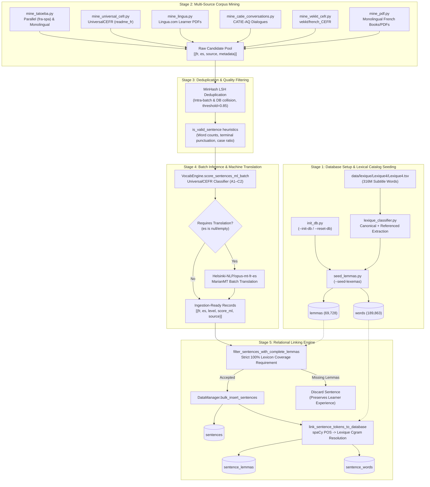
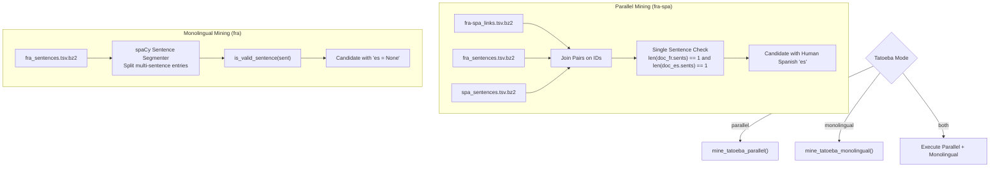
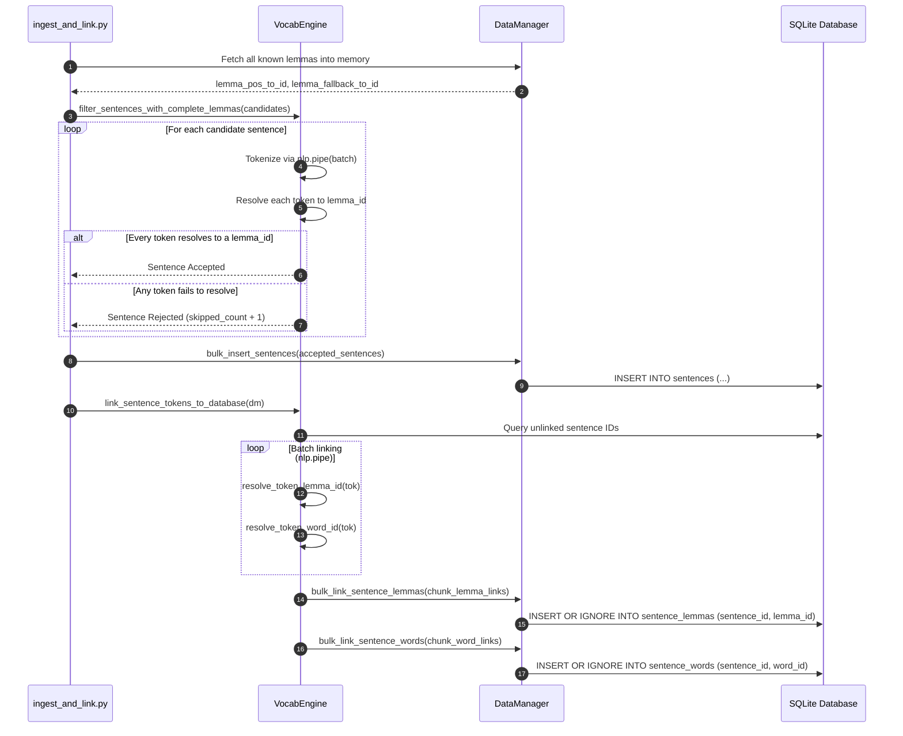

<!-- Navigation Header -->
[← 04 Vocabulary Modeling & Progression](file:///home/eyenga/Disk2/Projects/FrenchTutor/docs/04_vocabulary_and_progression.md) | [Documentation Index](file:///home/eyenga/Disk2/Projects/FrenchTutor/docs/README.md) | [06 Deployment & Operations →](file:///home/eyenga/Disk2/Projects/FrenchTutor/docs/06_deployment_and_operations.md)

---

# Chapter 5: Ingestion Pipeline, Lexique 4 Seeding & Corpus Mining

This chapter provides an exhaustive architectural and practical guide to the data ingestion, lexical seeding, corpus mining, and relational linking subsystems of **FrenchTutor**.

The ingestion system transforms raw, heterogenous text collections—spanning bilingual subtitle dumps, HuggingFace CEFR corpora, pedagogical PDFs, and dialogue transcripts—into clean, pedagogically viable sentence pairs. These sentences are rigorously validated, deduplicated, scored via neural classification, and relationally indexed into the two-tier lexical database (`lemmas`, `words`, `sentence_lemmas`, and `sentence_words`).

---

## 1. High-Level Ingestion Pipeline Architecture

The ingestion pipeline is driven by a unified Command-Line Interface (CLI) implemented in [`backend/ingestion/orchestrator.py`](file:///home/eyenga/Disk2/Projects/FrenchTutor/backend/ingestion/orchestrator.py). The architecture follows a strict staged pipeline design:



### Pipeline Execution Lifecycle
1. **Catalog Initialization**: The SQLite database schema is initialized or wiped fresh (`init_db.py`). The Lexique 4 lexical repository is parsed, classified, and seeded into `lemmas` and `words` (`seed_lemmas.py`).
2. **Corpus Harvesting**: Mining modules extract raw candidate French sentences and optional Spanish translations from diverse public sources. Multi-sentence turns are segmented into standalone sentences using spaCy.
3. **Deduplication & Sanitization**: Candidates are sanitized using orthographic heuristics (`is_valid_sentence`) and deduplicated against existing database sentences and within the incoming batch using MinHash Locality-Sensitive Hashing (LSH).
4. **Batch Scoring & Translation**: Neural CEFR classifier scores the sentences in batches (`VocabEngine.score_sentences_ml_batch`). Candidates lacking reference translations are selectively translated to Spanish using `Helsinki-NLP/opus-mt-fr-es` (`MarianMT`).
5. **Coverage Filtering & Junction Linking**: Every candidate sentence is checked against `lemmas`. If even a single word lacks a corresponding lemma entry, the sentence is rejected. Accepted sentences are inserted into `sentences`, and their tokens are resolved to `sentence_lemmas` and `sentence_words`.

---

## 2. Lexique 4 Parsing & Database Seeding

The FrenchTutor pedagogical architecture requires a complete catalog of base lemmas and inflected surface words. Parsing and classification logic resides in [`backend/ingestion/pipeline/lexique_classifier.py`](file:///home/eyenga/Disk2/Projects/FrenchTutor/backend/ingestion/pipeline/lexique_classifier.py) and is executed by [`backend/ingestion/pipeline/seed_lemmas.py`](file:///home/eyenga/Disk2/Projects/FrenchTutor/backend/ingestion/pipeline/seed_lemmas.py).

### 2.1 Extraction Rules in `lexique_classifier.py`
The source file `data/lexique/Lexique4/Lexique4.tsv` contains 189,863 rows representing inflected word occurrences in French cinema and television subtitles (a 316-million-word corpus).

#### Canonical Lemma Extraction (`14_IsLem == '1'`)
- Rows where column `14_IsLem == '1'` (~65,650 rows) define canonical dictionary headwords where `1_Mot == 4_Lemme`.
- The parser extracts `lemma = 4_Lemme.lower().strip()`, `pos = 5_Cgram.upper().strip()`, and `frequency = float(12_FreqLemme)`.

#### Referenced-Only Lemma Resolution
- Lexique 4 contains approximately 3,696 `(4_Lemme, 5_Cgram)` pairs that appear **strictly** within inflected rows without a corresponding `14_IsLem == '1'` row. For example, the adjective *applicative* [ADJ] appears in inflected form, but the masculine base headword *applicatif* does not possess an explicit `IsLem == 1` record.
- **Referential Integrity Guarantee**: To ensure that every inflected surface form has a valid foreign key target in `lemmas`, `lexique_classifier.py` tracks all referenced `(4_Lemme, 5_Cgram)` pairs in `non_islem_lemmas`. If a referenced pair never appears with `IsLem == 1`, it is synthesized into `lemmas` using the maximum observed `12_FreqLemme` frequency.
- This produces exactly **69,728 unique canonical lemmas**.

#### Surface Word Extraction
- Every row of the 189,863 entries is processed to create a surface form record:
  - `word`: `1_Mot.lower().strip()`
  - `lemma`: `4_Lemme.lower().strip()`
  - `pos`: `5_Cgram.upper().strip()`
  - `frequency`: `float(10_FreqMot)`
- **Deduplication**: When identical tuples `(word, lemma, pos)` appear across multiple rows in Lexique 4, the record with the highest surface frequency (`10_FreqMot`) is retained, yielding exactly **189,863 words**.

### 2.2 Mathematical Rank and CEFR Classification
During parsing, all 69,728 lemmas are sorted descending by `frequency` (`12_FreqLemme`), with stable alphabetical tie-breaking:

```python
sorted_lemmas = sorted(
    combined_lemmas.items(),
    key=lambda item: (-item[1], item[0][0], item[0][1])
)
```

Each lemma receives a 1-based rank $R \in [1, 69728]$ mapped to a CEFR level:

$$\text{Zipf} = \log_{10}(\text{FreqLemme}) + 3.0$$

| CEFR Level | Lemma Rank Range ($R$) | Frequency Threshold (`12_FreqLemme`) | Zipf Score | Foundational Base Set |
| :---: | :---: | :---: | :---: | :--- |
| **A1** | $1 \le R \le 800$ | $\ge 95.0$ / M | $\ge 4.98$ | Overridden if in `CORE_A1_LEMMAS` (`is_base = 1`) |
| **A2** | $801 \le R \le 1,800$ | $32.0 \le F < 95.0$ | $4.51 \le \text{Zipf} < 4.98$ | Standard conversational vocabulary |
| **B1** | $1,801 \le R \le 3,500$ | $12.5 \le F < 32.0$ | $4.10 \le \text{Zipf} < 4.51$ | Intermediate independent terms |
| **B2** | $3,501 \le R \le 6,500$ | $4.5 \le F < 12.5$ | $3.65 \le \text{Zipf} < 4.10$ | Advanced & abstract terms |
| **C1** | $6,501 \le R \le 12,000$ | $1.4 \le F < 4.5$ | $3.15 \le \text{Zipf} < 3.65$ | Specialized / literary terms |
| **C2** | $R > 12,000$ | $< 1.4$ / M | $< 3.15$ | Rare, archaic, or domain jargon |

> [!NOTE]
> The boolean flag `is_base` identifies core functional vocabulary (pronouns, basic conjunctions, auxiliary verbs like *être*, *avoir*, *aller*) defined in `CORE_A1_LEMMAS`. These words are automatically unlocked for new users regardless of their initial proficiency level.

### 2.3 Database Seeding Workflows

The seeding operations can be executed via standalone scripts or through the unified orchestrator:

```bash
# Workflow A: Manual Step-by-Step Seeding
uv run python -m backend.ingestion.pipeline.init_db --reset
uv run python -m backend.ingestion.pipeline.seed_lemmas

# Workflow B: Orchestrator Pipeline
uv run python -m backend.ingestion.orchestrator --reset-db --seed-lexemas
```

#### Insertion Logic in `seed_lemmas.py`:
1. **Schema Check**: Creates `lemmas` and `words` tables and their indices if they do not exist.
2. **Lemmas Insertion**: Inserts all 69,728 lemma tuples using `INSERT OR IGNORE INTO lemmas`.
3. **Surrogate Key Resolution**: Executes `SELECT id, lemma, pos FROM lemmas` into a memory mapping `(lemma, pos) -> id`.
4. **Words Linking**: Maps each surface word's parent `(lemma, pos)` to its foreign key `lemma_id` and executes bulk insertion into `words`.
5. **Legacy Compatibility**: Populates the legacy `lexemas` table if present to maintain backward compatibility with previous test suites.

---

## 3. Corpus Mining Subsystems

The mining layer extracts natural, colloquial, and pedagogical sentences from diverse sources. Mining submodules output standardized dictionaries in the following format:

```python
{
    "fr": str,                  # Clean French sentence
    "es": Optional[str],        # Human Spanish translation (or None if unavailable)
    "source": str,              # Identifier tag (e.g., 'tatoeba_parallel', 'hf_universal_cefr')
    "metadata": Dict[str, Any]  # Source-specific metadata (title, chapter, dataset split)
}
```

### 3.1 Tatoeba Corpus Mining ([`mine_tatoeba.py`](file:///home/eyenga/Disk2/Projects/FrenchTutor/backend/ingestion/pipeline/mine_tatoeba.py))
The Tatoeba dataset provides crowdsourced, community-reviewed sentences. The module supports three operational modes:

```bash
uv run python -m backend.ingestion.pipeline.mine_tatoeba both
```



#### Key Implementation Details:
- **Parallel Mode**: Pairs French and Spanish lines via Tatoeba links. Crucially, multi-sentence pairs or mismatched sentence counts are **strictly discarded** (`len(sents_fr) != 1 or len(sents_es) != 1`) to eliminate alignment errors and clause truncations.
- **Monolingual Mode**: Streams `fra_sentences.tsv.bz2`, segments multi-sentence entries using spaCy (`doc.sents`), cleans each sentence, and marks `es = None`.
- **Automatic Ingestion Download**: Automatically downloads compressed exports from `downloads.tatoeba.org` if local files are absent.

### 3.2 HuggingFace UniversalCEFR Mining ([`mine_universal_cefr.py`](file:///home/eyenga/Disk2/Projects/FrenchTutor/backend/ingestion/pipeline/mine_universal_cefr.py))
UniversalCEFR (`UniversalCEFR/readme_fr`) provides sentences labeled with CEFR readability metadata.
- **Extraction**: Streams and concatenates all splits (`train`, `validation`, `test`).
- **Processing**: Cleans quotes and dialogue artifacts using `format_sentence` and validates sentence boundaries.
- **Output**: Yields candidate records tagged with `source = 'hf_universal_cefr'`.

### 3.3 Lingua.com Pedagogical PDF Mining ([`mine_lingua.py`](file:///home/eyenga/Disk2/Projects/FrenchTutor/backend/ingestion/pipeline/mine_lingua.py))
Mines graded reading comprehension texts from Lingua.com.
- **Catalog Web Scraping**: Fetches `https://lingua.com/french/reading/`, parsing HTML headings for level markers (`Level A1`, `Level A2`, `Level B1`, `Level B2`) and direct `.pdf` download links.
- **PDF Extraction**: Downloads and caches PDFs in `data/books/lingua/`. Extracts text via PyMuPDF (`pymupdf`), truncating the extraction when reaching the comprehension questions section (`stop_phrase="Questions de compréhension:"`).
- **Hyphen Repair**: Fixes end-of-line hyphenation splits (`re.sub(r'-\n\s*', '', full_text)`).

### 3.4 CATIE-AQ Everyday Conversations ([`mine_catie_conversations.py`](file:///home/eyenga/Disk2/Projects/FrenchTutor/backend/ingestion/pipeline/mine_catie_conversations.py))
Captures modern conversational spoken French from `CATIE-AQ/everyday-conversations-llama3.1-2k-in-french`.
- **Dialogue Unpacking**: Iterates through multi-turn conversational message threads.
- **Boilerplate & Greeting Filtering**: Discards generic automated greetings (*"Bonjour !", "Comment puis-je vous aider aujourd'hui ?"*) and Imperial measurement units (*onces, miles, gallons*).
- **Segmentation**: Splits conversational turns into discrete sentences using spaCy sentence segmentation, yielding natural conversational French candidates (`source = 'hf_catie_conversations'`).

### 3.5 Vekkt CEFR Dataset Mining ([`mine_vekkt_cefr.py`](file:///home/eyenga/Disk2/Projects/FrenchTutor/backend/ingestion/pipeline/mine_vekkt_cefr.py))
Extracts sentences from `vekkt/french_CEFR` across levels A1 through C2.
- **Split Selection**: Restricts extraction to `train` and `validation` splits (omitting unlabelled test data).
- **Deduplication**: Validates string cleanliness and enforces batch uniqueness (`source = 'hf_vekkt_cefr'`).

### 3.6 Monolingual PDF Extraction ([`mine_pdf.py`](file:///home/eyenga/Disk2/Projects/FrenchTutor/backend/ingestion/pipeline/mine_pdf.py))
A general-purpose miner for arbitrary French books, literature, or articles supplied as PDF files.
- Uses `pymupdf` to stream text page-by-page.
- Rejoins broken word wraps across page breaks.
- Segments text into candidate sentences via `extract_sentences_from_pdf` and prepares them for neural translation.

---

## 4. Ingestion & Relational Linking Engine

The core ingestion engine in [`backend/ingestion/pipeline/ingest_and_link.py`](file:///home/eyenga/Disk2/Projects/FrenchTutor/backend/ingestion/pipeline/ingest_and_link.py) and [`backend/ingestion/pipeline/common.py`](file:///home/eyenga/Disk2/Projects/FrenchTutor/backend/ingestion/pipeline/common.py) ensures that no ill-formed, duplicate, or un-parsable sentences enter the database.

### 4.1 Sentence Normalization & Quality Heuristics (`is_valid_sentence`)
Every sentence passes through strict regular expression and structural heuristics before processing:

```python
def is_valid_sentence(text: str, min_words: int = 3, max_words: int = 40) -> bool:
```

1. **Word Count Bounds**: Enforces $3 \le \text{word count} \le 40$ to avoid single-word fragments or overly complex run-on clauses.
2. **No Numbers**: Sentences containing digits (`\d`) are dropped to avoid date/numeric parsing inconsistencies in exercise evaluation.
3. **Punctuation Formatting**: Trailing quotes and symbols (`« », < >, “ ”`) are stripped. French typographical spacing before double punctuation (`? ! : ;`) is standardized via `format_sentence`.
4. **Dialogue & Spaced Dashes**: Sentences with spaced hyphens or em-dashes (`\s[-—–]\s`) or repetitive punctuation (`.{4,}`, `_{4,}`) are rejected.
5. **Capitalization Integrity**: The first alphabetic character must be uppercase. Sentences where $> 50\%$ of letters are capitalized (all-caps shouting) are rejected.
6. **Terminal Punctuation**: The sentence must terminate with valid sentence-ending punctuation (`[.!?…]`).
7. **Character Whitelist**: Discards strings containing illegal symbols, non-standard math characters, or foreign alphabets outside French diacritics (`áàâäéèêëíìîïóòôöúùûüçœæ`).

### 4.2 MinHash LSH Deduplication
To avoid inserting near-duplicate sentences across overlapping corpora, FrenchTutor employs Locality-Sensitive Hashing (LSH) on MinHash signatures of lemmatized sentences:

```python
def deduplicate_candidate_records(
    candidates: List[Dict[str, Any]],
    threshold: float = 0.85,
    num_perm: int = 128
) -> List[Dict[str, Any]]:
```

- **Signature Creation**: For each sentence, spaCy extracts all non-punctuation lemma tokens to populate a 128-permutation MinHash signature (`get_lemma_minhash`).
- **Database Collision Check**: Existing sentences in `sentences.fr` are indexed into a `MinHashLSH` index. Candidates matching an existing sentence with Jaccard similarity $\ge 0.85$ are immediately dropped.
- **Intra-Batch Collision Check**: Candidates are checked against previously accepted items in the current mining run.
- **Translation Preference**: If two duplicate candidates collide within a batch, the record that already possesses a human Spanish translation (`es`) is prioritized over the untranslated candidate.

### 4.3 Selective Batch Translation (MarianMT)
Sentences mined from monolingual sources (`es is None`) undergo selective machine translation:
- **Model**: `Helsinki-NLP/opus-mt-fr-es` running on CUDA (or CPU fallback).
- Sentences with pre-existing translations (e.g., Tatoeba parallel pairs) bypass the NMT stage entirely, conserving GPU resources.

```python
# From backend/ingestion/pipeline/common.py
if missing_fr:
    translated_texts = translate_batch(missing_fr, batch_size=16)
```

### 4.4 Strict Relational Linking Engine

Ingestion enforces a **zero-unknown-lemma invariant**: every accepted sentence must be 100% resolvable against the `lemmas` table.



#### Token Resolution Rules:
1. **Elision & Contraction Stripping**: French contractions (*l', d', j', qu', s', jusqu', lorsqu'*) are decoupled. spaCy's native lemmatizer resolves *j'* to *je*, *l'* to *le*, and *d'* to *de*.
2. **spaCy POS to Lexique Cgram Mapping**: POS tags are mapped through `SPACY_TO_LEXIQUE_CGRAM` (e.g., `VERB` $\to$ `['VER', 'AUX']`, `NOUN` $\to$ `['NOM']`, `PRON` $\to$ `['PRO:per', 'PRO:dem', ...]`).
3. **Multi-Stage Lemma Resolution** (`resolve_token_lemma_id`):
   - **Step 1**: Match `(spacy_lemma, cgram)` in `lemma_pos_to_id`.
   - **Step 2**: Match `spacy_lemma` in `lemma_fallback_to_id`.
   - **Step 3**: Match `(token_text, cgram)` in `lemma_pos_to_id`.
   - **Step 4**: Match `token_text` in `lemma_fallback_to_id`.
4. **Surface Word Resolution** (`resolve_token_word_id`):
   - Matches `(clean_token_text, cgram)` in `word_pos_to_id`.
   - Matches de-elided prefixes (e.g., *l'arbre* $\to$ *arbre*).
   - Falls back to `word_fallback_to_id[clean_token_text]`.

---

## 5. Offline Dataset Rescoring

As sequence classification models and CEFR definitions improve, the existing database can be rescored without altering sentence IDs, relational links, or user progress. Rescoring is handled by [`backend/ingestion/rescore_dataset.py`](file:///home/eyenga/Disk2/Projects/FrenchTutor/backend/ingestion/rescore_dataset.py).

### Rescoring Procedure
1. Retrieves all sentences from SQLite: `dm.get_all_sentences()`.
2. Computes CEFR predictions in GPU batches via `VocabEngine.score_sentences_ml_batch(fr_texts, batch_size=64)`.
3. Compares new continuous scores and discrete levels (`A1`–`C2`) against current values.
4. Executes atomic updates:
   ```sql
   UPDATE sentences SET level = ?, score_ml = ? WHERE id = ?;
   ```
5. Synchronizes and overwrites the JSON backup catalog at `data/sentences.json`.

```bash
uv run python -m backend.ingestion.rescore_dataset
```

---

## 6. Complete CLI Command Reference

The ingestion orchestrator (`backend/ingestion/orchestrator.py`) provides unified control over all ingestion workflows.

### 6.1 CLI Arguments Table

| Flag | Type | Default | Description |
| :--- | :--- | :--- | :--- |
| `--all` | Flag | `False` | Executes full pipeline: init DB $\to$ seed lexemas $\to$ mine Tatoeba $\to$ ingest & link. |
| `--init-db` | Flag | `False` | Initializes table schemas if they do not already exist. |
| `--reset-db` | Flag | `False` | Deletes existing `frenchtutor.db` before initializing schemas. |
| `--clear-db` | Flag | `False` | Purges all records from `sentences`, `sentence_lemmas`, and `sentence_words`. |
| `--seed-lexemas`<br>`--seed-lemmas` | Flag | `False` | Downloads Lexique 4, computes Zipf ranks, and seeds `lemmas` and `words`. |
| `--mine-tatoeba` | Flag | `False` | Mines candidate sentences from the Tatoeba corpus. |
| `--tatoeba-mode` | Choice | `both` | Mining mode: `parallel` (fra-spa), `monolingual` (fra), or `both`. |
| `--tatoeba-limit` | Integer | `None` | Caps maximum number of candidate sentences harvested from Tatoeba. |
| `--mine-universal-cefr`| Flag | `False` | Mines HuggingFace `UniversalCEFR/readme_fr` dataset. |
| `--universal-cefr-limit` | Integer | `None` | Caps candidate sentences mined from UniversalCEFR. |
| `--mine-lingua` | Flag | `False` | Downloads and parses graded reading PDFs from Lingua.com. |
| `--lingua-limit` | Integer | `None` | Caps number of Lingua reading PDFs to download. |
| `--mine-vekkt` | Flag | `False` | Mines sentences from `vekkt/french_CEFR` on HuggingFace. |
| `--vekkt-limit` | Integer | `None` | Caps candidate sentences mined from vekkt/french_CEFR. |
| `--mine-conversations` | Flag | `False` | Mines spoken dialogue sentences from CATIE-AQ conversations. |
| `--conversations-limit` | Integer | `None` | Caps sentences extracted from CATIE-AQ conversations. |
| `--mine-pdf` | String | `None` | Path to a local French PDF to extract and translate. |
| `--ingest` | Flag | `False` | Runs deduplication, neural scoring, translation, and relational DB linking. |

---

### 6.2 Common Developer Recipes

#### Recipe 1: Clean Reset & Lexique 4 Seeding
Wipe the SQLite database clean, establish the 9-table relational schema, and seed the complete 69,728 lemma catalog and 189,863 word entries:
```bash
uv run python -m backend.ingestion.orchestrator --reset-db --seed-lexemas
```

#### Recipe 2: Mine and Ingest Parallel Tatoeba Sentences
Harvest 5,000 verified human French-Spanish bilingual pairs from Tatoeba, deduplicate against the database, score CEFR levels, and link to lexical tables:
```bash
uv run python -m backend.ingestion.orchestrator \
  --mine-tatoeba \
  --tatoeba-mode parallel \
  --tatoeba-limit 5000 \
  --ingest
```

#### Recipe 3: Mine Conversational Spoken French
Ingest spoken turns from the CATIE-AQ conversation dataset with automatic MarianMT Spanish translation:
```bash
uv run python -m backend.ingestion.orchestrator \
  --mine-conversations \
  --conversations-limit 3000 \
  --ingest
```

#### Recipe 4: Ingest a Custom Monolingual French PDF Book
Extract clean sentences from a book, translate missing sentences, and build relational links:
```bash
uv run python -m backend.ingestion.orchestrator \
  --mine-pdf "data/books/le_petit_prince.pdf" \
  --ingest
```

#### Recipe 5: Multi-Corpus Aggregation
Harvest from Tatoeba, UniversalCEFR, and Lingua.com in a single execution:
```bash
uv run python -m backend.ingestion.orchestrator \
  --mine-tatoeba --tatoeba-limit 2000 \
  --mine-universal-cefr --universal-cefr-limit 2000 \
  --mine-lingua --lingua-limit 10 \
  --ingest
```

#### Recipe 6: Offline CEFR Rescoring
Re-score all database sentences following model fine-tuning or rubric adjustments:
```bash
uv run python -m backend.ingestion.rescore_dataset
```

---

<!-- Navigation Footer -->
[← 04 Vocabulary Modeling & Progression](file:///home/eyenga/Disk2/Projects/FrenchTutor/docs/04_vocabulary_and_progression.md) | [Documentation Index](file:///home/eyenga/Disk2/Projects/FrenchTutor/docs/README.md) | [06 Deployment & Operations →](file:///home/eyenga/Disk2/Projects/FrenchTutor/docs/06_deployment_and_operations.md)
