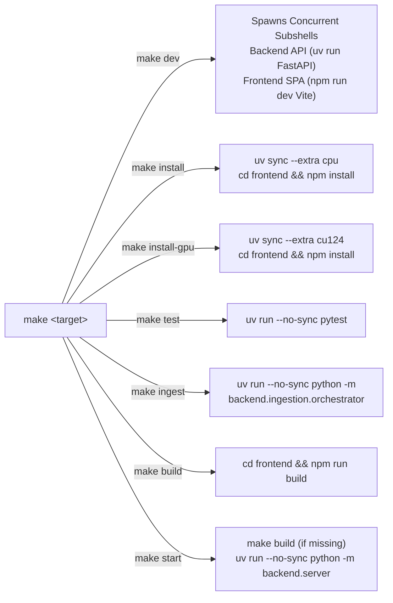

# 06. Deployment, Infrastructure & Operations

[← Previous: 05 Ingestion & Mining](file:///home/eyenga/Projects/FrenchTutor/docs/05_ingestion_and_mining.md) | [Documentation Index](file:///home/eyenga/Projects/FrenchTutor/docs/README.md)

---

## 1. Executive Summary & Operational Architecture

FrenchTutor is engineered as a containerized, hybrid neural-linguistic web service. The runtime couples a fast **FastAPI** backend with a high-performance **React / Vite** single-page application (SPA), supported by an embedded **SQLite (WAL mode)** database and multi-gigabyte neural NLP models (GlotLID FastText, NLLB-200 distilled, GPT-2 FR, SentenceTransformers).

To reconcile the demands of developer agility, cross-platform portability, deterministic dependency resolution, and deep-learning acceleration, the operational stack is organized around three pillars:
1. **Ultra-Fast Dependency Management via `uv`**: Pure deterministic resolution via `uv.lock`, sub-second environment synchronizations, and isolated PyTorch hardware variants (CPU vs CUDA 12.4).
2. **Multi-Stage & Dual-Target Docker Architecture**: A production build packaging both the Node.js/Vite frontend bundle and the Python backend into a single lean container, mirrored by a development setup offering live hot-reloading (Vite HMR + Uvicorn reload) and optional NVIDIA GPU passthrough.
3. **Layered Automated Testing Strategy with `pytest`**: Decoupled test suites where sub-second unit, database, and API tests execute in isolated environments with mocked neural models, while dedicated `@pytest.mark.ml` suites validate end-to-end tensor inference and lexical token alignment.


---

## 2. Environment Setup & Dependency Management with `uv`

The project standardizes entirely on [`uv`](https://github.com/astral-sh/uv), an ultra-fast Python package and project manager written in Rust. In accordance with project operational standards, **virtual environments must never be manually activated (`source .venv/bin/activate`), and raw python binaries inside `.venv/bin/` must not be invoked directly**. Instead, all executions go through `uv run` or target-specific `make` recipes.

### 2.1 Configuration File Structure (`pyproject.toml`)

FrenchTutor defines its workspace configuration in [`pyproject.toml`](file:///home/eyenga/Projects/FrenchTutor/pyproject.toml):

```toml
[project]
name = "frenchtutor"
version = "0.1.0"
requires-python = ">=3.11,<3.14"

dependencies = [
    "gradio",
    "transformers",
    "sentence-transformers",
    "fasttext",
    "huggingface_hub",
    "datasets",
    "pyarrow",
    "numpy<2",
    "sentencepiece",
    "sacremoses",
    "language-tool-python",
    "pymupdf>=1.23.0",
    "datasketch>=1.5.0",
    "spacy>=3.8.15",
    "fr-core-news-sm @ https://github.com/explosion/spacy-models/releases/download/fr_core_news_sm-3.8.0/fr_core_news_sm-3.8.0-py3-none-any.whl",
    "edge-tts>=7.2.8",
]

[project.optional-dependencies]
cpu = [ "torch" ]
cu118 = [ "torch" ]
cu124 = [ "torch" ]

[tool.uv]
package = true
conflicts = [
    [
        { extra = "cpu" },
        { extra = "cu118" },
        { extra = "cu124" },
    ],
]

[tool.uv.sources]
torch = [
    { index = "pytorch-cpu", extra = "cpu" },
    { index = "pytorch-cu118", extra = "cu118" },
    { index = "pytorch-cu124", extra = "cu124" },
]

[[tool.uv.index]]
name = "pytorch-cpu"
url = "https://download.pytorch.org/whl/cpu"
explicit = true

[[tool.uv.index]]
name = "pytorch-cu124"
url = "https://download.pytorch.org/whl/cu124"
explicit = true
```

### 2.2 PyTorch Dual-Variant Hardware Management (CPU vs CUDA 12.4)

PyTorch distributes different binary wheels depending on the underlying CUDA compute capability. A standard CUDA wheel can exceed 2.5 GB, whereas a CPU-only wheel is approximately 180 MB. 

To prevent bloated CI images and ensure smooth development on non-GPU laptops while simultaneously supporting full GPU acceleration on workstations and servers:
- **Mutually Exclusive Extras**: Under `[tool.uv]`, `conflicts` ensures that `cpu`, `cu118`, and `cu124` cannot be installed into the same environment simultaneously.
- **Explicit Wheel Indices**: Under `[tool.uv.sources]`, the `torch` dependency routes to `pytorch-cpu` or `pytorch-cu124` based on the active extra.
- **Deterministic Lockfile**: [`uv.lock`](file:///home/eyenga/Projects/FrenchTutor/uv.lock) locks all variants deterministically across platforms.

#### Synchronization Commands

```bash
# Standard local setup (CPU inference ~180MB PyTorch):
uv sync --extra cpu

# Workstation / Production server with NVIDIA GPU (CUDA 12.4 ~2.5GB PyTorch):
uv sync --extra cu124

# Include development test tools (pytest, pytest-cov, httpx):
uv sync --extra cpu --dev

# Strictly synchronize using frozen lockfile (used in Docker builds):
uv sync --extra cpu --no-dev --frozen
```

### 2.3 Rationale Behind `UV_NO_SYNC=1` and `--no-sync`

By default, whenever `uv run <command>` is executed, `uv` checks whether `pyproject.toml` or `uv.lock` has changed and triggers an automatic synchronization against the `.venv` directory.

While convenient in simple projects, this behavior presents serious hazards in production containers and concurrent runtime processes:
1. **Container Immutable Filesystem Layering**: In Docker, runtime containers run as non-root or unprivileged workers where modifying `.venv` at runtime is prohibited. Re-triggering resolution during server startup degrades boot time.
2. **Preventing Accidental Extra Fallback**: If `uv run` executes without an explicit `--extra` argument, it might attempt to re-sync without the desired accelerator, uninstalling `cu124` and reverting to default wheels.
3. **Subprocess Concurrency**: Background tasks or multiple worker processes spawning simultaneously might attempt concurrent writes to `.venv`.

Therefore, the production container entrypoint and project `Makefile` enforce explicit non-synchronization:
```bash
# Dockerfile Entrypoint
CMD ["uv", "run", "--no-sync", "python", "-m", "backend.server", "--host", "0.0.0.0", "--port", "8000"]
```
Or via environment variable:
```bash
export UV_NO_SYNC=1
```

---

## 3. Docker Containerization Architecture

FrenchTutor provides two distinct container deployment strategies:
1. **Unified Production Deployment** ([`docker-compose.yml`](file:///home/eyenga/Projects/FrenchTutor/docker-compose.yml), [`Dockerfile`](file:///home/eyenga/Projects/FrenchTutor/Dockerfile)): Compact, multi-stage production images with bundled frontend assets.
2. **Hot-Reload Development Cluster** ([`docker-compose.dev.yml`](file:///home/eyenga/Projects/FrenchTutor/docker-compose.dev.yml)): Separate backend and frontend development containers with live source code mounts, Vite Hot Module Replacement (HMR), and host Hugging Face cache persistence.

### 3.1 Multi-Stage Unified Production Dockerfile

The production container defined in [`Dockerfile`](file:///home/eyenga/Projects/FrenchTutor/Dockerfile) uses a two-stage build to isolate the Node.js build tools from the final Python runtime (Node 20 Alpine frontend compilation followed by a lean `python:3.11-slim` runtime with `uv`).

> [!NOTE]
> `default-jre-headless` is strictly required in the runtime image. The project's grammar checking engine ([`backend/scoring/spellchecker.py`](file:///home/eyenga/Projects/FrenchTutor/backend/scoring/spellchecker.py)) utilizes `language-tool-python`, which orchestrates a local headless Java LanguageTool server.

### 3.2 Production Compose Topology (`docker-compose.yml`)

The production configuration defines two services sharing the same image build recipe:
- `backend-cpu`: Standard CPU-bound container exposed on port 8000.
- `backend-gpu`: Activated via the Docker Compose `--profile gpu` flag, allocating NVIDIA device reservations for CUDA compute.


#### Production Operations Quickstart

```bash
# Launch CPU production server:
docker compose up -d --build backend-cpu

# Launch GPU production server with CUDA 12.4:
docker compose --profile gpu up -d --build backend-gpu

# Inspect logs:
docker compose logs -f backend-cpu
```

### 3.3 Development Compose Topology (`docker-compose.dev.yml`)

For local containerized development, [`docker-compose.dev.yml`](file:///home/eyenga/Projects/FrenchTutor/docker-compose.dev.yml) separates the backend and frontend into independent hot-reloading containers:

1. **Volume Isolation (`/app/.venv` & `/app/frontend/node_modules`)**: Anonymous volumes prevent the host container filesystem from clobbering the Linux-compiled binaries in `.venv` and `node_modules`.
2. **FastAPI Live Reload**: Mounts `./backend` and passes `--reload --reload-dir backend` to uvicorn via `backend.server`.
3. **Vite Development Server (HMR)**: Runs Node.js 20 on port 5173 with hot module replacement, routing API requests through its reverse proxy to the backend container.
4. **Shared Hugging Face Cache**: Mounts `${HF_CACHE_DIR:-~/.cache/huggingface}:/root/.cache/huggingface` so multi-gigabyte neural weights downloaded inside the container are not discarded when containers restart.

```bash
# Start CPU development environment:
docker compose -f docker-compose.dev.yml up

# Start GPU development environment:
docker compose -f docker-compose.dev.yml --profile gpu up backend-dev-gpu frontend-dev
```

---

## 4. Automated Testing Suite & Strategy

The project employs a tiered testing architecture managed by `pytest`. Because FrenchTutor integrates both deterministic relational data operations and computationally intensive neural transformer models, tests are strictly partitioned using custom pytest markers.

### 4.1 Pytest Configuration & Test Partitioning

Test configuration is declared in `pyproject.toml`:

```toml
[tool.pytest.ini_options]
testpaths = ["tests"]
pythonpath = ["."]
markers = [
    "ml: tests requiring Hugging Face / PyTorch ML models",
    "slow: tests that take significant time to run",
]
addopts = "-v -m 'not ml' --tb=short"
```

> [!IMPORTANT]
> By default, `addopts` contains `-m 'not ml'`. This ensures that `pytest` or `make test` executes **only** lightweight unit tests, API route checks, and lexical classification tests, completing in **< 2 seconds** without loading PyTorch weights or requiring network access.

### 4.2 Test Markers & Execution Matrix

| Test Suite | Filter Flag | Description | Execution Time | Typical Use Case |
| :--- | :--- | :--- | :--- | :--- |
| **Fast Unit / Integration** | `pytest` or `pytest -m "not ml"` | Database schema, repository layer, Lexique 4 classification, token parsing, API endpoints, mock TTS. | ~1–2 seconds | Pre-commit hooks, CI pull-request validation, local development. |
| **Neural Inference Suite** | `pytest -m ml` | Evaluates [`MLEngine`](file:///home/eyenga/Projects/FrenchTutor/backend/ml/engine.py), GlotLID language identification, NLLB cross-attention matrix extraction, and GPT-2 fluency scores. | ~20–60 seconds | Nightly builds, GPU server validation, release candidate staging. |
| **Comprehensive Suite** | `pytest -m ""` | Runs all available tests without filtering. | ~30–75 seconds | Full regression auditing before major releases. |
| **Coverage Analysis** | `pytest --cov=backend` | Calculates line coverage across the backend codebase (omitting heavy preloaded neural engines as defined in `pyproject.toml`). | ~3 seconds | Code quality auditing. |

### 4.3 Mocking Strategies for ML & External Services in CI/CD

To keep fast test suites deterministic and hermetic, [`tests/conftest.py`](file:///home/eyenga/Projects/FrenchTutor/tests/conftest.py) provides session-scoped and function-scoped test fixtures that mock external dependencies:

```python
# Excerpt from tests/conftest.py
@pytest.fixture
def mock_tts(tmp_path):
    """Provide a MagicMock TTS engine so no real network requests are made."""
    fake_audio_path = tmp_path / "test_audio.wav"
    fake_audio_path.write_bytes(b"RIFF" + b"\x00" * 44)

    mock = MagicMock()
    mock.synthesize.return_value = str(fake_audio_path)
    mock.get_audio_path.return_value = str(fake_audio_path)
    mock.data_manager = None
    return mock

@pytest.fixture
def isolated_data_manager(temp_db_path):
    """Provide a DataManager attached to an isolated database with initial seed data."""
    from backend.db import DataManager
    dm = DataManager(db_path=temp_db_path)
    dm.bulk_insert_sentences(SEED_SENTENCES)
    return dm

@pytest.fixture
def test_client(isolated_data_manager, mock_tts, monkeypatch):
    """Provide a FastAPI TestClient wired to isolated data, scoring, and eager managers."""
    from fastapi.testclient import TestClient
    from backend import server
    from backend.api import deps
    from backend.scoring import ScoringEngine
    from backend.ml.precompute import EagerPrecomputeManager
    
    engine = ScoringEngine(data_manager=isolated_data_manager)
    eager = EagerPrecomputeManager(get_engine_fn=server.get_ml_engine, data_manager=isolated_data_manager)
    monkeypatch.setattr(deps, "data_manager", isolated_data_manager)
    monkeypatch.setattr(deps, "scoring_engine", engine)
    monkeypatch.setattr(deps, "tts_engine", mock_tts)
    monkeypatch.setattr(deps, "eager_processor", eager)
    
    return TestClient(server.app)
```

Through these fixtures:
- **TTS Network Calls**: `edge-tts` calls are intercepted by `mock_tts`, returning a valid 44-byte WAV header without internet access.
- **ML Engine Deferral**: The `ScoringEngine` runs its grammar, orthographic, and dictionary components directly, while heavy transformer inference in `MLEngine` is either mocked or exercised in dedicated `test_ml_models.py` runs.
- **Database Isolation**: Every test receives an independent SQLite database via `temp_db_path`, guaranteeing zero cross-test interference.

---

## 5. Operational Tooling & Makefile Reference

The root [`Makefile`](file:///home/eyenga/Projects/FrenchTutor/Makefile) serves as the primary developer workflow interface. It abstracts `uv run`, port assignments, parallel worktree support, and multi-process lifecycle management.



### 5.1 Makefile Command Index

| Target | Description | Underlying Execution | Notes & Arguments |
| :--- | :--- | :--- | :--- |
| `make help` | Displays the target index and usage instructions. | Shell echo statements | Run `make help` for immediate CLI guidance. |
| `make install` | Installs Python CPU dependencies and Node.js packages. | `uv sync --extra cpu`<br/>`cd frontend && npm install` | Default initialization command for new development machines. |
| `make install-gpu`| Installs Python dependencies with CUDA 12.4 acceleration. | `uv sync --extra cu124`<br/>`cd frontend && npm install` | Run on machines equipped with NVIDIA GPUs. |
| `make dev` | Starts full-stack development servers concurrently. | Backgrounds FastAPI (`--reload`) and Vite dev server (`npm run dev`). Traps `SIGINT`/`SIGTERM` to cleanly terminate both processes on exit. | Supports dynamic port overrides for parallel git worktrees: `make dev BACKEND_PORT=8001 FRONTEND_PORT=5174`. |
| `make start` | Starts the production FastAPI server. | Checks if `frontend/dist` exists (builds it if missing), then runs `uv run --no-sync python -m backend.server`. | FastAPI serves the compiled SPA from `frontend/dist` directly at root (`/`). |
| `make build` | Compiles the production React frontend bundle. | `cd frontend && npm run build` | Generates static HTML, JS, CSS, and asset bundles inside `frontend/dist`. |
| `make test` | Executes the fast automated test suite. | `uv run --no-sync pytest` | Runs non-ML tests (`-m 'not ml'`). Completes in < 2 seconds. |
| `make ingest` | Runs the corpus mining and seeding orchestrator. | `uv run --no-sync python -m backend.ingestion.orchestrator $(ARGS)` | Accepts pipeline flags, e.g.: `make ARGS="--seed-lemmas" ingest` or `make ARGS="--mine tatoeba" ingest`. |
| `make clean` | Cleans up build artifacts and caches. | `rm -rf frontend/dist .pytest_cache`<br/>`find . -type d -name "__pycache__" -exec rm -rf {} +` | Resets compiled frontend assets and bytecode caches. |

### 5.2 Dynamic Port Configuration for Parallel Git Worktrees

When developers or agents work on multiple git worktrees simultaneously, port collisions (defaulting to 8000 for backend and 5173 for frontend) will occur. The `Makefile` dynamically parameterizes these bindings:

```bash
# Developer / Agent in Worktree A (Standard):
make dev

# Developer / Agent in Worktree B (Isolated Ports):
make dev BACKEND_PORT=8002 FRONTEND_PORT=5175
```

The Makefile passes these variables directly to both the FastAPI server runtime (`--port $(PORT)`) and Vite (`npm run dev -- --port $(FRONTEND_PORT)`), while simultaneously configuring Vite's proxy target (`BACKEND_PORT=$(PORT)`).

### 5.3 Full Lifecycle Process Clean-Up (`make dev`)

Because `make dev` forks two long-running child processes in the background (Uvicorn and Vite), unhandled interrupts could leave orphan processes holding TCP ports. The `Makefile` implements a robust bash process group cleanup trap:

```makefile
dev:
	@set -m; \
	cleanup() { \
		trap - EXIT INT TERM; \
		kill -- -$${BACKEND_PID} 2>/dev/null || true; \
		kill -- -$${FRONTEND_PID} 2>/dev/null || true; \
		wait 2>/dev/null || true; \
	}; \
	trap cleanup EXIT INT TERM; \
	(PORT=$(PORT) BACKEND_PORT=$(PORT) HOST=$(HOST) uv run --no-sync python -m backend.server --port $(PORT) --host $(HOST) --reload --reload-dir backend) & \
	BACKEND_PID=$$!; \
	(cd frontend && BACKEND_PORT=$(PORT) PORT=$(PORT) npm run dev -- --host $(HOST) --port $(FRONTEND_PORT)) & \
	FRONTEND_PID=$$!; \
	wait $${BACKEND_PID} $${FRONTEND_PID} 2>/dev/null || true
```

When Ctrl+C (`SIGINT`) or a container stop signal (`SIGTERM`) is received, `kill -- -$PID` signals the entire process group, ensuring both Uvicorn workers and Node/Vite processes exit cleanly without dangling file locks or listening ports.

---

## 6. Production Operations & Health Auditing

### 6.1 Service Health Checks

The FastAPI server exposes built-in health and documentation endpoints:
- **API Documentation**: `GET http://<host>:<port>/docs` (Interactive OpenAPI Swagger UI)
- **API Specification**: `GET http://<host>:<port>/openapi.json`
- **Application Index**: `GET http://<host>:<port>/` (Serves `index.html` from `frontend/dist` in production)

### 6.2 Volume & Data Persistence

In production deployments, the following host volumes must be persisted:

| Container Path | Host Recommended Path | Purpose | Backup Policy |
| :--- | :--- | :--- | :--- |
| `/app/data` | `./data` | Stores SQLite database (`frenchtutor.db`), WAL journal files, and synthesized audio cache (`data/audio_cache/`). | Daily snapshot / WAL checkpoint backup. |
| `/root/.cache/huggingface` | `~/.cache/huggingface` | Stores downloaded neural model weights (`nllb-200`, `gpt-fr`, `glotlid`, `MiniLM`). | Ephemeral cache (can be reconstructed via download, but persisting avoids bandwidth delay). |

---

[← Previous: 05 Ingestion & Mining](file:///home/eyenga/Projects/FrenchTutor/docs/05_ingestion_and_mining.md) | [Documentation Index](file:///home/eyenga/Projects/FrenchTutor/docs/README.md)
