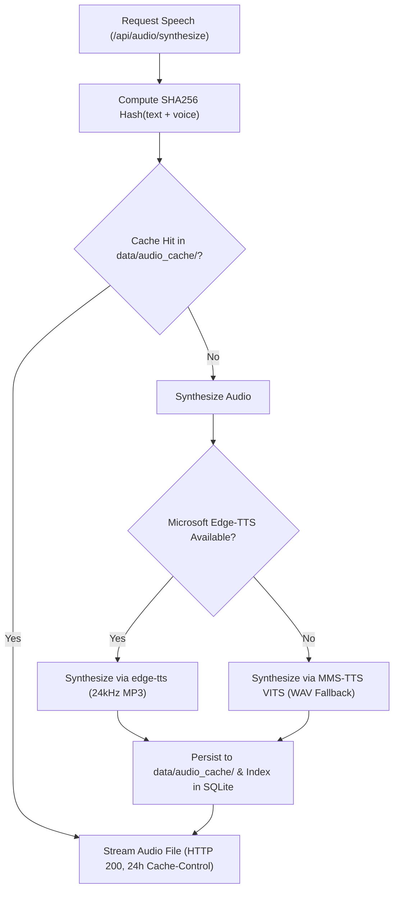

# Audio & Speech Engine

The speech synthesis subsystem (`backend/tts_engine.py`) provides high-fidelity native Parisian French audio for listening comprehension in Transcription Mode. It combines cloud-based neural synthesis with an offline local fallback and a persistent content-hashed cache.



---

## 1. Primary Engine: Microsoft Edge Neural TTS

For studio-quality prosody, rhythm, and French liaison, FrenchTutor defaults to Microsoft Edge Neural TTS via the `edge-tts` asynchronous driver:
- **Default Voice**: `fr-FR-VivienneMultilingualNeural` (Natural Parisian female speaker).
- **Alternative Voice**: `fr-FR-HenriNeural` (Natural Parisian male speaker).
- **Audio Format**: 24kHz MP3 (`audio/mpeg`).
- **Liaison & Nasality**: Accurately reproduces standard French phonological liaisons (*les_enfants*, *un_ami*) critical for authentic auditory training.

---

## 2. Offline Resilience: Local MMS-TTS VITS Fallback

If an Internet connection is unavailable or `edge-tts` fails:
- **Model**: `facebook/mms-tts-fra` (Massively Multilingual Speech VITS architecture).
- **Framework**: PyTorch / Hugging Face `transformers` (`VitsModel` and `AutoTokenizer`).
- **Lazy Loading**: Weights are downloaded and loaded into memory only on the first fallback invocation, protected by a thread lock (`self._lock`).
- **Audio Output**: 16kHz WAV (`audio/wav`) written using `scipy.io.wavfile`.

---

## 3. Persistent Audio Caching

To guarantee zero latency and reduce network calls, generated audio files are permanently cached:

1. **Deterministic Hashing**:
   $$\text{Hash} = \operatorname{SHA256}(\text{text.strip()} + \text{voice})$$
2. **Disk Storage**: Files are saved to `data/audio_cache/{hash}.mp3` (or `.wav`).
3. **Database Indexing**: The `audio_cache` table in `app.db` records:
   - `sentence_id` (optional foreign key).
   - `text_hash` (unique index).
   - `text` (raw French string).
   - `file_path` (absolute path on disk).
4. **HTTP Caching**: The `/api/audio/synthesize` endpoint returns HTTP headers:
   ```http
   Cache-Control: public, max-age=86400
   ```
   Ensuring browsers cache the audio locally across repeat listens and session replays.

---

## 4. Thread-Safe Event Loop Execution

`edge-tts` is built on Python's `asyncio`, while FastAPI's worker endpoints run across thread pools. To avoid `RuntimeError: There is no current event loop in thread`:

```python
def _synth_edge_tts(self, text: str, output_path: str, voice: str) -> None:
    async def _run():
        communicate = edge_tts.Communicate(text, voice=voice)
        await communicate.save(output_path)

    try:
        loop = asyncio.get_event_loop()
        if loop.is_running():
            new_loop = asyncio.new_event_loop()
            try:
                new_loop.run_until_complete(_run())
            finally:
                new_loop.close()
        else:
            loop.run_until_complete(_run())
    except RuntimeError:
        asyncio.run(_run())
```

---

## 5. Background Batch Prewarming

When a user requests a batch of Transcription exercises via `GET /api/exercises/batch?mode=transcription`, the server automatically prewarms audio in the background:

```python
if mode == "transcription" and batch:
    tts_engine.prewarm_batch(batch)
```

`TTSEngine.prewarm_batch` dispatches a detached background daemon thread that checks every sentence in the newly created batch. Any sentences without cached audio are synthesized ahead of time, ensuring that when the student clicks "Play", the audio begins immediately without loading spinners.
