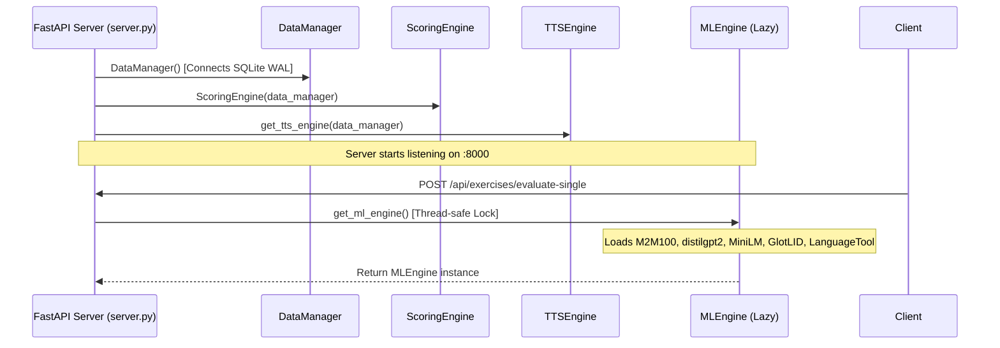
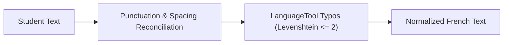

# Backend Architecture

The FrenchTutor backend is implemented in Python using FastAPI (`backend/server.py`). It coordinates persistent storage, adaptive scoring, speech synthesis, and heavy neural NLP evaluation while serving the compiled React frontend.

---

## 1. Lifecycle & Singleton Management

Heavy resources and engines are managed as singletons to minimize initialization overhead and memory consumption:

1. **Eager Initializations**:
   - `data_manager = DataManager()`: Establishes SQLite connection, enforces WAL mode, creates tables and indexes.
   - `scoring_engine = ScoringEngine(data_manager)`: Calibrates user profiles, loads CEFR thresholds.
   - `tts_engine = get_tts_engine(data_manager)`: Sets up Edge-TTS handler and audio cache directory.
2. **Lazy Initialization (`get_ml_engine()`)**:
   - `MLEngine` loads several gigabytes of PyTorch weights (`facebook/m2m100_418M`, `distilgpt2`, `paraphrase-multilingual-MiniLM-L12-v2`), GlotLID/FastText, and initializes `language_tool_python.LanguageTool('fr')`.
   - Protected by `threading.Lock()` to prevent race conditions during concurrent server warm-up.

---

## 2. Text Preprocessing & Autocorrection

Before evaluating student input against neural metrics, `server.py` runs a multi-pass normalization pipeline (`autocorrect_text`):

1. **Terminal Punctuation & Spacing Reconciliation**:
   - Terminal punctuation marks (`.`, `?`, `!`) from the reference sentence are reconciled if omitted, preventing artificial NMT SentencePiece perplexity spikes.
   - French two-part punctuation spacing (e.g. preceding space before `?`, `!`, `:`, `;`) is normalized.
2. **LanguageTool Minor Typo Correction**:
   - Genuine typographical slips (`TYPOS` category, `misspelling` rule issue type) with a Levenshtein edit distance $\le 2$ are gently corrected without modifying grammatical agreements or confused-word choices.
3. **Elision & Contraction Protection**:
   - Functional prefixes (`j'`, `l'`, `c'`, `d'`, `m'`, `t'`, `s'`, `n'`, `qu'`) are protected from accidental mutation.

### Tier 1 Preprocessing Error Handling Matrix

| Error Type | Example | Handled By | Outcome |
| :--- | :--- | :--- | :--- |
| **Missing Terminal Mark** | `Comment vas-tu` (ref: `Comment vas-tu ?`) | Reference Alignment | Appends `?`; zero penalty; logs `added '?'` |
| **Mismatched Terminal Mark** | `Je vais bien?` (ref: `Je vais bien.`) | Reference Alignment | Replaces with `.`; zero penalty; logs `'?' -> '.'` |
| **High Punctuation Spacing** | `C'est bien!` | French Regex Rule | Normalizes to `C'est bien !`; zero penalty |
| **Surface Typo / Slip** | `pome` $\to$ `pomme` (edit dist $\le 2$) | LanguageTool (`TYPOS`) | Corrected non-punitively; logs `pome -> pomme` |
| **Grammar Agreement** | `ils mange`, `un pomme` | **Excluded from Tier 1** | **Preserved intact**; forwarded to Tier 2 for diagnostic evaluation |
| **Confused Words / Homophones** | `a` vs `à`, `son` vs `sont` | **Excluded from Tier 1** | **Preserved intact**; forwarded to Tier 2 for diagnostic evaluation |

---

## 3. REST API Specification

### User Management

| Method | Endpoint | Description | Key Parameters / Payload |
| :--- | :--- | :--- | :--- |
| `GET` | `/api/users` | List all registered user profiles | None |
| `POST` | `/api/users` | Create a new user profile | `{"name": "...", "avatar": "owl"}` |
| `PUT` | `/api/users/{user_id}` | Update profile name or avatar | `{"name": "...", "avatar": "..."}` |
| `DELETE`| `/api/users/{user_id}`| Delete profile (prevents deleting last remaining user) | None |
| `GET` | `/api/user/profile` | Retrieve active user stats for mode | `?user_id=...&mode=translation` |
| `GET` | `/api/user/vocab` | Get total known, learning, and CEFR counts | `?user_id=...` |
| `POST` | `/api/user/reset` | Reset continuous score / level | `{"start_score": 1.20, "mode": "...", "user_id": "..."}` |

### Exercise Sessions & Hints

| Method | Endpoint | Description | Key Parameters / Payload |
| :--- | :--- | :--- | :--- |
| `GET` | `/api/exercises/batch` | Sample difficulty-matched sentences with progressive vocabulary | `?mode=translation&score=1.20&count=3&exclude=12,15&user_id=...&max_unknown=2` |
| `POST` | `/api/exercises/hint` | Compute aligned French target words for selected Spanish words | `{"source_text": "...", "reference_text": "...", "selected_indices": [0, 1]}` |
| `POST` | `/api/exercises/evaluate-single` | Full neural translation evaluation | `{"sentence_id": 1, "source_text": "...", "student_text": "...", "reference_text": "..."}` |
| `POST` | `/api/exercises/evaluate-transcription`| Listening comprehension diff evaluation | `{"sentence_id": 1, "student_text": "...", "reference_text": "..."}` |
| `POST` | `/api/exercises/complete-batch` | Finalize batch and compute score delta | `{"evaluated_items": [...], "mode": "translation", "user_id": "..."}` |

### Audio & System

| Method | Endpoint | Description | Key Parameters / Payload |
| :--- | :--- | :--- | :--- |
| `GET` | `/api/audio/synthesize` | Stream synthesized audio (.mp3 / .wav) | `?text=Bonjour&sentence_id=42&voice=fr-FR-VivienneMultilingualNeural` |
| `GET` | `/api/stats` | Corpus level distribution & current user profile | None |

---

## 4. Alignment & Hint Computation

The `/api/exercises/hint` endpoint maps Spanish words to target French tokens using M2M100 cross-attention weights:

1. Cross-attention matrices are cached in `_hint_cache` keyed by `(source_text, reference_text)` to avoid re-running neural forward passes on repeated user selections.
2. `get_aligned_targets(selected_source_indices, matrix, num_tgt_words)` computes:
   - Strongest column alignment: $t^* = \operatorname{argmax}_t M_{t, s}$.
   - Bilateral coverage: Target words where $s$ is the primary source attractor and column attention is $\ge 65\%$ of the maximum column peak.
3. First-time vocabulary detection: If the sentence contains word roots not yet mastered by the user, their corresponding Spanish tokens are pre-highlighted.

---

## 5. Static Asset Distribution

When running in production, FastAPI serves the compiled React application directly:
- Checks if `frontend/dist` exists.
- Mounts static files on `/` using `StaticFiles(directory=frontend_dist, html=True)`.
- Eliminates the need for a separate Nginx or Node reverse proxy for local desktop usage.

---

## 6. Legacy Gradio Application (`backend/app.py`)

`backend/app.py` contains the legacy Gradio 4.x interface:
- Uses `gr.Blocks()` with tabbed interfaces for Translation, Review, and Grammar diagnostics.
- Serves as an isolated testbed for ML model behavior independent of Vite and modern React tooling.
- Can be launched via `uv run python -m backend.app`.
