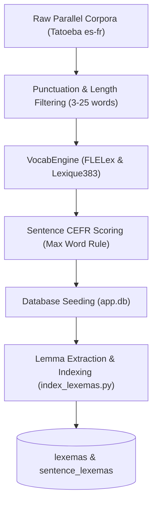

# Data Creation & Ingestion Pipeline

This document explains how the FrenchTutor sentence corpus is mined, filtered, scored for CEFR difficulty, and indexed into the SQLite database.



---

## 1. Note on the `curriculum/` Directory

> [!WARNING]
> **Legacy AI Content Status**
> 
> The markdown specifications and scripts located in the `curriculum/` folder (`curriculum/A1.md` through `curriculum/C1_C2.md`, `curriculum/units/`, `units.json`, `curriculum_parser.py`, `unit_builder.py`, `spacy_clusterer.py`, etc.) represent early, AI-generated experiments.
> 
> This content is **low quality and is NOT actively used** by the current application runtime. The application relies entirely on authentic bilingual parallel pairs in SQLite (`data/app.db`), scored dynamically by `VocabEngine` and indexed through `scripts/index_lexemas.py`. The `curriculum/` folder is retained solely for historical reference.

---

## 2. Corpus Mining & Cleaning

The active corpus is derived primarily from open parallel resources like **Tatoeba** (`scripts/generate_dataset.py`):

1. **Parallel Extraction**: Reads aligned Spanish (`Tatoeba.es-fr.es`) and French (`Tatoeba.es-fr.fr`) files from `data/raw/`.
2. **Quality Gate Filtering (`is_valid_sentence`)**:
   - **Length bounds**: Only sentences between 3 and 25 words are retained.
   - **Punctuation & Casing**: Must start with an uppercase character (or dialogue marker `«`, `"`, `'`, `¿`, `¡`) and end with terminating punctuation (`.`, `!`, `?`, `;`).
   - **Web Junk**: Strips sentences containing URLs (`http`, `www.`), `@` handles, or XML/HTML markup (`<`, `>`).
   - **Quote Normalization**: Strips mismatched leading/trailing typographical quotes.

---

## 3. Lexical Difficulty Scoring (`backend/vocab_engine.py`)

Rather than relying on subjective manual labels, sentences are classified objectively based on empirical CEFR frequency lexicons:

### Lexical Datasets
- **FLELex (Beacco)**: Empirical French as a Foreign Language (FLE) lexicon mapping lemmas to CEFR levels (A1 through C2).
- **Lexique383**: Standard French lexical database used to resolve surface forms to canonical lemmas and part-of-speech categories.

### Morphosyntactic POS Tagging
`VocabEngine` uses spaCy (`fr_core_news_sm`) to disambiguate tokens and map them to Lexique383 grammatical codes (`SPACY_TO_LEXIQUE_POS`):
- `VERB` / `AUX` $\to$ `VER`, `AUX`
- `NOUN` $\to$ `NOM`
- `ADJ` $\to$ `ADJ`, `ADJ:pos`, `ADJ:dem`
- `ADV` $\to$ `ADV`
- `PRON` $\to$ `PRO:per`, `PRO:rel`, etc.

### The Maximum-Word Difficulty Rule
A sentence's overall CEFR tier is determined by the **maximum difficulty score of any constituent content word**:

$$\text{Sentence Score} = \max_{w \in \text{Words}} \text{CEFR}(w)$$

Where:
- $\text{CEFR} \in \{1: \text{A1}, 2: \text{A2}, 3: \text{B1}, 4: \text{B2}, 5: \text{C1}, 6: \text{C2}\}$.
- Common functional words (articles, prepositions, basic pronouns) and proper nouns are pre-classified as A1 base words and do not artificially inflate difficulty.
- Out-of-vocabulary words not present in FLELex or the A1 list are ignored so rare loanwords or proper names do not distort scoring.

---

## 4. Lexema Indexing (`scripts/index_lexemas.py`)

To power the progressive vocabulary acquisition engine, every sentence in the database is tokenized into canonical word roots (`lexemas`):

```bash
uv run python scripts/index_lexemas.py
```

### Process:
1. **Lemma Extraction**: Parses French sentences with spaCy, extracting lemmas and POS tags for all content words.
2. **Base vs Content Classification**:
   - Words in the standard A1 core list (*le, la, être, avoir, je, tu, pour, dans, etc.*) are marked with `is_base = 1`.
   - Content verbs, nouns, adjectives, and adverbs are marked with `is_base = 0`.
3. **Relational Junction**: Populates `sentence_lexemas` with unique `(sentence_id, lexema_id)` tuples.
4. **Seed User Counts**: New users automatically inherit `is_known = 1` for all base lexemas, ensuring their initial learning queues focus strictly on learnable content vocabulary.
