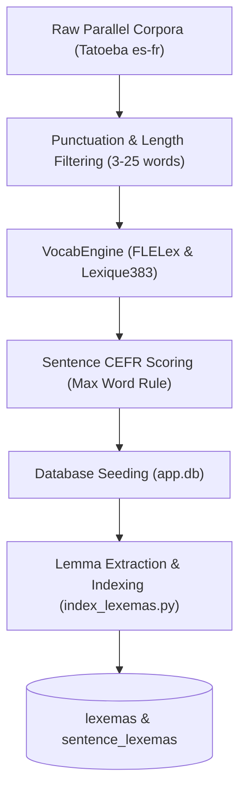

# Data Creation & Ingestion Pipeline

This document explains how the FrenchTutor sentence corpus is mined, filtered, scored for CEFR difficulty, and indexed into the SQLite database.



---

## 1. Note on the `curriculum/` Directory

> [!WARNING]
> **Legacy AI Content Status**
> 
> The markdown specifications and scripts located in the `curriculum/` folder (`curriculum/A1.md` through `curriculum/C1_C2.md`, `curriculum/units/`, `units.json`, `curriculum_parser.py`, `unit_builder.py`, `spacy_clusterer.py`, etc.) represent early, AI-generated experiments.
> 
> This content is **low quality and is NOT actively used** by the current application runtime. The application relies entirely on authentic bilingual parallel pairs in SQLite (`data/app.db`), scored dynamically by `VocabEngine` and indexed through `scripts/index_lexemas.py`. The `curriculum/` folder is retained solely for historical reference.

---

## 2. Corpus Mining & Cleaning

The active corpus is derived primarily from open parallel resources like **Tatoeba** (`scripts/generate_dataset.py`):

1. **Parallel Extraction**: Reads aligned Spanish (`Tatoeba.es-fr.es`) and French (`Tatoeba.es-fr.fr`) files from `data/raw/`.
2. **Quality Gate Filtering (`is_valid_sentence`)**:
   - **Length bounds**: Only sentences between 3 and 25 words are retained.
   - **Punctuation & Casing**: Must start with an uppercase character (or dialogue marker `«`, `"`, `'`, `¿`, `¡`) and end with terminating punctuation (`.`, `!`, `?`, `;`).
   - **Web Junk**: Strips sentences containing URLs (`http`, `www.`), `@` handles, or XML/HTML markup (`<`, `>`).
   - **Quote Normalization**: Strips mismatched leading/trailing typographical quotes.

---

## 3. Sentence CEFR Difficulty Scoring (`backend/vocab_engine.py`)

Sentences are classified into CEFR levels (A1 through C2) and assigned continuous scores using a dedicated sequence classification transformer model, complemented by empirical lexical dictionaries:

### Deep Learning CEFR Sequence Classifier (`UniversalCEFR`)
French sentences are evaluated holistically using `UniversalCEFR/xlm-roberta-base-cefr-all-classifier` (integrated in `backend/model_registry.py`).
- **Input**: Complete French sentence string.
- **Output**: Categorical CEFR level (`A1`–`C2`) and calibrated continuous expectation score:

$$\text{score}_{\text{ml}} = \sum_{k=1}^6 k \cdot P(\text{level}_k)$$

Where $k \in \{1: \text{A1}, 2: \text{A2}, 3: \text{B1}, 4: \text{B2}, 5: \text{C1}, 6: \text{C2}\}$.

### Lexical Baseline & Diagnostics (FLELex & Lexique383)
- **FLELex (Beacco)**: Empirical French as a Foreign Language (FLE) lexicon mapping lemmas to CEFR levels.
- **Lexique383**: Morphosyntactic tagger resolving surface forms to canonical lemmas and part-of-speech codes.
- **Lexical Score**: $\text{score}_{\text{lexical}} = \max_{w \in \text{Words}} \text{CEFR}(w)$, preserved for vocabulary catalog lookup and progressive word unlocks.

---

## 4. Lexema Seeding & Sentence Linking (`scripts/index_lexemas.py`)

To power the progressive vocabulary acquisition engine:
1. **Catalog Seeding**: When `app.db` is initialized, the `lexemas` table is populated once with every single lemma/POS entry from `data/flelex_beacco.tsv` (14,236 entries). No dynamic insertions to `lexemas` occur after this initialization.
2. **Sentence Linking**: Every sentence in the database is tokenized and linked to existing pre-seeded lexemas:

```bash
python scripts/index_lexemas.py
```

### Process:
1. **Lemma Lookup**: Parses French sentences with spaCy, extracting lemmas and matching them against the pre-seeded `lexemas` catalog.
2. **Relational Junction**: Populates `sentence_lexemas` with unique `(sentence_id, lexema_id)` tuples.
3. **Seed User Counts**: New users automatically inherit `is_known = 1` for all foundational base lexemas (`is_base = 1`), ensuring their initial learning queues focus strictly on learnable content vocabulary.
