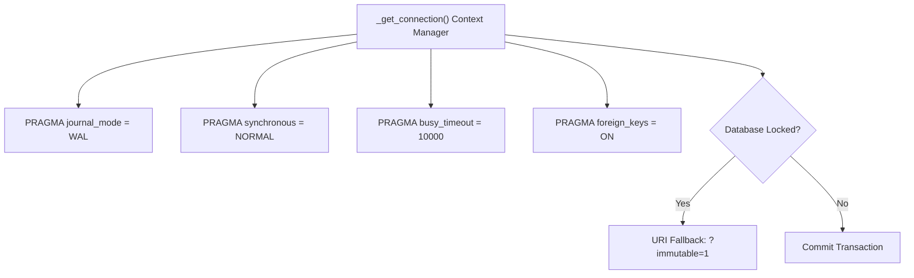
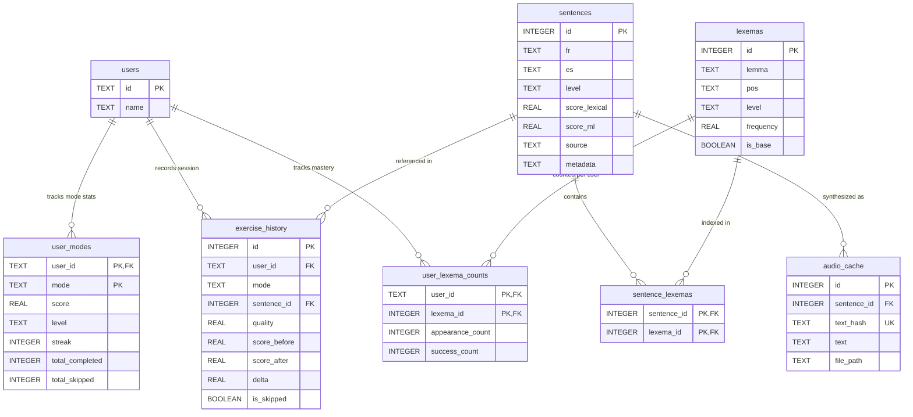

# Database Architecture

The persistence layer is managed by `backend/data_manager.py` targeting an embedded SQLite database at `data/app.db`. It handles corpus storage, relational lexema junctions, progressive vocabulary tracking, multi-user profiles, exercise history, and audio synthesis caches.

---

## 1. Storage Design & Concurrency

SQLite was chosen for zero-configuration, single-file portability, and high local read throughput.

- **Write-Ahead Logging (WAL)**: Enables concurrent readers while a write transaction is underway.
- **Busy Timeout**: Configured for 10,000 ms to prevent `database is locked` errors during bursts.
- **Read-Only Fallback**: If an unrecoverable `OperationalError` occurs (e.g. read-only filesystem or concurrent locks), the connection retries using SQLite's immutable URI mode (`file:...app.db?immutable=1`).

---

## 2. Entity-Relationship Diagram

---

## 3. Relational Table Specifications

### `sentences`
Stores bilingual Spanish-French pairs, CEFR metadata, and lexical ratings.
- `id`: Integer primary key.
- `fr` / `es`: Cleaned French and Spanish sentences.
- `level`: CEFR tier string (`A1`, `A2`, `B1`, `B2`, `C1`, `C2`).
- `score_lexical`: Continuous score determined by `VocabEngine` ($1.00 - 6.00$).
- `score_ml`: Secondary score from neural evaluations.
- `source`: Provenance tag (e.g. `tatoeba`, `custom`).

### `users` & `user_modes`
Enables multi-user support with independent progression per exercise modality.
- `users`: Core profile identity (`id`, `name`).
- `user_modes`: Composite primary key `(user_id, mode)`. Tracks individual proficiency (`score`, `level`, `streak`, `total_completed`, `total_skipped`) in `translation` versus `transcription` modes.

### `lexemas` & `sentence_lexemas`
Canonical French vocabulary repository.
- `lexemas`: Contains normalized lemma roots extracted via spaCy, part-of-speech tags, CEFR levels, and `is_base` (flagging common functional words like *être, avoir, le, la* that are always considered mastered).
- `sentence_lexemas`: Many-to-many junction mapping each sentence to all content lemmas it contains.

### `user_lexema_counts`
Tracks progressive vocabulary acquisition per user:
- `appearance_count`: Total times a user encountered this word root.
- `success_count`: Times the user succeeded on an exercise containing this root ($Q \ge 0.60$).
- Vocabulary mastery (`is_known`) is derived dynamically when:
  - The lexema is a base stopword (`is_base = 1`), OR
  - The lexema's CEFR level is strictly below the user's active CEFR level, OR
  - `success_count >= VOCABULARY_UNLOCK_THRESHOLD` (default 1).

### `exercise_history`
Audit log recording every completed or skipped sentence exercise, tracking `score_before`, `score_after`, and `delta`.

### `audio_cache`
Indexes generated neural TTS audio files by SHA256 content hash of `(text, voice)` to ensure immediate cache hits.

---

## 4. Indexing & Optimization

The database applies targeted indexes to keep sentence filtering and vocabulary lookups sub-millisecond:

| Table | Index Name | Indexed Columns | Purpose |
| :--- | :--- | :--- | :--- |
| `sentences` | `idx_sentences_level` | `level` | Fast tier-based slicing |
| `sentences` | `idx_sentences_score_lex` | `score_lexical` | Distance-based CEFR sampling |
| `lexemas` | `idx_lexemas_lemma` | `lemma` | Fast string lookup during ingestion |
| `lexemas` | `idx_lexemas_is_base` | `is_base` | Filtering out functional stopwords |
| `sentence_lexemas` | `idx_sl_sentence` | `sentence_id` | Sentence vocabulary extraction |
| `sentence_lexemas` | `idx_sl_lexema` | `lexema_id` | Sentence candidate retrieval by lemma |
| `audio_cache` | `idx_audio_cache_hash`| `text_hash` | Instant audio cache lookup |

---

## 5. Progressive Vocabulary Selection Algorithm

`DataManager.get_progressive_sentences()` executes the core pedagogical $i+1$ selection loop:

1. **Query Known Lexicon**: Retrieves all `lexema_id`s marked `is_known=1` or `is_base=1` for the active `user_id`.
2. **Candidate Slicing**: Queries sentences matching target CEFR level score ($\pm 0.5$).
3. **Set Difference Calculation**: For each candidate sentence:
   $$\text{Unknown Count} = | \text{Sentence Lexemas} \setminus \text{Known Lexicon} |$$
4. **Pedagogical Filtering**:
   - **Translation Mode**: Retains candidates where $\text{Unknown Count} \le \text{max\_unknown}$ (default 2).
   - **Transcription Mode**: Retains candidates where $\text{Unknown Count} == 0$.
5. **Sampling**: Randomly samples $N$ items from the filtered set, prioritizing sentences containing words in the user's active learning queue.
