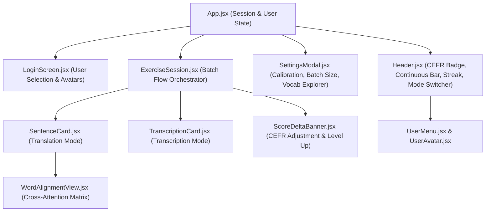

# Frontend Architecture

The FrenchTutor client is a single-page application built with React 18, Vite, and Tailwind CSS (`frontend/src/`). It communicates with the FastAPI backend over REST JSON endpoints.



---

## 1. Component Hierarchy & Responsibilities

### `App.jsx`
Root state orchestrator:
- Manages active user ID (`frenchtutor_user_id`) and active practice mode (`translation` vs `transcription`).
- Synchronizes batch size (`1-10`) with `localStorage`.
- Fetches initial user profiles and exercises via `/api/user/profile` and `/api/exercises/batch`.
- Tracks recent sentence IDs (`recentSentenceIds`) to prevent immediate repetition across batches.

### `Header.jsx`
Top navigation and persistent feedback bar:
- **CEFR Tier Badge**: Color-coded badges indicating current level (A1: emerald, A2: sky, B1: indigo, B2: purple, C1: amber, C2: rose).
- **Sub-level Progress Bar**: Visual progress indicator reflecting continuous score position within the level (e.g. $1.75$ represents $75\%$ through A1).
- **Mode Toggle**: Switches between Translation and Transcription without reloading the session.
- **Streak Counter**: Consecutive successful batches indicator with flame animation.

### `ExerciseSession.jsx`
Batch execution controller:
- Manages batch state: current card index, submitted answers, and progress stepper.
- Dispatches individual evaluation requests (`evaluate-single` or `evaluate-transcription`).
- Orchestrates retry sessions: allows learners to re-attempt low-scoring sentences without affecting their primary CEFR rating.
- Triggers `/api/exercises/complete-batch` when the last sentence in the batch is finished.

### `SentenceCard.jsx` (Translation Mode)
Core generative recall interface:
- **Source Prompt**: Displays Spanish sentence with word-level click targets for on-demand hints.
- **First-Time Vocabulary Chips**: Automatically flags root words introduced for the first time in the user's curriculum.
- **Dynamic Hints**: Requests alignment mapping from `/api/exercises/hint` when words are selected.
- **Evaluation Breakdown Accordion**: Renders scores for Semantics ($S_{\text{sem}}$), NMT ($S_{\text{NMT}}$), and Fluency ($S_{\text{fluency}}$), grammar alerts, and token-level error highlights.

### `TranscriptionCard.jsx` (Transcription Mode)
Audio listening and comprehension interface:
- **Speech Controls**: Integrated HTML5 audio player streaming from `/api/audio/synthesize`.
- **Playback Speed Toggle**: Allows switching between 0.75x, 1.0x, and 1.25x speed.
- **Token Diff Renderer**: Highlights differences against the reference text using color-coded chips:
  - Exact match (green).
  - Accent / case mismatch (amber).
  - Typos / spelling errors (red).
  - Missing words (dashed red).
  - Extra words (gray strikethrough).

### `WordAlignmentView.jsx`
Interactive bipartite alignment matrix:
- Visualizes neural cross-attention weights between Spanish and French tokens.
- Clicking any Spanish word highlights its corresponding French translation counterpart and vice versa.
- Displays connection strength curves weighted by attention values.

### `ScoreDeltaBanner.jsx`
Batch completion celebration modal:
- Computes and displays the net CEFR change ($\Delta$).
- Triggers celebratory animations if the user graduated to a new CEFR tier (e.g. A1 $\to$ A2).
- Lists newly unlocked vocabulary words mastered during the batch.

### `LoginScreen.jsx`, `UserMenu.jsx`, `UserAvatar.jsx`
Multi-user management:
- Visual avatar picker (Owl, Cat, Fox, Bear, Rabbit, Panda, etc.).
- Allows creating, switching, and deleting profiles directly from the client.

### `SettingsModal.jsx`
Configuration panel:
- **Level Calibration**: Allows setting starting proficiency scores ($1.00 - 6.00$) per mode.
- **Batch Size Slider**: Customizes session length between 1 and 10 sentences.
- **Vocabulary Explorer**: Visual breakdown of total known vs learning words across CEFR tiers.

---

## 2. State & Storage Synchronization

Client state is kept lean by relying on server-side SQLite authority:
- `localStorage` stores only non-sensitive client preferences (`frenchtutor_user_id`, `frenchtutor_mode`, `frenchtutor_batch_size`).
- Profiles and vocabulary stats are queried directly on mode change to eliminate stale local state.
- Evaluation responses populate transient component state and are cleared when advancing to the next sentence.

---

## 3. Production Build & Development

- **Development**:
  ```bash
  cd frontend
  npm run dev
  ```
  Runs Vite dev server with proxy forwarding `/api` calls to `http://localhost:8000`.
- **Production Bundle**:
  ```bash
  cd frontend
  npm run build
  ```
  Compiles optimized assets to `frontend/dist/`, which are automatically mounted by FastAPI's static server.
