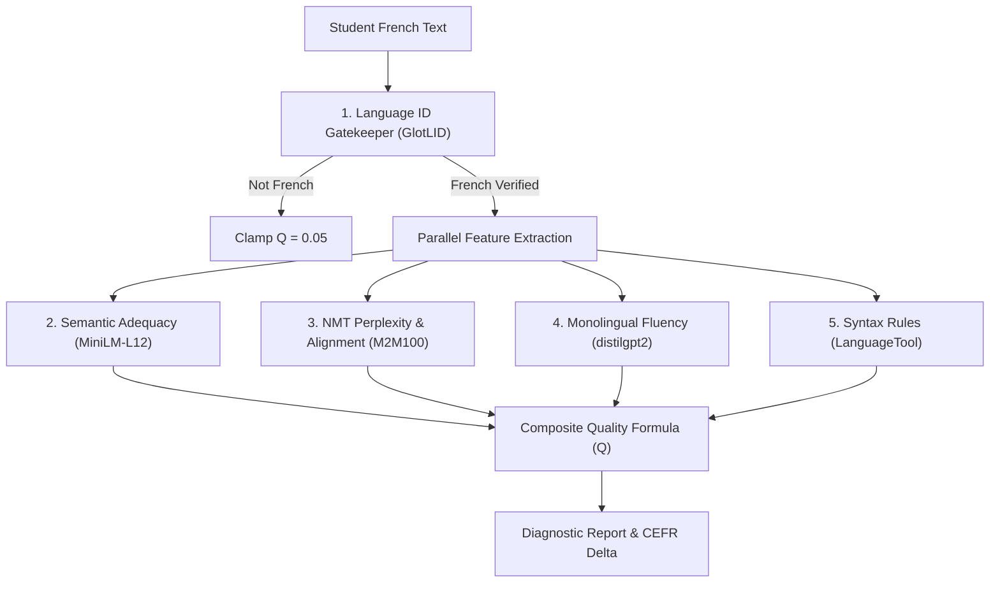

# ML Correction Pipeline

The machine learning evaluation engine (`backend/models.py`) evaluates student French translations using a five-stage neural and rule-based pipeline. All models run on CPU with float32 precision for deterministic stability.

---

## 1. Stage 1: Fast Language Identification (LID)

The gatekeeper ensures student inputs are genuine French attempts before invoking heavy neural scoring.
- **Model**: `cis-lmu/glotlid` (FastText architecture).
- **Threshold**: Requires language prediction tag matching `fra`, `fr`, `pcd`, `gcf`, or `gcr` with probability $P \ge 0.40$.
- **Short-Sentence Functional Bypass**: FastText models frequently misclassify short sentences (< 6 words) due to limited n-gram context (e.g. classifying *"Bonjour"* as Picard). If the input has $\le 5$ words and contains common French functional words (*le, la, un, je, tu, est, suis, merci, bonjour, etc.*), it automatically passes with probability 1.0.
- **Failure Consequence**: Non-French submissions receive a minimal quality score of $Q = 0.05$.

---

## 2. Stage 2: Semantic Adequacy ($S_{\text{sem}}$)

Measures whether the student preserved the core meaning of the reference sentence, regardless of stylistic or grammatical variations.
- **Model**: `sentence-transformers/paraphrase-multilingual-MiniLM-L12-v2`.
- **Computation**: Encodes student text and reference translation into 384-dimensional dense vectors:
  $$R_{\text{cos}} = \frac{\mathbf{u}_{\text{student}} \cdot \mathbf{v}_{\text{ref}}}{\|\mathbf{u}_{\text{student}}\| \|\mathbf{v}_{\text{ref}}\|}$$
  $$S_{\text{sem}} = \max(0.0, \min(100.0, R_{\text{cos}} \times 100))$$

---

## 3. Stage 3: NMT Conditional Perplexity ($S_{\text{NMT}}$) & Alignment

Evaluates translation plausibility given the Spanish source text and derives fine-grained word alignment.
- **Model**: `facebook/m2m100_418M` (`M2M100ForConditionalGeneration`, CPU eager attention).
- **Conditional Perplexity**: Evaluates target cross-entropy loss given Spanish input:
  $$\text{PPL} = \exp\left(\frac{1}{N}\sum_{i=1}^N \mathcal{L}_{\text{CE}}(\hat{y}_i, y_i \mid \mathbf{x}_{\text{source}})\right)$$
  $$S_{\text{NMT}} = \max\left(0.0, \min\left(100.0, \frac{\text{PPL}_{\text{ref}}}{\max(\text{PPL}_{\text{student}}, 10^{-5})} \times 100\right)\right)$$

### SentencePiece Aggregation & Contraction Handling
M2M100 uses SentencePiece subtoken tokenization with the `\u2581` boundary marker. 
- Sub-tokens are dynamically aggregated into full words.
- Dynamic regex splitting separates elided French contractions (`J'aime` $\to$ `["J'", "aime"]`, `c'est` $\to$ `["c'", "est"]`) so contracted pronouns and verbs align independently.

### Hybrid Alignment Matrix (SimAlign)
To eliminate alignment jitter, attention weights are fused with semantic contextual embeddings:
1. **Cross-Attention Extraction**: Mean attention extracted across the top-4 decoder cross-attention layers.
2. **Softmax Normalization**: Row-level softmax normalizes attention per target token:
   $$\tilde{A}_{t, s} = \frac{A_{t, s}}{\sum_{s'} A_{t, s'} + \epsilon}$$
3. **Contextual Embedding Matrix**: Cosine similarity between Spanish and French word embeddings from MiniLM.
4. **Hybrid Fusion**:
   $$M_{\text{hybrid}} = 0.5 \left(\frac{M_{\text{word\_attn}}}{\max(M_{\text{word\_attn}})}\right) + 0.5 M_{\text{context\_sim}}$$

### Token & Word Diagnostics
For every target word, the pipeline reports:
- $\text{Loss}$ & Perplexity ($\text{PPL}$).
- Model confidence probability: $P = \exp(-\text{Loss}) \times 100\%$.
- Model top prediction: argmax token from logits.
- Loss delta penalty: $\Delta L = \max(0, \text{Loss} - \text{Loss}_{\text{top1}})$. Words with $\Delta L > 8.0$ are flagged as lexical errors.

---

## 4. Stage 4: Monolingual Fluency ($S_{\text{fluency}}$)

Evaluates whether the student's output constitutes natural, grammatical French in isolation, without reference to the Spanish source.
- **Model**: `distilgpt2` (Autoregressive causal language model).
- **Computation**: Measures next-token prediction perplexity across shifted input tokens:
  $$S_{\text{fluency}} = \max\left(0.0, \min\left(100.0, \frac{\text{PPL}_{\text{ref}}}{\max(\text{PPL}_{\text{student}}, 10^{-5})} \times 100\right)\right)$$

---

## 5. Stage 5: Syntax & Grammar Diagnostics

Detects genuine grammatical agreement, conjugation, gender errors, and word confusions that neural embeddings might overlook.
- **Engine**: `language_tool_python` (`fr`).
- **Rule Filtering**: Filters strictly for genuine grammatical violations (`GRAMMAR`), agreement errors, and homophone confusions (`CONFUSED_WORDS`), while excluding subjective stylistic preferences (`STYLE`, `TYPOGRAPHY`, `PUNCTUATION`).
- **Penalty Calculation**: Each unique grammatical violation deducts 4.0 points from the composite score (capped at a maximum penalty of 20.0 points):
  $$\text{Penalty}_{\text{syntax}} = \min(20.0, \text{Count}_{\text{errors}} \times 4.0)$$

### Stage 5 Diagnostic Error Taxonomy

| Error Category | Example Rule IDs / Triggers | Sample Mistake | Pipeline Action |
| :--- | :--- | :--- | :--- |
| **Subject-Verb Agreement** | `ACCORD_SUJET_VERBE`, `VERBE_PLURIEL` | *« Ils mange la pomme »* | Flagged; -4.0 pts |
| **Gender & Number Agreement** | `ACCORD_GENRE`, `ACCORD_NOMBRE` | *« Une grand garçon »*, *« Les chat noir »* | Flagged; -4.0 pts |
| **Homophones / Confused Words** | `CONFUSED_WORDS`, `A_A_ACCENT`, `SON_SONT` | *« Il a faim »* vs *« Il va à Paris »*, *« Son/Sont »* | Flagged; -4.0 pts |
| **Incorrect Auxiliary Verb** | `AUXILIAIRE_ETRE_AVOIR` | *« Je suis allé »* vs *« J'ai allé »* | Flagged; -4.0 pts |
| **Preposition & Syntax Rules** | `PREPOSITION_DE`, `VERBE_INFINITIF` | *« J'aime de voyager »* | Flagged; -4.0 pts |
| **Subjective Style / Register** | `STYLE`, `REDUNDANCY`, `COLLOQUIALISMS` | *« on »* vs *« nous »*, passive voice | **Ignored** (no deduction) |
| **Typography & Spacing** | `TYPOGRAPHY`, `PUNCTUATION`, `WHITESPACE` | Guimet quotes, spacing nuances | **Ignored** (handled in Tier 1) |

---

## 6. Composite Sentence Quality ($Q$)

The individual metrics are unified into a normalized composite quality score $Q \in [0.0, 1.0]$:

$$\text{Raw Composite} = 0.55 S_{\text{sem}} + 0.25 S_{\text{NMT}} + 0.20 S_{\text{fluency}}$$
$$\text{Final Composite} = \max\left(0.0, \min\left(100.0, \text{Raw Composite} - \text{Penalty}_{\text{syntax}}\right)\right)$$
$$Q = \frac{\text{Final Composite}}{100.0}$$

- $Q \ge 0.60$: Marked as a successful practice attempt for vocabulary mastery tracking.
- $Q \ge 0.70$: Contributes positively to user streak count.
- $Q < 0.40$: Resets active user streak.
