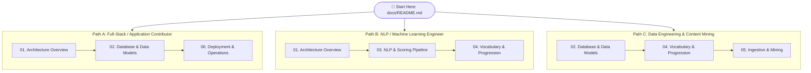
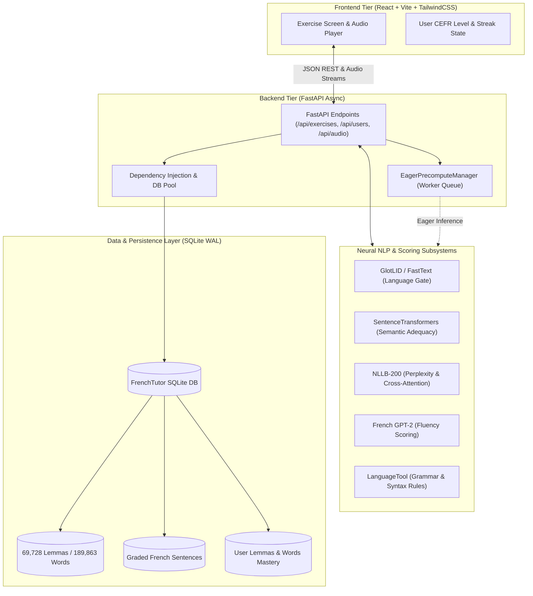

# FrenchTutor Technical Documentation Hub

Welcome to the technical documentation for **FrenchTutor**, an intelligent, adaptive language learning platform designed for French acquisition using multi-model neural natural language processing, psycholinguistic lexical modeling, and comprehensible input principles.

---

## 1. Documentation Index

The documentation is organized into six core architectural chapters covering the entire lifecycle of the application:

```
docs/
├── README.md                          # [YOU ARE HERE] Documentation Hub & System Map
├── 01_architecture_overview.md        # High-Level Architecture, Request Lifecycle & Tech Stack
├── 02_database_and_models.md          # SQLite Schema, 2-Tier Lemma/Word Design & Repository Layer
├── 03_nlp_and_scoring_pipeline.md     # Multi-Stage NLP Scoring, GlotLID, NLLB Cross-Attention & Fluency
├── 04_vocabulary_and_progression.md   # Lexical Math (Zipf/Rank), CEFR Progression & Candidate Buffers
├── 05_ingestion_and_mining.md         # Ingestion Pipeline, Lexique 4 Seeding, Corpus Mining & Linking
└── 06_deployment_and_operations.md    # Docker (CPU/GPU), uv, PyTorch Management, Pytest & Makefiles
```

---

## 2. Chapter Summaries

| Chapter | Focus Area | Key Concepts Covered |
| :--- | :--- | :--- |
| **[01. Architecture Overview](file:///home/eyenga/Projects/FrenchTutor/docs/01_architecture_overview.md)** | System Design & Topology | React SPA + FastAPI topology, multi-model asynchronous ML pipeline, end-to-end request sequence diagrams, concurrency locks, eager precomputation workers, and directory structure. |
| **[02. Database & Data Models](file:///home/eyenga/Projects/FrenchTutor/docs/02_database_and_models.md)** | Data Layer & Storage | Two-tier lexical architecture (`lemmas` vs `words`), dual user tracking (`user_lemmas` vs `user_words`), complete 10-table Mermaid ER diagram, SQL DDL specifications, SQLite WAL mode, and repository mixins (`DataManager`). |
| **[03. NLP & Scoring Pipeline](file:///home/eyenga/Projects/FrenchTutor/docs/03_nlp_and_scoring_pipeline.md)** | Evaluation & Scoring | 5-stage submission evaluation: FastText LID gatekeeper (`glotlid`), SentenceTransformers semantic similarity ($S_{\text{sem}}$), NLLB-200 NMT cross-attention token alignment ($S_{\text{NMT}}$), French GPT-2 fluency ($S_{\text{fluency}}$), LanguageTool rule engine, and audio grading. |
| **[04. Vocabulary & Progression](file:///home/eyenga/Projects/FrenchTutor/docs/04_vocabulary_and_progression.md)** | Pedagogical Engine | Rank-based CEFR assignment ($1 \le R \le 800$ to $R > 12{,}000$), Zipf score formula $\text{Zipf} = \log_{10}(\text{FreqLemme}) + 3$, spaCy POS to Lexique 4 `Cgram` mapping, $i+1$ comprehensible input constraints, candidate buffering queues, and dual appearance counters. |
| **[05. Ingestion & Mining Pipeline](file:///home/eyenga/Projects/FrenchTutor/docs/05_ingestion_and_mining.md)** | Data Ingestion & Seeding | CLI orchestrator (`orchestrator.py`), Lexique 4 parsing (canonical vs referenced lemmas; 69,728 lemmas, 189,863 words), corpus miners (Tatoeba, UniversalCEFR, Lingua, Catie, Vekkt, PDF), LSH deduplication, strict relational linking (`sentence_lemmas`, `sentence_words`), and offline rescoring. |
| **[06. Deployment & Operations](file:///home/eyenga/Projects/FrenchTutor/docs/06_deployment_and_operations.md)** | Infrastructure & Tooling | Fast dependency management with `uv`, CPU vs CUDA 12.4 GPU PyTorch variants (`UV_NO_SYNC=1`), multi-stage Docker builds, development hot-reloading with GPU passthrough, pytest markers (`@pytest.mark.ml`), mocking patterns, and Makefile command index. |

> [!NOTE]
> **Integration of Lexique 4 Reference**:
> The foundational contents previously located in `lexique4_implementation.md` have been distributed directly into the core chapters where they logically belong:
> - Relational schema, DDL, and dual tracking $\to$ **[02. Database & Data Models](file:///home/eyenga/Projects/FrenchTutor/docs/02_database_and_models.md)**
> - Psycholinguistic math, Zipf formulation, rank thresholds, and POS mapping $\to$ **[04. Vocabulary & Progression](file:///home/eyenga/Projects/FrenchTutor/docs/04_vocabulary_and_progression.md)**
> - Lexique 4 file parsing, referential integrity rules, and database seeding commands $\to$ **[05. Ingestion & Mining Pipeline](file:///home/eyenga/Projects/FrenchTutor/docs/05_ingestion_and_mining.md)**

---

## 3. Recommended Reading Pathways

Select a tailored reading pathway depending on your role and objectives:



- **Full-Stack & Frontend Contributors**: Focus on the system boundaries, API schemas, database interactions, and local development lifecycle in chapters [01](file:///home/eyenga/Projects/FrenchTutor/docs/01_architecture_overview.md), [02](file:///home/eyenga/Projects/FrenchTutor/docs/02_database_and_models.md), and [06](file:///home/eyenga/Projects/FrenchTutor/docs/06_deployment_and_operations.md).
- **NLP & ML Engineers**: Deep-dive into model execution, cross-attention alignment, perplexity thresholds, and vocabulary progression in chapters [01](file:///home/eyenga/Projects/FrenchTutor/docs/01_architecture_overview.md), [03](file:///home/eyenga/Projects/FrenchTutor/docs/03_nlp_and_scoring_pipeline.md), and [04](file:///home/eyenga/Projects/FrenchTutor/docs/04_vocabulary_and_progression.md).
- **Data Engineers & Content Curators**: Review relational schema integrity, mining subsystems, deduplication heuristics, and dataset rescoring in chapters [02](file:///home/eyenga/Projects/FrenchTutor/docs/02_database_and_models.md), [04](file:///home/eyenga/Projects/FrenchTutor/docs/04_vocabulary_and_progression.md), and [05](file:///home/eyenga/Projects/FrenchTutor/docs/05_ingestion_and_mining.md).

---

## 4. Global Architecture Overview



---

## 5. Core Terminology & Glossary

| Term | Definition in FrenchTutor | Reference |
| :--- | :--- | :--- |
| **Lemma** | The canonical dictionary headword (e.g., *manger*, *grand*, *chat*) stored in the `lemmas` table. Pedagogical progression and CEFR level tracking are driven strictly at the lemma level. | [Chapter 02](file:///home/eyenga/Projects/FrenchTutor/docs/02_database_and_models.md), [Chapter 04](file:///home/eyenga/Projects/FrenchTutor/docs/04_vocabulary_and_progression.md) |
| **Surface Word** | The inflected, conjugated, or contracted textual token as it actually appears in a sentence (e.g., *mangeait*, *grandes*, *chats*) stored in the `words` table. Used for granular exposure analytics. | [Chapter 02](file:///home/eyenga/Projects/FrenchTutor/docs/02_database_and_models.md) |
| **Zipf Score** | A base-10 logarithmic measure of word frequency per billion words: $\text{Zipf} = \log_{10}(\text{FreqLemme}) + 3$. | [Chapter 04](file:///home/eyenga/Projects/FrenchTutor/docs/04_vocabulary_and_progression.md) |
| **$i+1$ Progression** | Krashen's input hypothesis implemented as a relational database query: a sentence is eligible for a learner at level $L$ if it contains **exactly 1 lemma** not yet marked as mastered (`appearance_count == 0` or insufficient successes). | [Chapter 04](file:///home/eyenga/Projects/FrenchTutor/docs/04_vocabulary_and_progression.md) |
| **Reinforcement Card** | A practice sentence containing **0 unknown lemmas**, used to solidify previously encountered vocabulary that has low mastery confidence. | [Chapter 04](file:///home/eyenga/Projects/FrenchTutor/docs/04_vocabulary_and_progression.md) |
| **Candidate Buffer** | An in-memory queue maintaining pre-sampled progression and reinforcement sentences per user session, eliminating SQLite scan latencies. | [Chapter 01](file:///home/eyenga/Projects/FrenchTutor/docs/01_architecture_overview.md), [Chapter 04](file:///home/eyenga/Projects/FrenchTutor/docs/04_vocabulary_and_progression.md) |
| **Cross-Attention Alignment** | Extracting the encoder-decoder cross-attention matrices from NLLB-200 to establish token-to-token bilingual alignments between Spanish prompts and French candidate translations. | [Chapter 03](file:///home/eyenga/Projects/FrenchTutor/docs/03_nlp_and_scoring_pipeline.md) |
| **GlotLID Gatekeeper** | A high-speed FastText neural classifier (`cis-lmu/glotlid`) evaluated first to reject submissions not written in standard French before invoking heavy sequence models. | [Chapter 03](file:///home/eyenga/Projects/FrenchTutor/docs/03_nlp_and_scoring_pipeline.md) |
| **Eager Precomputation** | Asynchronous background worker that predicts the learner's next likely exercise and calculates reference embeddings and translations in advance. | [Chapter 01](file:///home/eyenga/Projects/FrenchTutor/docs/01_architecture_overview.md), [Chapter 03](file:///home/eyenga/Projects/FrenchTutor/docs/03_nlp_and_scoring_pipeline.md) |

---

## 6. Development Quick Reference

```bash
# Install dependencies with uv
make install

# Start development servers (FastAPI backend + Vite frontend with hot reload)
make dev

# Run fast unit test suite (skipping heavy neural inference)
make test

# Run full neural ML test suite
uv run pytest -m ml

# Run database setup and Lexique 4 lemma seeding
make ingest
```

For comprehensive operational commands and Docker GPU setup, see **[06. Deployment & Operations](file:///home/eyenga/Projects/FrenchTutor/docs/06_deployment_and_operations.md)**.
