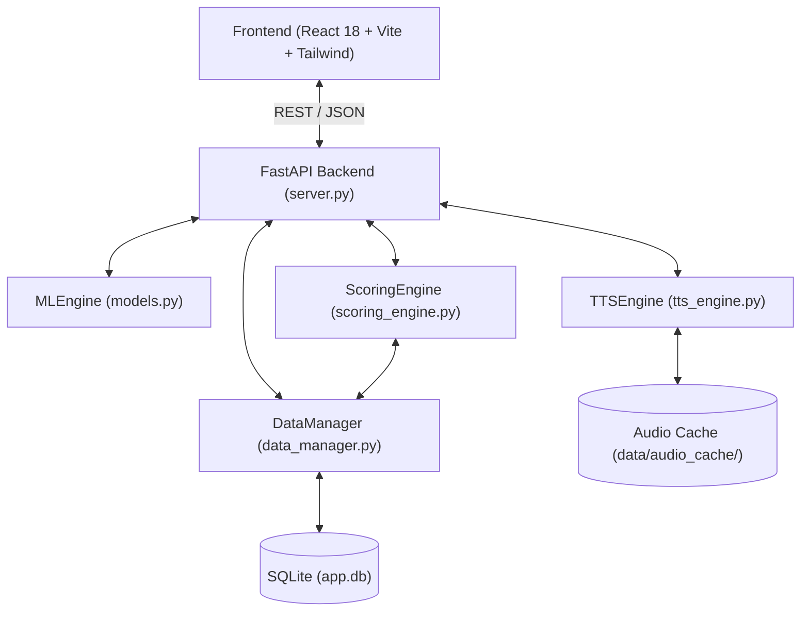

# System Overview

FrenchTutor is an intelligent, full-stack language tutor designed specifically for Spanish speakers learning French. It couples neural NLP models with spaced vocabulary mastery tracking, adaptive continuous CEFR scoring, and neural audio synthesis.



---

## 1. Core Architecture Pillars

1. **Dual Practice Modes**:
   - **Translation (Production)**: Translating Spanish prompts into French. Evaluated with multi-metric neural NLP (semantics, conditional NMT perplexity, word alignment, monolingual fluency, grammar).
   - **Transcription (Comprehension)**: Listening to native Parisian neural French speech and transcribing. Evaluated with deterministic sequence matching (accent, typo, missing/extra tokens) restricted strictly to familiar vocabulary.
2. **Continuous CEFR Calibration ($1.00 - 6.00$)**:
   - Instead of static tier buckets, proficiency is scored on a continuous scale:
     - `1.00 – 1.99`: A1
     - `2.00 – 2.99`: A2
     - `3.00 – 3.99`: B1
     - `4.00 – 4.99`: B2
     - `5.00 – 5.99`: C1
     - `6.00`: C2
   - User scores adjust dynamically after each batch based on evaluated quality ($Q \in [0.0, 1.0]$).
3. **Progressive Vocabulary Acquisition ($i+1$)**:
   - Sentences are indexed against FLELex and Lexique383.
   - For Translation, exercises inject at most $N$ unmastered word roots (`max_unknown=2` by default). Words transition from *Unseen* $\to$ *Learning* $\to$ *Mastered* after repeated successful uses.
   - For Transcription, `max_unknown=0` is enforced so listening comprehension practices only known lexical items.
4. **Resilient Local Inference**:
   - Neural models (`facebook/m2m100_418M`, `distilgpt2`, `paraphrase-multilingual-MiniLM-L12-v2`, `glotlid`) run strictly on CPU with thread-safe lazy loading and zero GPU dependency.

---

## 2. Technology Stack

| Layer | Component | Implementation |
| :--- | :--- | :--- |
| **Frontend** | Framework | React 18, Vite, Tailwind CSS, Lucide Icons |
| **Backend** | API Server | FastAPI, Uvicorn, Pydantic |
| **Persistence** | Database | SQLite 3 (`WAL` mode, foreign keys, row factory) |
| **NLP - LID** | Gatekeeper | FastText (`cis-lmu/glotlid`) with common-word bypass |
| **NLP - Semantics** | Semantic Adequacy | Sentence-Transformers (`paraphrase-multilingual-MiniLM-L12-v2`) |
| **NLP - NMT & Align** | Perplexity & Attention | Hugging Face Transformers (`facebook/m2m100_418M`) + SimAlign |
| **NLP - Fluency** | Monolingual LM | Hugging Face Transformers (`distilgpt2`) |
| **NLP - Syntax** | Grammar Diagnostics | `language_tool_python` (`fr`) |
| **Lexical Engine** | Morphosyntax & CEFR | spaCy (`fr_core_news_sm`), FLELex (Beacco), Lexique383 |
| **Speech** | Text-to-Speech | Microsoft Edge-TTS (Primary) + Hugging Face VITS (Local fallback) |
| **Tooling** | Packaging & Tests | `uv`, `pytest`, `run_tests.py` |

---

## 3. Directory Layout

```text
FrenchTutor/
├── backend/                  # Core Python services
│   ├── server.py             # FastAPI REST endpoints & app orchestrator
│   ├── models.py             # Neural MLEngine (M2M100, GPT, Minilm, GlotLID, LanguageTool)
│   ├── scoring_engine.py     # CEFR score tracking, batch delta, transcription diff
│   ├── data_manager.py       # SQLite schema, user modes, lexema tracking, CRUD
│   ├── vocab_engine.py       # FLELex / Lexique383 CEFR difficulty calculator
│   ├── tts_engine.py         # Edge-TTS & MMS-TTS VITS speech synthesizer
│   └── app.py                # Legacy Gradio prototype interface
├── frontend/                 # React 18 SPA (Vite + Tailwind)
│   ├── src/components/       # UI cards, modals, alignments, audio players
│   └── dist/                 # Production static bundle served by FastAPI
├── data/                     # Local data store
│   ├── app.db                # Main SQLite database
│   ├── audio_cache/          # Cached .mp3/.wav synthesis files
│   └── flelex_beacco.tsv     # Lexical frequency and CEFR lexicon
├── curriculum/               # Legacy curriculum mining & AI-generated specs (inactive)
├── scripts/                  # Mining, indexing, and migration utilities
├── tests/                    # Pytest suite with isolated test fixtures
└── docs/                     # Technical documentation suite
```

---

## 4. Documentation Index

- [Backend Architecture](Backend%20Architecture.md): FastAPI endpoints, thread-safe singletons, and server routing.
- [Database](Database.md): SQLite schema, 8 relational tables, progressive selection queries, and concurrency.
- [ML Correction Pipeline](ML%20Correction%20Pipeline.md): Neural scoring formulas, cross-attention alignment, and grammar inspection.
- [Frontend](Frontend.md): React component hierarchy, reactive state flows, and interactive UI views.
- [Data Creation](Data%20Creation.md): Corpus mining, FLELex scoring, and notes on legacy curriculum files.
- [User Experience](User%20Experience.md): Pedagogical strategy for Spanish speakers, continuous leveling, and UX loops.
- [Audio & Speech Engine](Audio%20&%20Speech%20Engine.md): Edge-TTS, fallback VITS, audio caching, and batch prewarming.
- [Testing & Development](Testing%20&%20Development.md): Pytest architecture, test markers, mock runners, and `uv` setup.
