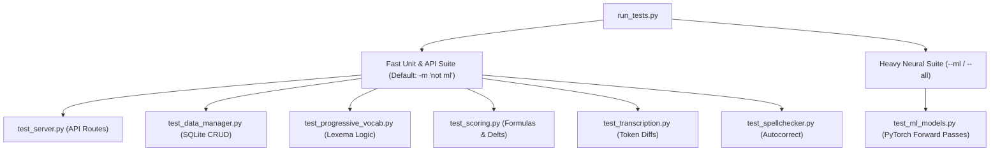

# Testing & Development Guide

FrenchTutor employs a dual-tiered testing strategy to ensure rapid developer feedback without compromising the verification of heavy neural models.

---

## 1. Fast vs. Heavy Test Categorization

Neural NLP models (M2M100, DistilGPT-2, MiniLM, GlotLID) require several gigabytes of RAM and several seconds to load weights. To maintain a fast test-driven development (TDD) cycle, tests are split using Pytest markers:



- **Fast Suite (`not ml`)**: Runs in **< 5 seconds**. Exercises all database operations, API endpoints, scoring algorithms, spellcheckers, and transcription sequence matchers using test doubles.
- **Heavy Suite (`ml`)**: Exercises real neural forward passes, SentencePiece aggregations, cross-attention extraction, and language identification.

---

## 2. Test Suite Structure (`tests/`)

| File | Scope & Tested Components |
| :--- | :--- |
| `conftest.py` | Pytest fixtures providing isolated temporary SQLite databases (`temp_db`) and mocked singletons. |
| `test_server.py` | FastAPI endpoint integration using `TestClient` (users, batch generation, evaluation routing). |
| `test_data_manager.py` | SQLite schema initialization, WAL mode, user creation, table migrations, and CRUD operations. |
| `test_progressive_vocab.py` | Vocabulary appearance logging, success counters, mastery transitions, and $i+1$ filtering. |
| `test_scoring.py` | Continuous CEFR calculations, score-to-level mapping, sentence quality metrics, and batch delta adjustments. |
| `test_transcription.py` | Deterministic sequence matcher, accent error classification, typo detection, and diff tokens. |
| `test_spellchecker.py` | Reference-guided accent restoration, Levenshtein typo corrections, and contraction protection. |
| `test_ml_models.py` | Integration tests for `MLEngine` (marked `@pytest.mark.ml`). |

---

## 3. Running Tests

The project includes a dedicated CLI test runner script (`run_tests.py`):

```bash
# 1. Run fast unit & API tests (Default, excludes slow ML models)
python run_tests.py
# or via uv:
uv run pytest

# 2. Run all tests including heavy neural models
python run_tests.py --all
# or via uv:
uv run pytest -m ""

# 3. Run only heavy ML model tests
python run_tests.py --ml

# 4. Run a specific test file or keyword
python run_tests.py tests/test_transcription.py
python run_tests.py -k "test_calculate_score_adjustment"

# 5. Verbose output
python run_tests.py -v
```

---

## 4. Development Workflow with `uv`

The project is packaged and managed using `uv` for deterministic dependency resolution.

### Environment Setup
```bash
# Clone repository and synchronize environment
uv sync
```

### Running the Application
```bash
# Launch the FastAPI backend server
uv run python -m backend.server

# In another terminal: run the Vite development server with hot-reload
cd frontend
npm install
npm run dev

# Or build the frontend for production serving by FastAPI:
npm run build
```

### Code Quality & Hygiene
- Keep CPU and offline inference deterministic: neural models in `backend/models.py` enforce `HF_HUB_OFFLINE=1` and `TRANSFORMERS_OFFLINE=1`.
- Always verify fast tests pass before committing:
  ```bash
  uv run python run_tests.py
  ```
