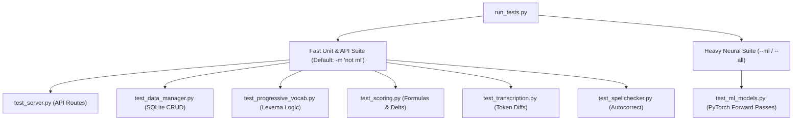

# Testing & Development Guide

FrenchTutor employs a dual-tiered testing strategy to ensure rapid developer feedback without compromising the verification of heavy neural models.

---

## 1. Fast vs. Heavy Test Categorization

Neural NLP models (M2M100, DistilGPT-2, MiniLM, GlotLID) require several gigabytes of RAM and several seconds to load weights. To maintain a fast test-driven development (TDD) cycle, tests are split using Pytest markers:



- **Fast Suite (`not ml`)**: Runs in **< 5 seconds**. Exercises all database operations, API endpoints, scoring algorithms, spellcheckers, and transcription sequence matchers using test doubles.
- **Heavy Suite (`ml`)**: Exercises real neural forward passes, SentencePiece aggregations, cross-attention extraction, and language identification.

---

## 2. Test Suite Structure (`tests/`)

| File | Scope & Tested Components |
| :--- | :--- |
| `conftest.py` | Pytest fixtures providing isolated temporary SQLite databases (`temp_db`) and mocked singletons. |
| `test_server.py` | FastAPI endpoint integration using `TestClient` (users, batch generation, evaluation routing). |
| `test_data_manager.py` | SQLite schema initialization, WAL mode, user creation, table migrations, and CRUD operations. |
| `test_progressive_vocab.py` | Vocabulary appearance logging, success counters, mastery transitions, and $i+1$ filtering. |
| `test_scoring.py` | Continuous CEFR calculations, score-to-level mapping, sentence quality metrics, and batch delta adjustments. |
| `test_transcription.py` | Deterministic sequence matcher, accent error classification, typo detection, and diff tokens. |
| `test_spellchecker.py` | Reference-guided accent restoration, terminal mark reconciliation, French spacing, and LanguageTool typo corrections. |
| `test_ml_models.py` | Integration tests for `MLEngine` (marked `@pytest.mark.ml`). |

---

## 3. Running Tests

The project includes a dedicated CLI test runner script (`run_tests.py`):

```bash
# 1. Run fast unit & API tests (Default, excludes slow ML models)
python run_tests.py
# or via uv:
uv run pytest

# 2. Run all tests including heavy neural models
python run_tests.py --all
# or via uv:
uv run pytest -m ""

# 3. Run only heavy ML model tests
python run_tests.py --ml

# 4. Run a specific test file or keyword
python run_tests.py tests/test_transcription.py
python run_tests.py -k "test_calculate_score_adjustment"

# 5. Verbose output
python run_tests.py -v
```

---

## 4. Development Workflow & Makefile

FrenchTutor provides a unified `Makefile` for local development, testing, and production builds.

### Standard Full-Stack Development
To run both the **FastAPI backend** (with Uvicorn auto-reload) and the **Vite React frontend** (with instant Hot Module Replacement) concurrently with a single command:

```bash
make dev
```
- **Frontend (HMR)**: Open [http://localhost:5173](http://localhost:5173) in your browser. Any frontend edit updates instantly without rebuilding.
- **Backend API**: Accessible at [http://localhost:8000](http://localhost:8000) (Swagger Docs at [http://localhost:8000/docs](http://localhost:8000/docs)). Vite automatically proxies all `/api` requests to port 8000.
- Press `Ctrl+C` in the terminal to cleanly terminate both servers simultaneously.

### Multi-Worktree Parallel Development
If you have multiple git worktrees on the same machine to develop different features in parallel, you can isolate ports without collisions:

```bash
# Worktree A (e.g. main branch on default ports 8000 & 5173):
make dev

# Worktree B (e.g. feature branch on ports 8001 & 5174):
make dev BACKEND_PORT=8001 FRONTEND_PORT=5174
```
Vite will automatically bind to `5174` and proxy all `/api` traffic directly to the backend running on `8001`.

### Production Build & Serve
To compile the production frontend assets and serve them directly via FastAPI:

```bash
# Build frontend assets into frontend/dist:
make build

# Start production server (auto-builds frontend if dist/ is missing):
make start
# Or with a custom port:
make start PORT=8080
```

### Makefile Reference Cheatsheet

| Target | Description | Overrides |
| :--- | :--- | :--- |
| `make dev` | Starts full-stack dev servers (Vite HMR + FastAPI reload) | `BACKEND_PORT=8001 FRONTEND_PORT=5174` |
| `make start` | Starts standalone FastAPI server serving static `frontend/dist` | `PORT=8080` |
| `make build` | Compiles production frontend bundle | — |
| `make test` | Runs the fast test suite via `uv run pytest` | — |
| `make install` | Installs frontend dependencies (`npm install`) & Python dependencies (`uv sync`) | — |
| `make clean` | Cleans `frontend/dist`, pytest caches, and `__pycache__` | — |

### Code Quality & Hygiene
- Keep CPU and offline inference deterministic: neural models in `backend/models.py` enforce `HF_HUB_OFFLINE=1` and `TRANSFORMERS_OFFLINE=1`.
- Always verify fast tests pass before committing:
  ```bash
  uv run python run_tests.py
  ```
