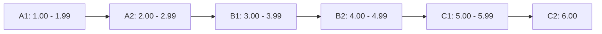
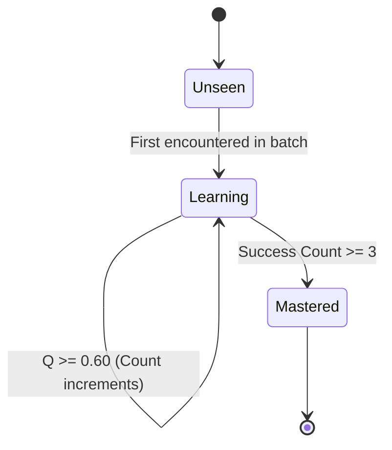
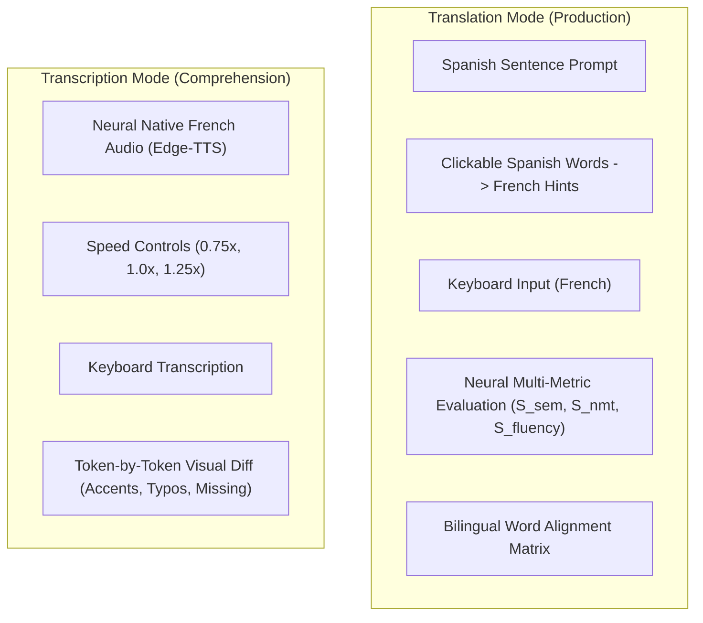

# User Experience & Pedagogical Design

FrenchTutor is designed to optimize language acquisition for **Spanish native speakers learning French**. By addressing cross-lingual transfer, false cognates, and orthographic friction, the platform provides an adaptive, motivating, and low-anxiety learning environment.

---

## 1. Pedagogical Rationale for Spanish Speakers

Spanish and French share Latin roots, resulting in high lexical overlap (~75% lexical similarity). However, Spanish learners face specific hurdles:
1. **Phonetic & Orthographic Divergence**: Spanish has near-phonetic orthography; French has extensive silent letters, nasal vowels, and liaison.
2. **Grammatical Elision**: Mandatory contractions (*j'ai*, *l'enfant*, *c'est*) that do not exist in standard Spanish (*yo tengo*, *el niño*, *es*).
3. **Accent Sensitivity**: French utilizes accents for grammatical differentiation (e.g. *a* vs *à*, *ou* vs *où*, *parlé* vs *parler*).

FrenchTutor adapts to these challenges through:
- **Tolerant Autocorrection**: Typographical slips and missing accents are reconciled non-punitively against reference translations.
- **Cross-Lingual Hints**: Visual cross-attention maps reveal which Spanish words align with French tokens, preventing word-for-word translation errors.
- **Pure-Audio Transcription**: Dedicated listening comprehension exercises train the ear to parse connected speech without orthographic interference.

---

## 2. Continuous CEFR Calibration ($1.00 - 6.00$)

Instead of locking students into rigid, monolithic tiers, FrenchTutor tracks progress on a continuous scale:

### Batch Delta Adjustment Algorithm
At the end of each session batch, `ScoringEngine.calculate_score_adjustment()` calculates the performance delta based on average batch quality $\bar{Q} \in [0.0, 1.0]$:

$$\text{Base Delta} = (\bar{Q} - 0.70) \times 0.50$$
$$\Delta = \operatorname{clamp}(\text{Base Delta}, -0.20, +0.25)$$
$$\text{New Score} = \operatorname{clamp}(\text{Current Score} + \Delta, 1.00, 6.00)$$

- **Thresholds**:
  - $\bar{Q} \ge 0.70$: Positive score progression ($\Delta > 0$) and streak increment.
  - $\bar{Q} \in [0.40, 0.69]$: Minor score regression; preserves active streak.
  - $\bar{Q} < 0.40$: Regression up to $-0.20$; resets streak to 0.
- **Sub-level UI Progress Bar**: The client converts scores into percentage within tier:
  $$\text{Progress} = (\text{Score} - \lfloor\text{Score}\rfloor) \times 100\%$$

---

## 3. Progressive Vocabulary Acquisition ($i+1$)

Based on Stephen Krashen's *Input Hypothesis*, learners acquire language most efficiently when exposed to messages containing structures just beyond their current competence level ($i+1$).

1. **Active Lexicon Tracking**: The system monitors which root lemmas the student has mastered in `user_lexema_counts`.
2. **Controlled Exposure**:
   - For **Translation**, batches only include sentences with at most $\text{max\_unknown} \le 2$ unmastered word roots.
   - For **Transcription**, sentences are strictly restricted to $\text{max\_unknown} = 0$, ensuring listening comprehension focuses on auditory recognition rather than novel vocabulary guessing.
3. **Mastery Threshold**: When a word root is successfully used across 3 separate batches with $Q \ge 0.60$, it transitions to *Mastered* and unlocks more advanced sentence pools.

---

## 4. Dual Practice Modalities

### Translation Mode (Active Production)
- Challenges the learner to generate French sentences from Spanish prompts.
- **Interactive Hints**: Clicking any Spanish word highlights its French counterpart via neural cross-attention without revealing the entire sentence.
- **First-Time Word Highlights**: Blue badges alert the student to newly introduced vocabulary roots.
- **Comprehensive Feedback**: Displays semantic adequacy, NMT perplexity, structural fluency, and grammar rules.

### Transcription Mode (Auditory Comprehension)
- Eliminates Spanish text entirely to simulate immersive listening.
- Plays high-fidelity Parisian neural audio with speed toggles (0.75x, 1.0x, 1.25x).
- Feedback is rendered as a clean token diff highlighting exact matches, accent discrepancies, typos, missing words, and superfluous words.
- Batches prewarm audio in the background so audio playback starts instantaneously.
