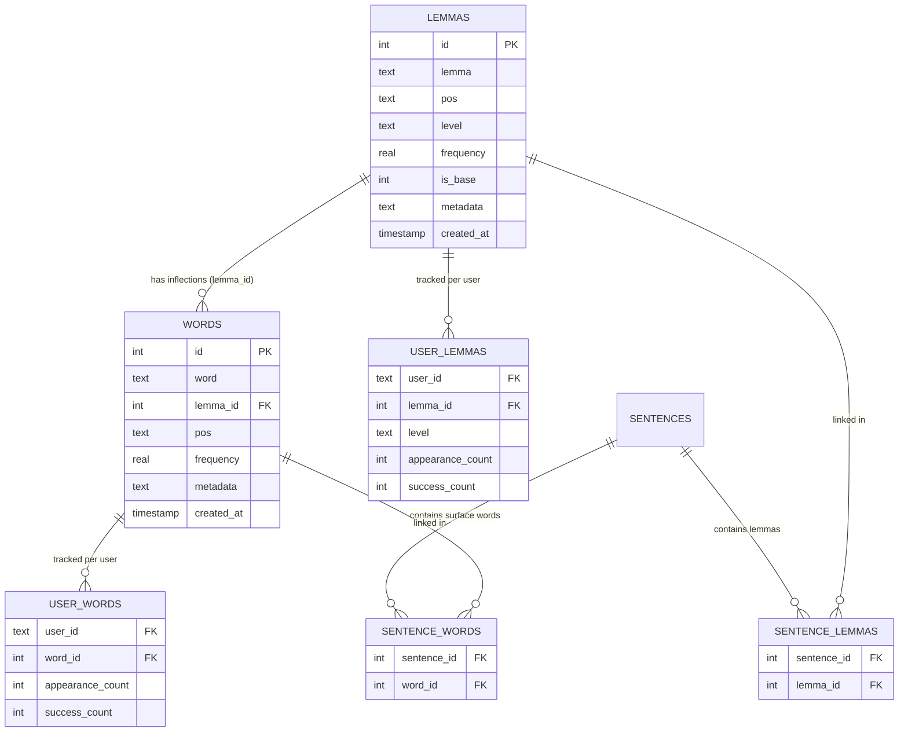

# Lexique 4 Implementation & Lexical Architecture Documentation

## 1. Overview & Purpose

This document details the design, mathematical modeling, and database architecture for the integration of the **Lexique 4** dataset (`data/lexique/Lexique4/Lexique4.tsv`) into FrenchTutor.

Previously, word roots were referred to as *lexemas*, and all entries were assigned a static default level (`A1`). The current implementation introduces:
1. **Psycholinguistic CEFR Level Assignment (A1–C2)**: Grounded in empirical vocabulary acquisition research and based strictly on the rank index of lemmas sorted by corpus frequency.
2. **Two-Tier Lexical Schema (`lemmas` and `words`)**: Distinguishing canonical base lemmas (dictionary entries) from inflected surface words (as they appear in sentences), with integer surrogate keys and strict natural uniqueness constraints.
3. **Dual User Tracking (`user_lemmas` and `user_words`)**: Recording learner exposure and performance simultaneously on both canonical roots and surface word forms.
4. **Context-Aware POS Integration**: Bridging spaCy Universal Dependencies POS tags with Lexique 4 `Cgram` categories for accurate token disambiguation.

---

## 2. Mathematical Model: Rank-Based CEFR Assignment

### Theoretical Grounding
The Common European Framework of Reference for Languages (CEFR) does not prescribe official word count quotas. Instead, applied linguistics benchmarks (Milton & Alexiou 2009, Nation 2001, Laufer 2010) measure the cumulative vocabulary breadth (in lemmas) typically mastered at each proficiency level.

In FrenchTutor, all unique `(lemma, pos)` pairs in Lexique 4 are sorted descending by `12_FreqLemme` (occurrences per million words in the 316-million-word subtitle corpus). Each lemma receives a 1-based rank index $R \in [1, N]$.

$$\text{Zipf} = \log_{10}(\text{FreqLemme}) + 3$$

> **Note:** The Zipf score represents the base-10 order of magnitude of exposure frequency per billion words. It is computed and preserved in `lemmas.metadata` for future analytical use, but level classification is driven strictly by rank $R$.

### Cumulative Thresholds

| CEFR Level | Lemma Rank Range ($R$) | Frequency Threshold (`12_FreqLemme`) | Zipf Score | Pedagogical Scope & Examples |
| :---: | :---: | :---: | :---: | :--- |
| **A1** | **$1 \le R \le 800$** | $\ge 95.0$ / M | $\ge 4.98$ | Foundational function words and routine vocabulary (*être, avoir, maison, ami, regarder*) |
| **A2** | **$801 \le R \le 1,800$** | $32.0 \le F < 95.0$ | $4.51 \le \text{Zipf} < 4.98$ | Daily conversational situations (*chambre, rapide, préparer, village, fête*) |
| **B1** | **$1,801 \le R \le 3,500$** | $12.5 \le F < 32.0$ | $4.10 \le \text{Zipf} < 4.51$ | Threshold independent vocabulary (*secteur, refuser, menace, bilan, prudent*) |
| **B2** | **$3,501 \le R \le 6,500$** | $4.5 \le F < 12.5$ | $3.65 \le \text{Zipf} < 4.10$ | Advanced & abstract terms (*privilégier, incursion, contestation, angoisse*) |
| **C1** | **$6,501 \le R \le 12,000$** | $1.4 \le F < 4.5$ | $3.15 \le \text{Zipf} < 3.65$ | Academic, technical, and literary terms (*austère, prépondérant, amarrer, caduc*) |
| **C2** | **$R > 12,000$** | $< 1.4$ / M | $< 3.15$ | Mastery, specialized jargon, or rare literary words (*thaumaturge, palinodie, obsolescence*) |

---

## 3. Lexique 4 Parsing & Extraction Rules

Parsing is handled by [`backend/ingestion/pipeline/lexique_classifier.py`](file:///home/eyenga/Projects/ingestion/backend/ingestion/pipeline/lexique_classifier.py).

### 1. Canonical Lemma Extraction
- Primary entries: Rows where `14_IsLem == '1'` (~65,650 rows). For these rows, `1_Mot == 4_Lemme`.
- Referenced-only lemmas: Lexique 4 contains ~3,696 `(4_Lemme, 5_Cgram)` pairs that appear strictly in inflected forms (e.g., *applicative* [ADJ] appears in the corpus, but the masculine base form *applicatif* does not have an `IsLem == 1` row).
- To guarantee **100% referential integrity**, these referenced lemmas are included in `lemmas` using their maximum observed frequency, producing **69,728 total unique lemmas**.

### 2. Surface Word Extraction
- Every row of the 189,863 entries in Lexique 4 is mapped:
  - `word`: `1_Mot.lower().strip()`
  - `pos`: `5_Cgram.upper().strip()`
  - `frequency`: float(`10_FreqMot`)
  - `lemma_id`: Foreign key pointing to the corresponding `lemmas(lemma, pos)` record.
- Deduplication: When multiple identical surface forms appear with the exact same parent lemma and POS, the record with the highest frequency is preserved.

---

## 4. Database Schema Specification

Implemented in [`backend/db/connection.py`](file:///home/eyenga/Projects/ingestion/backend/db/connection.py).



### Table Definitions

#### `lemmas`
Stores the base canonical forms, their CEFR level, frequency, and metadata.
```sql
CREATE TABLE IF NOT EXISTS lemmas (
    id INTEGER PRIMARY KEY AUTOINCREMENT,
    lemma TEXT NOT NULL,
    pos TEXT NOT NULL,
    level TEXT NOT NULL DEFAULT 'A1',
    frequency REAL DEFAULT 0.0,
    is_base BOOLEAN NOT NULL DEFAULT 0,
    metadata TEXT DEFAULT '{}',
    created_at TIMESTAMP DEFAULT CURRENT_TIMESTAMP,
    UNIQUE(lemma, pos)
);
CREATE INDEX IF NOT EXISTS idx_lemmas_pos ON lemmas(pos);
CREATE INDEX IF NOT EXISTS idx_lemmas_level ON lemmas(level);
CREATE INDEX IF NOT EXISTS idx_lemmas_is_base ON lemmas(is_base);
```

#### `words`
Stores every surface word form, linked directly to its parent lemma.
```sql
CREATE TABLE IF NOT EXISTS words (
    id INTEGER PRIMARY KEY AUTOINCREMENT,
    word TEXT NOT NULL,
    lemma_id INTEGER NOT NULL,
    pos TEXT NOT NULL,
    frequency REAL DEFAULT 0.0,
    metadata TEXT DEFAULT '{}',
    created_at TIMESTAMP DEFAULT CURRENT_TIMESTAMP,
    FOREIGN KEY (lemma_id) REFERENCES lemmas(id) ON DELETE CASCADE,
    UNIQUE(word, lemma_id, pos)
);
CREATE INDEX IF NOT EXISTS idx_words_pos ON words(pos);
CREATE INDEX IF NOT EXISTS idx_words_lemma_id ON words(lemma_id);
```

#### `sentence_lemmas` & `sentence_words`
Junction tables linking sentences to their contained lemmas and surface words.
```sql
CREATE TABLE IF NOT EXISTS sentence_lemmas (
    sentence_id INTEGER NOT NULL,
    lemma_id INTEGER NOT NULL,
    PRIMARY KEY (sentence_id, lemma_id),
    FOREIGN KEY (sentence_id) REFERENCES sentences(id) ON DELETE CASCADE,
    FOREIGN KEY (lemma_id) REFERENCES lemmas(id) ON DELETE CASCADE
);
CREATE INDEX IF NOT EXISTS idx_sentence_lemmas_lemma ON sentence_lemmas(lemma_id);

CREATE TABLE IF NOT EXISTS sentence_words (
    sentence_id INTEGER NOT NULL,
    word_id INTEGER NOT NULL,
    PRIMARY KEY (sentence_id, word_id),
    FOREIGN KEY (sentence_id) REFERENCES sentences(id) ON DELETE CASCADE,
    FOREIGN KEY (word_id) REFERENCES words(id) ON DELETE CASCADE
);
CREATE INDEX IF NOT EXISTS idx_sentence_words_word ON sentence_words(word_id);
```

#### `user_lemmas` & `user_words`
Tracks learner progress and mastery independently across canonical lemmas and surface forms.
```sql
CREATE TABLE IF NOT EXISTS user_lemmas (
    user_id TEXT NOT NULL,
    lemma_id INTEGER NOT NULL,
    level TEXT DEFAULT 'A1',
    appearance_count INTEGER NOT NULL DEFAULT 0,
    success_count INTEGER NOT NULL DEFAULT 0,
    PRIMARY KEY (user_id, lemma_id),
    FOREIGN KEY (user_id) REFERENCES users(id) ON DELETE CASCADE,
    FOREIGN KEY (lemma_id) REFERENCES lemmas(id) ON DELETE CASCADE
);
CREATE INDEX IF NOT EXISTS idx_user_lemmas_user_success ON user_lemmas(user_id, success_count, lemma_id);

CREATE TABLE IF NOT EXISTS user_words (
    user_id TEXT NOT NULL,
    word_id INTEGER NOT NULL,
    appearance_count INTEGER NOT NULL DEFAULT 0,
    success_count INTEGER NOT NULL DEFAULT 0,
    PRIMARY KEY (user_id, word_id),
    FOREIGN KEY (user_id) REFERENCES users(id) ON DELETE CASCADE,
    FOREIGN KEY (word_id) REFERENCES words(id) ON DELETE CASCADE
);
```

---

## 5. POS Mapping (spaCy $\to$ Lexique 4 `Cgram`)

When spaCy processes French sentences in [`backend/nlp/vocab_engine.py`](file:///home/eyenga/Projects/ingestion/backend/nlp/vocab_engine.py), its Universal POS tags are mapped to Lexique 4 `Cgram` categories:

| spaCy Tag (`tok.pos_`) | Candidate Lexique 4 `Cgram` Categories | Examples |
| :--- | :--- | :--- |
| `VERB`, `AUX` | `VER`, `AUX` | *manger, suis, aller* |
| `NOUN`, `PROPN` | `NOM` | *chat, maison, Paris* |
| `ADJ` | `ADJ`, `ADJ:num`, `ADJ:dem`, `ADJ:pos`, `ADJ:ind` | *grand, premier, ce* |
| `ADV` | `ADV` | *rapidement, bien, très* |
| `PRON` | `PRO:per`, `PRO:dem`, `PRO:ind`, `PRO:rel`, `PRO:pos` | *il, elle, qui, tout* |
| `DET` | `ART:def`, `ART:ind`, `ADJ:pos`, `ADJ:dem` | *le, la, un, mon* |
| `ADP` | `PRE` | *à, de, dans, pour* |
| `CCONJ`, `SCONJ` | `CON` | *et, ou, mais, que* |

When indexing sentences:
- Token text + POS $\to$ resolves to `words.id`.
- Token lemma + POS $\to$ resolves to `lemmas.id`.
- If POS-specific matching misses, resolution falls back to token text/lemma alone.

---

## 6. Runtime Card Evaluation & Dual Tracking

Implemented in [`backend/db/vocabulary.py`](file:///home/eyenga/Projects/ingestion/backend/db/vocabulary.py) via `record_token_appearances(...)`:

When a student answers or skips a sentence card (`/api/exercises/evaluate-single` or `/api/exercises/evaluate-transcription`):
1. **Lookup**: Resolves all `lemma_id`s from `sentence_lemmas` and all `word_id`s from `sentence_words` for that sentence.
2. **`user_lemmas` Update**:
   - `appearance_count = appearance_count + 1`
   - `success_count = success_count + (1 if is_correct else 0)`
3. **`user_words` Update**:
   - `appearance_count = appearance_count + 1`
   - `success_count = success_count + (1 if is_correct else 0)`
4. **Exercise Generation Isolation**:
   - Sentence candidate selection (`get_progressive_sentences`) remains driven strictly by **`lemmas`** (filtering $i+1$ unknown lemmas from `sentence_lemmas`). The `words` table provides granular surface usage analytics without impacting candidate selection algorithms.

---

## 7. Execution Commands & Workflows

### Reset & Seed the Database
To clear previous tables and populate `lemmas` and `words` from Lexique 4:

```bash
# 1. Reset the SQLite database schema
uv run python -m backend.ingestion.pipeline.init_db --reset

# 2. Seed lemmas (69,728) and words (189,863) from Lexique 4
uv run python -m backend.ingestion.pipeline.seed_lemmas
```

### Ingest and Link Sentences
To mine sentences and generate relational links into `sentence_lemmas` and `sentence_words`:

```bash
# Ingest Tatoeba dataset:
uv run python -m backend.ingestion.orchestrator --mine-tatoeba --ingest

# Ingest HuggingFace UniversalCEFR dataset:
uv run python -m backend.ingestion.orchestrator --mine-hf --ingest

# Or run full pipeline in one step:
uv run python -m backend.ingestion.orchestrator --reset-db --seed-lexemas --mine-tatoeba --ingest
```

### Verification & Automated Tests
Execute the comprehensive test suite covering the new architecture:

```bash
# Run architecture & classifier tests
uv run pytest tests/test_lexique_classifier.py tests/test_lemma_word_architecture.py

# Run the complete test suite
uv run pytest
```
